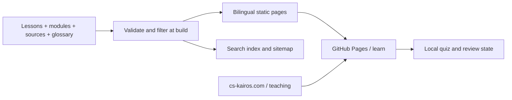

# Learning platform architecture

Adopted 2026-10-23 for the authorized Phase 0–3 implementation.

## First principles and ownership

The scarce resources are reader attention, reliable evidence, bilingual editorial time and the availability of existing courses. This repository owns public lessons, questions, glossary, learning UI, static assets and release evidence. The [personal-site repository](https://github.com/JasonLn0711/JasonLn0711.github.io) owns the research entrance and primary domain. The [CEH bridge](https://github.com/JasonLn0711/ceh-cehp-certification-notes-2026/blob/main/docs/public-teaching-bridge-2026-10-23.md) owns the connection to personal learning evidence. Planning records capacity, status, locators and the next validation gate.

The adopted scope is M01–M20, with two M01 lessons, one core lesson in every later module, and one AI/ML and networking unit each. MATLAB remains intact. The complete request and scope confirmation are preserved in the [canonical source archive](https://github.com/JasonLn0711/JasonLn0711.github.io/blob/main/docs/sources/2026-10-23-phase-0-3-blueprint.md).

## Decisions

1. **Static output and separate deployment.** Svelte 5, SvelteKit 2 and adapter-static generate HTML, JSON and hashed assets. GitHub Pages continues to serve `learn.cs-kairos.com`; the personal site uses its existing Cloudflare Worker. No shared runtime authentication, API secrets or protected-service bindings enter the learning application.
2. **One content object per bilingual lesson.** `content/lessons/*.json` holds both languages and structured teaching blocks. The main site retains mdsvex. For learning content, JSON replaces the earlier suggested MDX format: one schema can validate translations, question revisions, source references and safe exercises without executing author HTML. Svelte renders escaped text and code. This is an implementation choice within the adopted content standard, not a second content store.
3. **One publication gate.** `src/lib/server/catalog.ts` loads source only at build time. `isPublic` requires a valid date, published status and a date no later than the Asia/Taipei build date. Routes, search, sitemap, glossary backlinks and review questions derive from this filtered catalog. The integration check injects unpublished markers and searches actual deployment artifacts. Public Git history is still public: private drafts must never be committed.
4. **Stable reading paths.** Chinese uses `/courses/ceh/v13/m01/.../`; English adds `/en`. The `order` field determines the reading sequence, starting with authorization before CIA. Canonical and reciprocal hreflang are emitted for each page. Old unversioned proposal URLs were never published and need no invented migration history.
5. **Preserve MATLAB as an asset tree.** `site/courses/matlab-practice/`, downloads, scripts and styling retain their paths and bytes. The old homepage is archived in `docs/archive/learning-home-2026-10-22.html`; the new generated root owns discovery. All 53 original site files can be compared with baseline `69c24f8`, including the archived homepage.
6. **Local practice only.** `kairos.practice.v1` stores question ID, revision, latest choice, confidence, attempt count and timestamp. Review recomputes correctness from the current answer key. Invalid storage recovers safely; revised questions exclude old attempts. Clearing this key affects only this platform's practice. There is no cross-device sync, identity, score upload or certification claim.
7. **Readable before interactive.** Lessons, sources, navigation, code and answer explanations are prerendered. JavaScript adds quizzes, local review and lazy-loaded search. Search retains a complete HTML catalog when scripts or the index are unavailable. Native form controls, a skip link, visible focus, constrained code scrolling and reduced-motion handling support accessibility.

The next evidence gate is independent reader completion of a lesson and its exercise. Public deployment and automated checks establish their own layers. New accounts, an LMS backend, tracking, paid services, additional course units and a publication cadence require separate scope decisions. Existing personal CEH reading position and shared study capacity remain with their owners.

[README](../README.md) · [Content guide](content-authoring.md) · [Publishing](publishing-security.md) · [Release evidence](releases/2026-10-23-phase-0-3.md)
