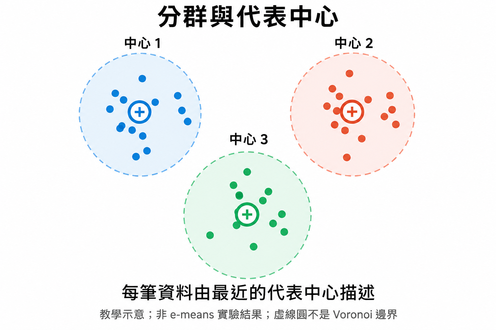
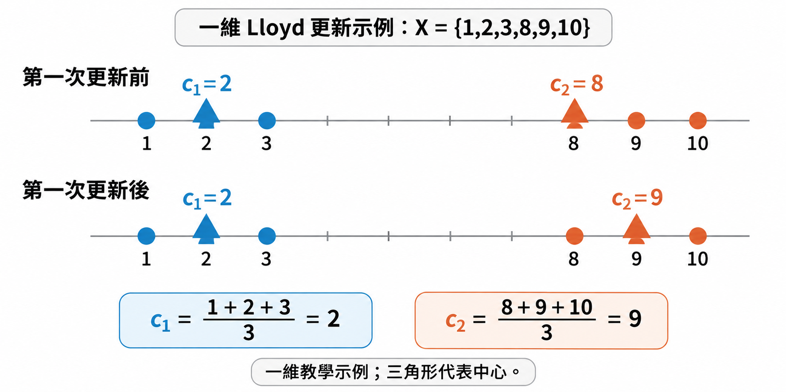
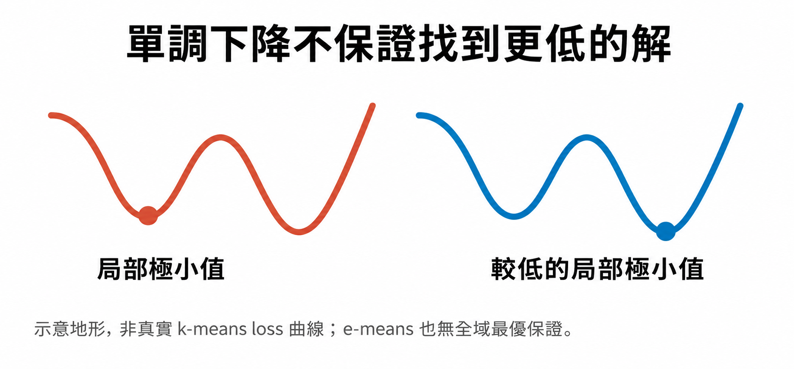
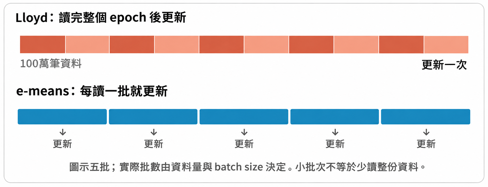
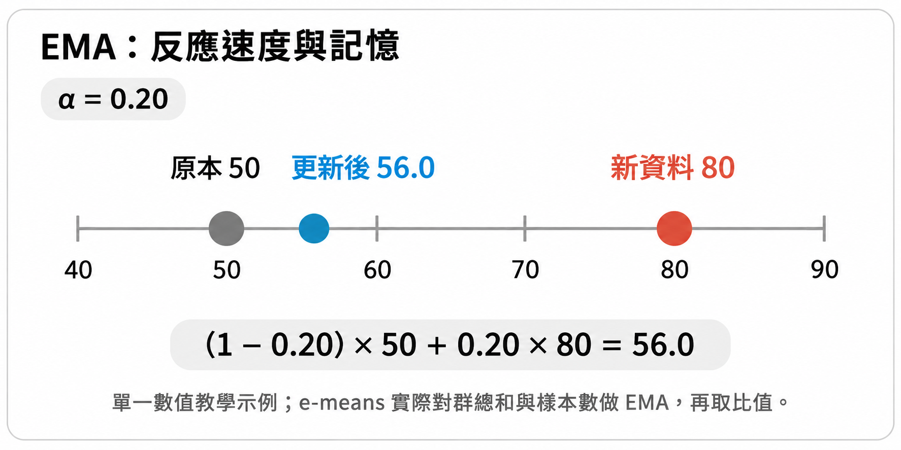
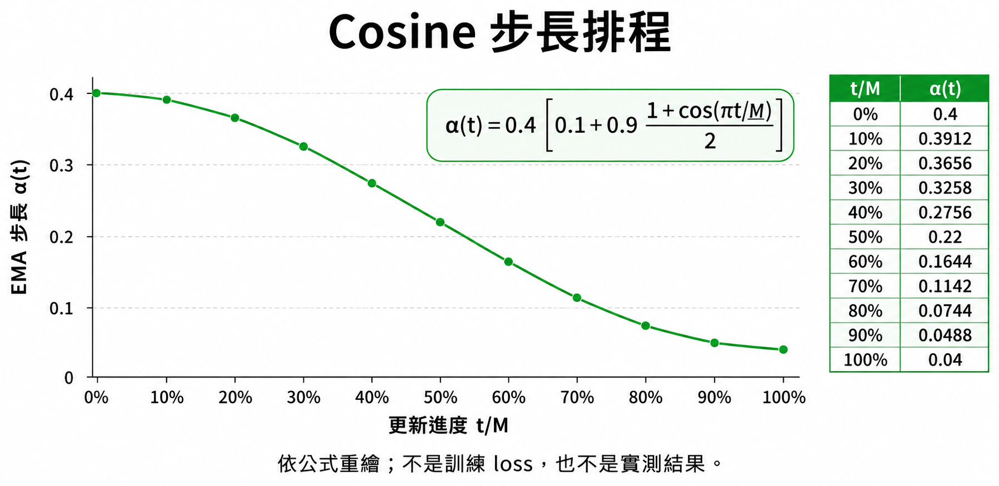
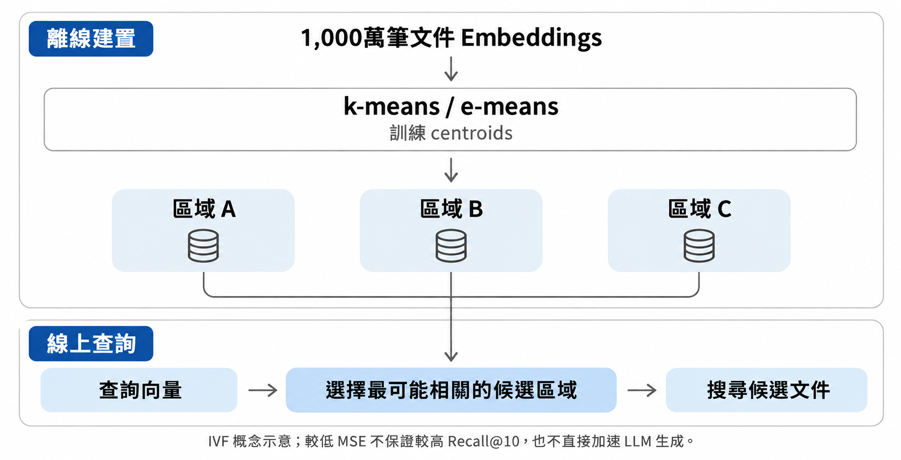

# e-means 與 k-means：更新機制、數學推導與證據界線

> 本文以完整供稿逐節整理，保留十四章、全部實質小節、表格、公式、例題與三道理解題；原始字節保存在 [原文](source/pasted-text-1.txt)。編輯更動與證據分層見 [核對筆記](verification-notes.md)，逐節對照見 [來源對照](source-map.md)。八張圖依附件逐張重繪，圖中文字另有本文與 [圖示規格](figure-specifications.md)可搜尋版本。本文並非本機效能重現報告。

從直覺、數學推導、最佳化理論，到大型 AI Embedding 系統的實際應用

## **一、核心結論：e-means 不是發明新的分群目標，而是改進尋找答案的方法**

附件指向下列研究；本次已核對論文識別、標題、作者與提交日期。這是 Meta FAIR 研究團隊於 **2026 年 11 月 6 日**發布的論文：

[**e-means: outperforming k-means (in one-tenth the epochs)**](https://arxiv.org/abs/2611.09501v1)

作者包括 Swann Bessa、Hugo Touvron、Matthijs Douze、Hervé Jégou 等研究者。

這項研究的核心是：

> 傳統 k-means 每次都要把整批資料重新分群，再重新計算群中心；e-means 則讓群中心在處理一小批資料後就逐步調整，並利用指數移動平均（Exponential Moving Average, EMA）控制更新。

研究團隊報告，在多個高維向量資料集上，e-means 只需約 1.4–2.6 個 epochs，就能達到傳統 Lloyd's k-means 執行 25 epochs 的損失水準。部分 GPU 實驗的執行時間加速達 10–45 倍。

但必須先建立三個觀念：

1. **兩者解決的是同一個最佳化問題。** e-means 並沒有換成另一種分群品質定義。
2. **更快不代表每一步運算都快 10 倍。** 主要改善在於需要更少的資料遍歷次數，搭配高效實作。
3. **更低 loss 不代表找到全域最佳解，也不代表分群在語意上一定更正確。** 這是非凸最佳化問題，仍然存在局部最佳解。

目前論文是新近發布的 arXiv 預印本。以下會將作者的實驗結果與可以獨立成立的數學原理分開討論。

## **二、先建立整個知識地圖**

我們可以把這個主題拆成六個互相連接的問題：

**核心任務：從大量資料中，找出具有代表性的 k 個中心**

Clustering / Vector Quantization

01 基本問題

什麼是分群？為什麼要最小化距離？

02 傳統演算法

Lloyd's k-means 如何更新中心？

03 新演算法

e-means 如何用 mini-batch 與 EMA？

04 最佳化理論

為什麼更新方式會影響局部最佳解？

05 實驗與驗證

如何正確比較 loss、速度與品質？

06 系統應用

如何用於 RAG、向量檢索與大型 AI 系統？

這六個問題可以用一句話串起來：

**定義好什麼是好的分群結果之後，我們要如何在有限的計算資源下，盡可能快速地找到它？**

## **三、什麼是 k-means？先用一個生活案例理解**

想像你負責一家物流公司，全臺灣有 10,000 個配送地址。

你想建立 10 個配送中心，並希望每位顧客離所屬配送中心都不要太遠。

這時候你面臨兩個問題：

- 每個顧客應該交由哪一個配送中心服務？
- 10 個配送中心應該設在哪裡？

這就是 k-means 背後的基本思考方式。

示意圖中的小圓點是資料，大圓圈標記的是群中心（Centroid）。這不是實際的 e-means 實驗。

如果把物流中心換成「影像特徵的代表向量」，同一個數學問題就能用於影像檢索、資料壓縮與機器學習。

### **3.1 k-means 的三個基本元素**

- $n$：總共有多少筆資料，例如 10,000 個配送地址。
- $k$：想分成幾群，例如 10 個配送中心。
- $d$：每筆資料有多少個數值維度，例如經緯度為 2 維，Embedding 可能有 768 或 1,024 維。

每筆資料表示為向量 $x_i$，每個中心表示為向量 $c_j$。

我們希望最小化：

$$
\boxed{ L(C)=\frac{1}{n}\sum_{i=1}^{n} \min_{1\leq j\leq k}\|x_i-c_j\|^2 }
$$

這是 k-means 的核心目標函數（Objective Function），也常稱為 Mean Squared Error（MSE）或平均平方量化誤差。

把公式翻成白話：

1. 找到每個資料點距離最近的中心。
2. 計算資料點與該中心之間的距離平方。
3. 把所有資料點的距離平方加總。
4. 除以資料筆數，得到平均損失。

**Loss 越低，代表在這種距離度量下，資料點平均越接近自己的分群中心。**

但要注意，這不保證人類認為屬於同一種類的東西一定會被分在同一群。

### **3.2 為什麼使用距離平方？**

假設某群顧客與配送中心的距離分別為 1、2、5 個單位。

普通距離總和是：

$$
1+2+5=8
$$

平方距離總和則是：

$$
1^2+2^2+5^2=30
$$

最遠的顧客被賦予更大的懲罰。

另一個重要的數學性質是：**當群組成員固定時，能夠最小化平方歐氏距離總和的位置，恰好就是該群資料的算術平均值。**

這正是 k-means 使用「平均中心」的數學理由。

不過，真實物流的道路距離不等於平方歐氏距離。這個例子主要用來理解機制；若實際設置物流中心，通常還需要路網、容量與配送成本等限制。

圖 1｜三群平行的資料與代表中心；虛線圓是教學範圍，並非 Voronoi 邊界。

## **四、傳統 k-means（Lloyd's Algorithm）到底如何運作？**

傳統 k-means 的關鍵是交替進行兩個步驟：

**先決定每個人屬於哪個群，再重新計算每個群的中心。**

### **4.1 用六個數字實際操作一次**

假設我們只有六筆一維資料：

$$
X=\{1,2,3,8,9,10\}
$$

我們希望分成兩群，所以 $k=2$。

一開始隨機選擇兩個中心：

$$
c_1=2,\qquad c_2=8
$$

第一步是 Assignment（分配）。

每個資料點找到最近的中心：

| 中心 1  | 中心 2   |
| ----- | ------ |
| 1、2、3 | 8、9、10 |

第二步是 Update（更新）。

對每個群計算平均值：

$$
c_1=\frac{1+2+3}{3}=2
$$

$$
c_2=\frac{8+9+10}{3}=9
$$

於是原本的中心 $(2,8)$ 變成 $(2,9)$。

接著重新分配全部資料，再重新計算平均值，直到結果不再改變，或達到預定迭代次數。

藍色與橘色是不同群；三角形代表中心。更新時，右側中心從 8 移動到 9。

圖 2｜固定資料的 Lloyd 更新；右中心從 8 移到 9，左中心維持 2。

### **4.2 為什麼這樣更新一定不會增加當前的 loss？**

這可以用微積分證明。

對某個已固定成員的群 $j$，我們要最小化：

$$
L_j(c_j)=\sum_{i\in A_j}\|x_i-c_j\|^2
$$

其中 $A_j$ 是屬於第 $j$ 群的資料集合。

對中心 $c_j$ 微分：

$$
\nabla_{c_j}L_j =2|A_j|c_j-2\sum_{i\in A_j}x_i
$$

令梯度等於零：

$$
\boxed{ c_j=\frac{1}{|A_j|}\sum_{i\in A_j}x_i }
$$

這就證明了：固定群組成員之後，平均值是平方距離目標下的最佳中心。

Lloyd's Algorithm 可以視為一種交替最佳化（Alternating Optimization）：

- **Assignment step**：固定中心，為每個點選擇最小距離的群。
- **Update step**：固定分群，為每個群選擇最佳平均中心。

每一步都不會增加完整資料集的 k-means 目標，因此完整迭代後 loss 具有單調不增的性質。

但是，有一個很重要的陷阱。

### **4.3 Loss 一直下降，為什麼結果仍然可能不好？**

因為「每一步都改善」不等於「一定找到全世界最好的答案」。

想像你在山區中下山。每一步都往低處走，最後到達某個山谷。

你確實已經無法再往周圍的低處走，但隔壁可能有更深的山谷。

局部最佳解

較好的最佳化結果

示意：Lloyd 的單調下降特性不代表能跨越較高損失區域，到達更好的解。

這個問題稱為 **Local Minimum（局部極小值）**。

k-means 之所以困難，是因為每個點的群組身分也要一起決定，整體目標函數通常是非凸的（Non-convex）。

這也是為什麼 k-means++ 這類初始化方法很重要：它希望一開始就選到比較合理的中心，降低陷入不良局部解的風險。

然而，初始化只能改善起點，不一定能解決所有最佳化問題。

圖 3｜同一示意地形的不同局部極小值；不宣稱 e-means 必定找到較低的解。

## **五、e-means 如何改變整個訓練過程？**

現在進入這篇論文最重要的部分。

e-means 的主要創新，不是重新定義 centroid，而是改變 centroid 的更新策略。

### **5.1 全量更新 vs 小批次更新**

假設我們有 100 萬筆 Embedding。

傳統 Lloyd's k-means：

Lloyd：收集全部資料後才更新

讀完 100 萬筆資料

更新一次

e-means：每讀一小批就更新

更新

更新

更新

更新

更新

圖中僅示意五批；實際批數由資料量與 batch size 決定

這裡有一個常見誤解：

**Mini-batch 不是只看整個資料集的 10% 就停止。**

如果一個 epoch 包含 100 萬筆資料，e-means 仍然可以在一個 epoch 內逐批讀完這 100 萬筆資料。

差別在於：

- Lloyd：每個 epoch 更新一次中心。
- e-means：每個 epoch 可以更新數十次，甚至更多次中心。

因此，e-means 的群中心能更早取得回饋與修正方向。

圖 4｜上下皆為一個 epoch；差別在更新頻率，圖示五批不指定真實 batch size。

### **5.2 Exponential Moving Average（EMA）：為什麼需要記憶？**

想像某個配送中心正在依據新訂單調整位置。

如果只考慮今天的訂單，中心可能大幅移動，明天又移回去，位置變得非常不穩定。

但如果永遠把過去所有訂單當成同樣重要，新資料又很難改變中心位置。

EMA 解決的是這個權衡：

**保留一部分過去的統計資訊，同時讓新資料逐漸影響中心。**

最簡單的 EMA 是：

$$
m_t=(1-\alpha)m_{t-1}+\alpha x_t
$$

其中：

- $m_t$：這次更新後的平均值。
- $m_{t-1}$：上一次平均值。
- $x_t$：這次觀察到的新數值。
- $\alpha$：更新步長，介於 0 與 1 之間。

例如，上一個平均值為 50，新觀測值為 80，並設 $\alpha=0.2$：

$$
m_t=0.8(50)+0.2(80)=56
$$

新的平均值從 50 移動到 56，而不是瞬間跳到 80。

EMA 更新步長的靜態算例（原稿互動元件未附程式）

更新步長 α

**靜態算例：α = 0.20**

更新後 = (1 − 0.20) × 50 + 0.20 × 80 = **56.0**

這是單一數值的 EMA 教學示例；實際 e-means 使用群組總和與樣本數的 EMA，下一節會推導。

當 $\alpha$ 越大，平均值越容易受到新資料影響；當 $\alpha$ 越小，則越穩定。

這種「反應速度與穩定性」的權衡，正是 e-means 最佳化過程的核心。

圖 5｜α=0.2 的靜態 EMA 算例，50 與 80 得到 56；實際 e-means 使用兩個統計量。

## **六、e-means 真正的數學核心：它不是直接平均 centroid**

剛才的 EMA 公式只是入門。

論文真正使用的更新方式更精細：**每個群不只儲存中心，還儲存加權的資料總和與資料數量。**

### **6.1 為每個群維護兩個統計量**

對第 $j$ 個群，定義：

$$
N_j=\text{這個群的加權樣本數}
$$

$$
S_j=\text{這個群的加權向量總和}
$$

因此，群中心可以寫成：

$$
\boxed{c_j=\frac{S_j}{N_j}}
$$

這其實就是平均值的定義：總和除以數量。

當一個 mini-batch 進來時，假設其中有 $n_j$ 筆資料被分配到第 $j$ 群，而這些資料的向量總和是 $s_j$。

e-means 更新方式為：

$$
\boxed{ \begin{aligned} N_j^{(t)}&=(1-\alpha_t)N_j^{(t-1)}+\alpha_t n_j\\ S_j^{(t)}&=(1-\alpha_t)S_j^{(t-1)}+\alpha_t s_j\\ c_j^{(t)}&=\frac{S_j^{(t)}}{N_j^{(t)}} \end{aligned} }
$$

注意：**它同時對樣本數和向量總和做 EMA，再透過兩者的比例取得中心。**

為什麼要這麼做？

因為每個 mini-batch 裡，不同群拿到的資料筆數可能完全不同。

假設一個 batch 有 100 筆資料，其中第一群分到 50 筆，第二群只分到 2 筆。

如果把兩個群的新平均值都當成同樣可靠，直接使用固定權重更新，就忽略了樣本數差異。

e-means 的設計能自然保留這些資訊。

### **6.2 手算兩次更新**

假設只有一個一維群，原本中心接近 0，並設：

$$
\alpha=0.2
$$

初始 $N$ 是一個非常小的正數，目的是避免除以零；論文使用 $10^{-10}$。

第一個 mini-batch 分配了兩筆資料到這個群：

$$
\{2,4\}
$$

因此：

$$
n=2,\qquad s=6
$$

更新後，忽略極小的初始量：

$$
N_1=0.2(2)=0.4
$$

$$
S_1=0.2(6)=1.2
$$

$$
c_1=\frac{1.2}{0.4}=3
$$

所以第一批資料得到中心 3。

現在第二個 mini-batch 進來：

$$
\{4,6\}
$$

因此 $n=2$，$s=10$。

新的加權樣本數：

$$
N_2=0.8(0.4)+0.2(2)=0.72
$$

新的加權向量總和：

$$
S_2=0.8(1.2)+0.2(10)=2.96
$$

新的中心：

$$
\boxed{c_2=\frac{2.96}{0.72}\approx4.11}
$$

第一批給出中心 3，第二批給出中心 5，但最終中心是 4.11。

它保留了舊資料的影響，同時向新資料的方向移動。

### **6.3 更深一層：推導 e-means 的有效學習率**

這是理解論文最佳化行為的一個關鍵。

令 mini-batch 中屬於第 $j$ 群的平均值為：

$$
\bar{x}_j=\frac{s_j}{n_j}
$$

把舊的 $S_j=N_jc_j$ 代入更新方程式，可得到：

$$
c_j^{\text{new}} = \frac{(1-\alpha)N_jc_j+\alpha n_j\bar{x}_j} {(1-\alpha)N_j+\alpha n_j}
$$

整理後：

$$
\boxed{ c_j^{\text{new}} = c_j+ \underbrace{ \frac{\alpha n_j} {(1-\alpha)N_j+\alpha n_j} }_{\beta_j} (\bar{x}_j-c_j) }
$$

其中 $\beta_j$ 是該群這一次更新的有效步長。

這代表一件非常重要的事：

**即使所有群使用相同的全域 **$\alpha$**，不同群實際移動的幅度仍然會受到本批樣本數與歷史統計量影響。**

而且在正常的非負計數條件下：

$$
0\leq\beta_j\leq1
$$

這讓新中心成為舊中心與本批平均值之間的加權組合，而不是毫無限制地跳向任意方向。

這與一般 SGD（Stochastic Gradient Descent）有一個重要差別：EMA 更新具有平均值的幾何結構。

在初始中心取自資料點的條件下，新中心仍位於歷來相關資料點的凸包（Convex Hull）內。作者認為，這可能解釋 EMA 在較大更新步長下比直接使用 SGD 更穩定的原因；但這仍是研究中的機制假說，不是已被嚴格證明的普遍優勢。

### **6.4 e-means 和傳統 MiniBatchKMeans 的差別**

這裡要特別釐清：**Mini-batch k-means 不是 e-means 首次發明的。**

早在 1967 年 MacQueen 的工作，以及 2010 年 Sculley 的研究中，就已經出現逐筆或小批次更新中心的方法。

e-means 的不同之處，在於如何管理歷史統計量及整個最佳化流程。

| 方法                 | 更新中心的核心方式      | 主要特性                |
| ------------------ | -------------- | ------------------- |
| Lloyd's k-means    | 每輪根據全部資料重算     | 每輪 loss 不增，但可能陷入局部解 |
| 傳統 MiniBatchKMeans | 累積小批次資料、調整中心   | 更新頻繁，但效果受步長與初始化影響   |
| e-means            | 對群組總和與數量使用 EMA | 舊資訊逐步衰減，搭配步長排程及其他機制 |

所以，e-means 的貢獻不是單一 EMA 方程式，而是把已知的 EMA 技術改造成適合固定資料集 k-means 的一套完整方法。

## **七、為什麼 e-means 不只更快，還可能找到更好的結果？**

如果只使用 mini-batch，還不足以完整解釋這篇研究。

作者結合了四個重要機制。

**Mini-batch + EMA**

快速回饋、逐步更新

**Cosine Schedule**

先大幅探索，後逐漸穩定

**Dead-cluster Revival**

重新利用失去作用的群中心

**Finalization**

完成訓練前修正最終中心

**Scaling Laws**

由問題規模自動設定參數

圖 6｜核心與四項平行組件；卡片排列沒有執行先後含義。

### **7.1 Cosine Schedule：為什麼一開始要敢動，後面要穩？**

回想剛才的 EMA。

當 $\alpha$ 很大時，中心可以快速移動，但可能容易震盪。

當 $\alpha$ 很小時，中心很穩定，但也可能很難脫離不理想的位置。

因此 e-means 不是永遠使用固定的 $\alpha$，而是採用餘弦退火排程（Cosine Annealing）：

$$
\boxed{ \alpha(t)=\alpha_0\left[ 0.1+0.9\frac{1+\cos(\pi t/M)}{2} \right] }
$$

其中 $M$ 是總 mini-batch 更新次數，$t$ 是目前第幾次更新。

Cosine 步長排程示意

初始步長 α₀ = 0.4，隨著訓練進展下降至其 10%。

橫軸：更新進度 0%–100%；縱軸：EMA 步長 0–0.4。

根據論文公式計算的示意曲線，並非實際訓練 loss。橫軸代表已完成的更新進度。

白話來說，就是先允許群中心比較積極地調整，再逐漸降低更新幅度，避免最後一直震盪。

這類設計在深度學習的 learning-rate scheduling 中也很常見。

圖 7｜由 cosine 公式計算的步長；橫軸是更新進度，縱軸不是 loss。

第7圖另附 [由公式直接繪製的 SVG](figures/cosine-exact.svg)、[PNG](figures/cosine-exact.png)及 [CSV 數值](figures/cosine-values.csv)，可依資料核對曲線；圖中端點採連續進度定義，離散索引差異見核對筆記。

### **7.2 為什麼 mini-batch 的隨機性反而可能是優勢？**

傳統 Lloyd 每次使用全部資料，會穩定地降低同一個訓練目標。

但如果它已經落入一個不良的局部極小值，這種穩定性可能使它無法脫離。

e-means 因為每次只看一小批資料，更新方向會有波動。

這些波動稱為 Stochastic Noise（隨機雜訊）。

它們可能讓 centroid 穿越某些分群邊界，進入傳統 Lloyd 難以到達的配置。

更精確地說：

- Lloyd 的完整迭代具有單調不增的 loss。
- e-means 的每次小批次更新不保證完整資料集 loss 都下降。
- 某次暫時的 loss 上升，可能導致稍後到達更低的局部極小值。

**因此，「訓練過程比較不穩定」不一定代表「最後的答案比較差」。**

但這不表示加入越多雜訊越好。過大的更新可能破壞已經找到的良好分群，這也是 Cosine Schedule 必須存在的原因。

### **7.3 Dead-cluster Revival：避免浪費群中心**

假設你本來打算建立 100 個配送中心，卻發現有 20 個配送中心完全沒有服務任何客戶。

那麼，雖然你設定 $k=100$，實際上只有 80 個中心在發揮作用。

在 k-means 裡，這種群叫作 Dead Cluster（死亡群組）。

e-means 定期檢查那些加權樣本數太少的群。

論文的設計是每五個 mini-batches 檢查一次，對樣本數低於平均值一定比例的群進行 revival，通常透過拆分另一個較有代表性的群來重新利用中心。

這不是所有 k-means 的全新概念，但作者對這個機制做了重要的實作與實驗改善。

研究中的一組 DEEP 資料實驗顯示：

| 機制             | 死亡群數  | 比例    |
| -------------- | ----- | ----- |
| 不使用 revival    | 4,313 | 26.3% |
| 從 batch 重新抽樣   | 2,343 | 14.3% |
| e-means 的群拆分策略 | 47    | 0.3%  |

來源：論文 Appendix H；DEEP、100 萬筆資料，16,384 個群。

在這組實驗中，如果大量群中心失去作用，再怎麼精確更新剩下的中心，也可能無法充分利用原本允許的 $k$ 個代表向量。

### **7.4 Finalization：最後為什麼還要重新計算平均值？**

e-means 訓練期間會持續使用 EMA。

但是 EMA 得到的中心，未必是對最後一輪分群結果最好的算術平均值。

因此作者提出一個簡單的收尾步驟：

在最後一個 epoch 記錄資料點被分配到哪個群，然後根據這些已記錄的分群成員，重新計算一次中心的平均值。

這被稱為 **Last-Epoch-Mean Finalization**。

對固定的最後分群結果，它可以保證不增加訓練平方誤差，而且因為已經記錄了分群結果，額外的計算成本相對小。

論文也提出另一種 Slow-EMA Finalization，目的是改善未參與訓練的新資料上的誤差。

這兩種收尾方式有不同目標：

| 收尾方法            | 優先改善                     |
| --------------- | ------------------------ |
| Last-Epoch Mean | Training MSE             |
| Slow EMA        | Out-of-sample / Test MSE |

這又引出一個研究層面的重要問題：

**你到底是在追求讓現有資料被更好地壓縮，還是希望新進資料也能得到良好的分群？**

兩個目標相關，但不一定完全一致。

## **八、Scaling Laws：e-means 最值得研究的另一項貢獻**

這裡的 Scaling Law 不是指「模型越大，語言模型就一定越聰明」。

它的意思是：

**根據資料量、群數與訓練預算，預測什麼 batch size 與更新步長比較合適。**

### **8.1 為什麼這件事重要？**

傳統 mini-batch 方法常常需要手動嘗試：

Batch size 應該設 512、4,096，還是 65,536？

更新步長應該設 0.01、0.1，還是 0.5？

若每換一份 Embedding 資料都重新調參，大型系統會花費大量實驗成本。

e-means 的研究團隊在 DEEP 資料集上的多種問題規模進行約 75,000 次最佳化實驗，擬合出兩組經驗公式。

### **8.2 第一條公式：預測 batch size**

論文預設的 batch law 可寫成：

$$
\boxed{ B\approx 0.035\, k^{0.13}n^{0.88}T^{0.81} }
$$

其中：

- $B$：一次 mini-batch 處理的筆數。
- $k$：群數。
- $n$：資料總筆數。
- $T$：計畫執行的 epochs。

實際執行時會把 $B$ 四捨五入到最接近的 2 的冪次，並限制不得大於 $n$。論文在 $n>2$ 百萬的大規模設定中，還會把這條預設 batch law 的結果除以 8，以改善品質與吞吐量的權衡。

### **8.3 第二條公式：預測初始更新步長**

$$
\boxed{ \alpha_0= \min\left( 0.824\,k^{-0.46}B^{0.90}n^{-0.45}T^{-0.11}, 1 \right) }
$$

這告訴我們：更新步長不是一個可以在所有資料集上固定使用的神奇常數。

作者發現，它會與資料規模、群數、批次大小及訓練預算產生系統性的關係。

例如，假設：

$$
n=10^6,\quad k=16,384,\quad T=3
$$

依照作者的預設規則，可算出大約：

$$
B=65,536,\qquad \alpha_0\approx0.363
$$

接著訓練過程會逐漸把步長降低至初始值的十分之一左右。

這只是一個依公式計算的例子，不代表這組設定一定是你的資料集的最佳選擇。

### **8.4 為什麼這些公式不能被當成普遍定律？**

這一點非常重要。

這些指數與係數主要來自經驗迴歸（Empirical Regression），並不是從 k-means 的數學定理推導出來的普遍最佳解。

作者在未參與擬合的資料集上驗證，取得不錯的結果；但論文也明確承認，這些規則主要針對較高維度的資料，在極低維度或非常小的資料集上可能不是最佳設定。

換句話說：

**Scaling Laws 可以減少調參，但沒有消除資料分布改變所帶來的不確定性。**

## **九、回到你提供的圖片：究竟應該怎麼解讀？**

現在我們可以從科學角度重新檢視這張圖。

### **9.1 左邊與中間：Voronoi Diagram 是什麼？**

圖中比較的是不同分群方法形成的 Voronoi Diagram（沃羅諾伊圖）。

每一個區域都代表：

> 在整個空間中，哪些位置最接近某一個特定的 centroid？

例如有三個配送中心時，整張地圖可以被分成三個區域。每個區域內的任何位置，都比其他配送中心更靠近自己的中心。

這些分界線由各個 centroid 的位置決定。

在二維的歐氏距離空間中，Voronoi 區域通常是由直線邊界構成的多邊形；在更高維度則是多面體區域。

圖片裡的紅點與藍點代表兩種演算法各自得到的中心，背景的小點是資料樣本，細線則是 Voronoi 邊界。

因此這兩張圖想表達的不是「紅色資料與藍色資料不同」，而是：

**在同一個分群任務上，兩種演算法能以不同的更新過程得到不同的中心配置。**

但光用眼睛看 Voronoi 圖，無法可靠判定誰的 loss 比較低，仍然需要計算目標函數。

### **9.2 右邊：Training Loss 曲線究竟顯示什麼？**

圖片右側的紅線代表傳統 k-means，藍線代表 e-means。

紅線慢慢下降，藍線在較少 epochs 內快速下降。

這裡最重要的不是曲線陡峭，而是比較的停止標準。

| 指標         | k-means   | e-means    |
| ---------- | --------- | ---------- |
| 執行時間       | 4.39 秒    | 0.43 秒     |
| 資料遍歷次數     | 25 epochs | 2.2 epochs |
| 最終顯示的 loss | 較高        | 較低         |

按照圖片的數字：

$$
\text{時間加速比}=\frac{4.39}{0.43}\approx10.21
$$

而資料遍歷次數的比例為：

$$
\frac{25}{2.2}\approx11.36
$$

這裡甚至可以再做一個很有意思的計算。

如果將總時間除以 epochs：

$$
\text{Lloyd 每 epoch}\approx0.176\text{ 秒}
$$

$$
\text{e-means 每 epoch}\approx0.195\text{ 秒}
$$

也就是說，**在這個展示案例中，總時間／epochs 的商值略大；總時間仍約縮短為十分之一。由於初始化、收尾與計時區間未提供，這不能獨立證明每輪距離計算較慢。**

這個商值示範總時間與遍歷次數的區分；它包含未分離的固定成本，不能當作單獨量測的每輪 kernel 時間。

另外，2.2 epochs 代表約完成兩次完整資料遍歷，再加上部分第三次遍歷，而不是只執行 2.2 次 centroid 更新。

圖片沒有提供精確的 loss 數值、誤差範圍或多次重複實驗統計，因此不能只用這張圖推論所有資料集的表現。

## **十、原始論文的實驗證據有多強？**

作者不只展示圖片中的二維範例，還使用多種影像與文字 Embedding 資料集進行測試。

以下選取論文 Table 4 的 DINO10B 子集結果：

| 資料筆數    | 群中心數      | e-means 達到基準所需 epochs | GPU 時間加速 |
| ------- | --------- | --------------------- | -------- |
| 100 萬   | 16,384    | 2.0                   | 12.7×    |
| 1,000 萬 | 65,536    | 1.4                   | 23.3×    |
| 1 億     | 262,144   | 1.6                   | 31.3×    |
| 10 億    | 1,048,576 | 1.6                   | 45.5×    |

基準是 Flash-KMeans 執行 25 iterations 的 Test MSE。前面三個規模使用 10 個 seeds 的中位數，10 億資料規模只有一次 seed，因此其統計確定性較低。

作者另外展示了 100 億筆、1,024 維 DINO Embeddings 的大規模案例，分成約 1,677 萬群。

在這個規模，僅是用 FP32 儲存每個群的 $S_j$ 向量，就大約需要 64 GiB 記憶體。因此必須使用多 GPU 分片（Sharding）等技術。

透過 IVF 的近似指派方式，作者報告，達到參考 loss 的計算成本可以從約 779 GPU-hours 降至 22.8 GPU-hours。這裡的額外改善不只來自 e-means，也來自近似搜尋所減少的距離計算。

### **10.1 但有反面證據嗎？**

原稿提出一則早期獨立重現案例；未提供可追溯文章網址、程式與執行回條，本次保留為待查核來源主張。

2026 年 11 月 10 日，一位開發者使用自行實作的 NumPy 版本，在 100,000 筆、128 維的合成資料上測試，得到約 1.51 倍加速，而且最終 loss 比 Lloyd 高約 1.42%。

這則未核實主張不能直接推翻原論文，因為其資料規模、實作方式與硬體配置不同；該開發者也明確指出，沒有使用論文的融合 GPU kernels。

但這項實驗提醒我們，10 倍加速不是演算法的普遍下界，也不是只實作 EMA 方程式就能自動得到的結果。

目前合理的證據判斷是：

| 主張                         | 判斷             |
| -------------------------- | -------------- |
| EMA 可用於 mini-batch k-means | 成立，有明確數學定義     |
| e-means 的部分實驗顯著優於 Lloyd    | 有作者實驗支持        |
| 對高維、大規模 Embedding 具有應用潛力   | 有說服力，但須在目標系統重現 |
| 所有資料集都可快 10 倍              | 無法支持           |
| 一定找到全域最佳分群                 | 無理論保證          |
| Lower MSE 一定改善下游 AI 任務     | 不能直接推論         |

## **十一、更深的理論連結：e-means 與 EM、SGD、GPU 計算的關係**

### **11.1 e-means 和 Expectation-Maximization 是同一回事嗎？**

不是，但它們有密切關係。

經典的 Gaussian Mixture Model（GMM）會假設資料來自多個高斯分布。

EM（Expectation-Maximization）演算法通常反覆執行：

E-step：估計每筆資料屬於各群的機率。

M-step：依據這些機率，更新各個群的分布參數。

k-means 可以理解為某些特定假設下的 Hard Assignment（硬指派）形式：每筆資料直接選擇一個群，不保留多群機率。

而 e-means 依然使用這種硬指派的 k-means 目標，只是用 EMA 維護更新過程中的統計量。

所以不要把 e-means 理解成「發明了一個全新的 Expectation-Maximization」。

### **11.2 時間複雜度真的改變了嗎？**

在最直接的實作下，對每個資料點找到距離最近的 $k$ 個中心之一，需要比較約 $k$ 個距離，每個距離涉及 $d$ 個維度。

因此，Lloyd 的主要計算成本近似：

$$
O(Tnkd)
$$

e-means 如果使用精確的最近中心指派，主要工作仍然是計算距離：

$$
O(T_{\mathrm{e}}nkd)
$$

所以它並沒有神奇地讓原本的距離搜尋問題消失。

真正的改善主要來自：

**以較少的資料遍歷次數，得到同等或更好的最佳化結果。**

如果再加入 IVF、GPU 矩陣運算、資料分片與低精度運算，就可能產生額外的系統層加速。

### **11.3 為什麼 GPU 特別適合這類工作？**

平方歐氏距離可以展開為：

$$
\|x-c\|^2=\|x\|^2+\|c\|^2-2x^\top c
$$

其中 $x^\top c$ 是內積。

這讓大量資料點與大量 centroid 之間的距離比較可以利用矩陣運算加速。

現代 GPU 很擅長進行這種高度平行的乘加運算。

論文還研究 BF16、FP8 與 INT8 的近似距離計算，但群組總和與 EMA 累積仍使用 FP32。低精度指派可能改變某些資料點的群組身分，因此需要額外驗證對最終 MSE 的影響。

這也是學習這篇研究時應該建立的另一個重要區別：

**演算法的數學改進，與硬體及系統實作的加速，是兩個不同但可以互相強化的層次。**

## **十二、e-means 在現代 AI 系統中能做什麼？**

我認為最值得優先理解的應用，是 Vector Quantization（向量量化）與 Approximate Nearest Neighbor Search（近似最近鄰搜尋）。

### **12.1 RAG 與向量資料庫**

假設有一千萬份文件，已經被轉換成高維 Embeddings。

當使用者提出問題，系統希望找到最相似的文件。

直接拿問題向量與一千萬筆資料逐一比較，成本可能太高。

一種常見做法是先透過分群建立粗略的搜尋區域：

**1,000 萬筆文件 Embeddings**

**k-means / e-means**

訓練代表各區域的 centroids

區域 A

區域 B

區域 C

**查詢時，先選出最可能相關的區域**

再到候選區域內搜尋文件

這是 IVF（Inverted File Index）背後的核心思路之一。

分群品質可能影響搜尋召回率（Recall），而分群訓練速度會影響索引建立或重建的時間。

因此，e-means 最直接的價值可能是加快大型向量索引的離線建置流程，而不是直接讓每次 LLM 文字生成變快。

論文 Appendix L 也測試了索引建置時間與 Recall\@10 的關係，作者報告 e-means 在多數受測資料集上能更快達到相近或更好的搜尋召回率。

圖 8｜離線 centroids 建置與線上候選區域搜尋；箭頭表示資料／查詢流程，並非成效因果。

### **12.2 資料集治理與去重**

想像一個大型 AI 訓練資料庫有數千萬筆圖片、音訊或文字片段。

可以先把資料轉成 Embeddings，再使用分群協助：

辨識高度相似的資料、抽取具代表性的樣本、探索資料分布，以及找出可能被過度或不足採樣的區域。

但是要區分：

**k-means 不是去重演算法本身。**

同一群中的資料不一定重複，而跨群的資料也可能非常相似。因此分群通常只用於建立候選集合，後續仍需使用更精確的相似度門檻或其他檢查。

### **12.3 語音與醫療影像 AI**

在語音系統中，可以把語音片段轉換成聲學 Embeddings，再用分群分析資料的聲學結構。

在醫療影像中，也可以將影像區塊或病灶候選區域轉換成特徵向量，利用分群輔助資料探索、抽樣與資料集管理。

但這裡還有一個容易被忽略的問題：

**Embedding 的距離是否真的代表你關心的相似性？**

例如，同一個語音群可能反映的是錄音裝置或背景雜訊，而不是口音、說話者或語意。

又例如，一個醫療影像群可能主要依據掃描設備差異分群，而不是病理差異。

因此不能只看 MSE 就宣布下游任務品質改善。

還要注意，e-means 的原始目標是平方歐氏距離。若你的應用主要採用 Cosine Similarity，應確認向量正規化、中心正規化及分群目標的相容性，不能直接假設兩者等價。

## **十三、如果要嚴謹地驗證 e-means，應該怎麼做？**

真正有研究價值的問題，不只是「它有沒有比較快」，而是：

> 在指定的資料分布、計算預算與品質要求下，e-means 是否能提供更好的速度—品質權衡？

我會建議用下列實驗矩陣，而不是只重做一張兩條曲線的圖片。

| 實驗維度 | 應比較的條件                                      |
| ---- | ------------------------------------------- |
| 求解器與初始化 | 求解器比較 Lloyd、MiniBatchKMeans、e-means；k-means++ 作為初始化策略另列 |
| 資料分布 | 合成 Gaussian、真實文字 Embeddings、真實影像 Embeddings |
| 資料規模 | 小型、中型、大型                                    |
| 更新機制 | EMA、固定步長、Cosine Schedule                    |
| 其他模組 | Revival on/off、Finalization on/off          |
| 品質指標 | Train MSE、Test MSE、Downstream Recall        |
| 效率指標 | Wall-clock Time、GPU-hours、Peak VRAM         |
| 穩定性  | 不同 random seeds 的結果分布                       |

比較時，應使用相同資料、明確的初始化策略與一致的評估方式，並完整計入初始化和收尾成本。

其中最值得比較的是兩種不同的評估視角。

**固定品質，比較時間：**

假設 Lloyd\@25 的 Test MSE 是 0.40。

問 e-means 需要多久才能達到不高於 0.40 的品質。

**固定計算預算，比較品質：**

假設兩種演算法都只能使用 10 秒 GPU 時間。

問誰能取得更低的 Test MSE，以及更好的下游 Recall。

第一種方式適合衡量效率改善；第二種方式適合有限資源下的演算法選擇。

如果是要檢驗論文方法是否真正有效，也應使用 ablation study（消融實驗），逐一移除 Cosine Schedule、Revival、Finalization 與 Scaling Laws，觀察哪些機制貢獻最大。

### **研究上的實際判斷**

在大型、高維、靜態 Embedding 資料集上，**e-means 值得優先納入候選方法**。

但如果資料很小、低維度、群數不多，或只需要一次性分群，傳統 Lloyd 或 k-means++ 可能已經足夠，而且實作與驗證成本更低。

若處理的是持續變動的資料流，則還需要研究概念漂移（Concept Drift）、歷史資料權重及中心更新穩定性。這篇論文主要最佳化的是固定資料集上的 k-means 問題，不能直接把結果推廣至所有即時串流情境。

## **十四、最後，把整篇論文濃縮成一個可以帶走的觀念**

傳統 Lloyd's k-means 的強項是簡單、可靠，而且每次完整迭代都能降低或維持訓練目標。

e-means 的新思路則是：

**不必每次都先取得全部資料的完整統計結果，才開始改善群中心。**

透過 mini-batch、EMA、合理的步長排程、死亡群復活以及最後的中心修正，演算法可以更頻繁地改善分群配置，並且有機會避免傳統方法容易停留的不良局部解。

而 Scaling Laws 則試圖把這套方法從「需要大量手動調參的實驗技巧」，轉變為較容易部署到不同問題規模的工程方法。

這篇研究最有價值的地方，不只是宣稱快 10 倍，而是展現了一種更廣泛的系統設計思路：

> **在不改變最終最佳化目標的前提下，重新設計更新頻率、記憶機制、探索策略與計算流程，就可能顯著改善取得答案的成本與品質。**

這個思想也適用於許多機器學習最佳化與大型 AI 系統設計問題。

## **理解檢查**

先不看公式答案，嘗試回答以下三題。

**問題一：最佳化理論**

Lloyd's k-means 每次完整迭代都不會增加 loss，為什麼 e-means 在訓練過程中允許 loss 暫時上升，卻可能得到更低的最終 loss？這是否代表 e-means 一定比較好？

**問題二：數學推導**

假設某個群的舊中心為 10、加權樣本數 $N=20$，新 mini-batch 有 5 筆屬於這個群，平均值為 30。當 $\alpha=0.2$ 時，請計算新的中心，並解釋為什麼不能直接用 $0.8(10)+0.2(30)$。

**問題三：研究設計**

你有 100 萬筆、768 維的文字 Embeddings，需要建立 8,192 個群，用於 IVF 向量搜尋。

e-means 比 Lloyd 快 8 倍，Test MSE 也低 0.5%，但實際 Recall\@10 下降了 2 個百分點。

你會採用 e-means 嗎？請說明該如何判斷，以及還需要進行哪些實驗。

這三題保留為自我檢核題；本次未作答或評分。整理筆記另附可核對的參考解。
