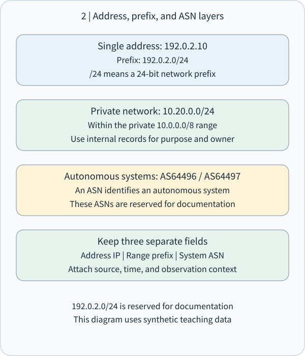
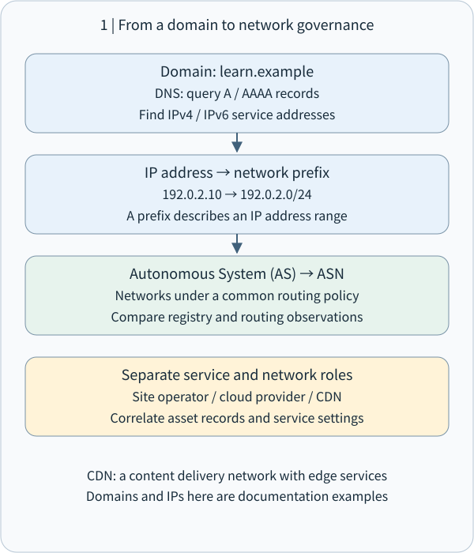

# CEH M02-06 | IP, ASN and Traceroute: Build an Evidence-Based Network Map

## 1 | The central idea

**Network footprinting connects addresses, prefixes, routing administration and path observations into a map with sources, timestamps and vantage points.** IP identifies a network destination; prefixes group addresses; an ASN identifies an autonomous routing system; traceroute reports responses to a particular sequence of probes.

Imagine investigating a coffee shop's deliveries. The shop name helps people find it, the street address guides delivery, a district groups addresses, a carrier manages routes, and tracking records describe an individual shipment. Each item contributes a different part of the picture.

This lesson follows M02-04 DNS (Domain Name System) and M02-05 email paths. We now move from names and messages to addresses and networks. All addresses, ASNs, domains and outputs below are synthetic teaching data. Practice is offline interpretation and local calculation. Active measurements belong to a separately approved, owned, isolated lab.

## 2 | IP addresses and prefixes

IP (Internet Protocol) carries data using source and destination addresses. A packet is a unit of network data. A router forwards packets toward a next hop using routing information. Addresses can be assigned to interfaces; services can also use shared or virtual addresses.

An IPv4 address has 32 bits and is commonly written as four decimal numbers, such as `192.0.2.25`. IPv6 has 128 bits; `2001:db8::25` uses a double colon to compress a run of zeros. A website may offer both families, so retain their observations separately. [IPv4 specification](https://www.rfc-editor.org/rfc/rfc791), [IPv6 specification](https://www.rfc-editor.org/rfc/rfc8200)

CIDR (Classless Inter-Domain Routing) writes a range as an address and prefix length. In `192.0.2.0/24`, the first 24 bits form a common prefix. The remaining eight bits provide `2^8 = 256` addresses, from `192.0.2.0` to `192.0.2.255`. This counts the entire address range; assignable interface counts depend on the subnet's purpose and configuration. [CIDR specification](https://www.rfc-editor.org/rfc/rfc4632)

An IPv4 /25 leaves seven bits and contains 128 addresses; a /24 leaves eight bits and contains 256. A longer prefix identifies a smaller range, like adding detail to an address narrows the district being described.

| Information | Synthetic example | Interpretation |
|---|---|---|
| Individual address | 192.0.2.25 | A network address |
| Network prefix | 192.0.2.0/24 | A range containing that address |
| Private network | 10.20.0.0/24 | A privately configured internal range |
| IPv6 documentation address | 2001:db8::25 | An address reserved for examples |

RFC 1918 reserves `10.0.0.0/8`, `172.16.0.0/12` and `192.168.0.0/16` for private IPv4 use. Different organizations can use these internally. NAT (Network Address Translation) maps internal and external addressing; multiple devices or people may share an external address. Investigations correlate the external address, precise time, ports and appropriate system records. [Private addressing](https://www.rfc-editor.org/rfc/rfc1918), [Traditional NAT](https://www.rfc-editor.org/rfc/rfc3022)

The ranges `192.0.2.0/24`, `198.51.100.0/24` and `203.0.113.0/24` are reserved IPv4 documentation examples. IPv6 uses `2001:db8::/32` for documentation. They support examples and offline calculations here. [IPv4 documentation ranges](https://www.rfc-editor.org/rfc/rfc5737), [IPv6 documentation prefix](https://www.rfc-editor.org/rfc/rfc3849)



## 3 | ASN: who manages the routing policy?

An AS (Autonomous System) presents a coherent external routing policy for a collection of networks. Its ASN (Autonomous System Number), such as our documentation example `AS64496`, is an identifier. Think of an AS as a carrier with its own routing rules and an ASN as that carrier system's identification number. [AS definition](https://www.rfc-editor.org/rfc/rfc1930)

An ISP (Internet Service Provider), cloud platform, large enterprise or academic network may operate an AS. One AS can announce multiple prefixes, and one organization may operate several ASes. ASNs identify routing systems; IP addresses support packet addressing.

BGP (Border Gateway Protocol) exchanges prefix reachability information between autonomous systems. Its AS_PATH is an attribute of a routing announcement. Traceroute uses probe responses to observe a path. Separate columns preserve the distinction between a routing announcement and a particular measurement. [BGP specification](https://www.rfc-editor.org/rfc/rfc4271)

RIRs (Regional Internet Registries) provide registration information through RDAP (Registration Data Access Protocol). Results may describe IP ranges, ASNs, registered organizations, contact roles and update information; available fields depend on the registry. [ARIN RDAP guide](https://www.arin.net/resources/registry/whois/rdap/)

For example, a synthetic record assigns `192.0.2.0/24` to Example Edge, while routing data associates its origin with AS64496. Record the registered organization and observed routing origin separately. Then consult contracts, cloud settings and your asset inventory to establish your service relationship. AS64496 and AS64497 are documentation ASNs. [Documentation ASN reservations](https://www.rfc-editor.org/rfc/rfc5398)

## 4 | Connect DNS, IP, CDN and service roles

Continue the coffee-shop scenario with this synthetic evidence:

```text
Collected: 2026-11-01 08:00 +08:00
DNS: shop.coffee.example A 192.0.2.25
Registration: 192.0.2.0/24 → Example Edge
Routing data: 192.0.2.0/24 → origin AS64496
Owned service configuration: shop.coffee.example uses an edge proxy
```

A DNS A record points to IPv4; AAAA points to IPv6. These records connect a service name to an edge address, then to registration and routing information. A CDN (Content Delivery Network) serves content through distributed edge nodes. A reverse proxy receives and forwards client requests toward backend services. Public DNS may therefore identify these service nodes. [Cloudflare proxied DNS behavior](https://developers.cloudflare.com/dns/proxy-status/)

Keep four roles distinct: domain administrator, address registrant, routing provider and application operator. In shared cloud environments, different parties may perform each role. Appropriate official and owned records establish the relationship among them.

A website can yield different observations by location, time, address family or load balancing. Anycast allows an address to be served from multiple locations, with routing directing traffic toward a serving node. Recording where and when a result was observed preserves its context. [Anycast service operation](https://www.rfc-editor.org/rfc/rfc4786)



## 5 | Traceroute: ask different hops to report

Traceroute actively sends probes with progressively larger hop allowances and organizes returned responses. A hop is a routing forwarding step. Imagine sending several test parcels: one reaches the first station, another reaches the second, and later parcels extend the observation.

IPv4 TTL (Time to Live) decreases by at least one during router forwarding. On expiration the router discards the packet and normally returns ICMP Time Exceeded. ICMP (Internet Control Message Protocol) carries network control and error information. IPv6 uses the field name Hop Limit. [IPv4 router TTL behavior](https://www.rfc-editor.org/rfc/rfc1812), [IPv6 Hop Limit](https://www.rfc-editor.org/rfc/rfc8200)

Consider a workstation → R1 → R2 → destination path. A TTL=1 probe expires at R1; TTL=2 expires at R2; TTL=3 reaches the destination and obtains the response appropriate to the probing method. Each is a newly sent probe. The tool arranges response addresses and timings into rows.

Implementations support different methods. Windows `tracert` uses ICMP Echo probes. The Linux traceroute project supports UDP, ICMP and TCP, among others; consult the installed version for defaults and options. Intermediate responses commonly use Time Exceeded. Destination detection depends on the method, such as ICMP Echo Reply or a destination Port Unreachable for traditional UDP probing. Record tool version, protocol and parameters. [Windows tracert](https://learn.microsoft.com/en-us/windows-server/administration/windows-commands/tracert), [Linux traceroute project](https://traceroute.sourceforge.net/)

RTT (Round-Trip Time), commonly expressed in milliseconds, runs from sending a probe to receiving its response. Each value includes travel toward the responding node and travel back to the observer. Interpret it as that probe's round-trip observation.


## 6 | Read a synthetic output

This is a paper exercise with startup messages omitted. Three values represent three probes using the same hop allowance.

```text
Observer: workstation in an isolated teaching network
Destination: 203.0.113.80
Time: 2026-11-01 08:00 +08:00
Method: ICMP Echo; synthetic output

hop   probe 1   probe 2   probe 3   responding address
 1      1 ms      1 ms      2 ms   10.20.0.1
 2      *         *         *      —
 3     17 ms     18 ms     16 ms   198.51.100.9
 4     21 ms     20 ms     22 ms   203.0.113.80
```

Row one records replies from `10.20.0.1`, with round trips of approximately 1–2 ms. It is a private address; the teaching topology establishes its specific role in this lab.

Row two's stars indicate that the expected responses were absent within the waiting period. Possible explanations include response filtering, rate limiting, return-path conditions or loss. Later responses remain useful observations. [Microsoft's explanation of stars](https://learn.microsoft.com/en-us/windows-server/administration/windows-commands/tracert)

Rows three and four contain intermediate and destination responses. The last row's 20–22 ms values describe this measurement's destination RTT. Repeated measurements under consistent conditions and end-to-end application monitoring can identify sustained changes.

If hop three instead reports 80 ms and the destination reports 20 ms, preserve both observations and examine response prioritization, device load, return paths and sampling differences. Router response processing affects measured values. Each hop's RTT includes its own outbound and return portions and deserves separate interpretation.

Load balancing and route changes can produce different responding addresses for probes at the same hop allowance. A single output is a snapshot; measurements from different times and locations extend the picture. RFC 2330 emphasizes explicit measurement methods, samples and uncertainty. [IP performance measurement framework](https://www.rfc-editor.org/rfc/rfc2330)

## 7 | Turn observations into defensive evidence

A practical network footprint record can contain these fields:

| Field | What to preserve |
|---|---|
| Purpose and scope | Owned-service inventory, authorized targets and methods |
| Time and vantage | Date, timezone, source network, IPv4 or IPv6 |
| Names and addresses | DNS results, resolver and query time |
| Registration and routing | RDAP source, prefix, ASN and route-data time |
| Path observation | Tool version, parameters, probe protocol, raw output |
| Service roles | Confirmed owned asset, provider edge, proxy or other role |
| Interpretation and next step | Observations, role inference and settings to verify |

For example: “At 08:00 the teaching network obtained A record192.0.2.25 for shop.coffee.example. Owned configuration identifies an edge proxy. Next, correlate its console and the asset inventory to establish backend and administrator roles.” Each statement has a source and the next action is clear.

Defenders can then ask whether public DNS points to intended services, retired addresses and vendors have been removed, administration interfaces follow planned access boundaries, and cloud, CDN, routing and application responsibilities have named owners. This connects M01 controls with later M13 server and M19 cloud responsibilities.

Active tracing follows approved targets, frequency and stop conditions. Public RDAP and previously collected routing data can be consulted as records. Traceroute sends packets into the measured path, making it an active interaction under M02-01. Share appropriately redacted extracts and retain originals under the organization's policy.


## 8 | Offline practice and knowledge checks

Use Python's standard `ipaddress` library for local range calculations. This program performs only local numeric operations:

```python
from ipaddress import ip_network, ip_address

network = ip_network("192.0.2.0/24")
address = ip_address("192.0.2.25")
print(network.num_addresses)
print(network.network_address, network.broadcast_address)
print(address in network)
```

```text
256
192.0.2.0 192.0.2.255
True
```

First predict the count; then run and compare. Change the prefix to `192.0.2.128/25` and predict membership of `.25`. Finally record the prefix, range and membership. Close the program when finished; retain or delete any saved practice file as appropriate. [Python ipaddress documentation](https://docs.python.org/3/library/ipaddress.html)

Check one: How many addresses does `192.0.2.0/24` contain? A.24; B.128; C.256; D.One.

Check two: What does an ASN identify most directly? A.An individual user; B.An autonomous routing system; C.Every webpage URL; D.A TCP port.

Check three: Hop two contains only stars, while hop four returns a destination response. Record the hop-two observation in one sentence and name one cause to investigate.

Check four: A website resolves to a cloud edge address. Which three records would you preserve to establish its relationship with your service? Include sources and timestamps.

Reference explanations accompany the website lesson. Actual learner responses can be recorded separately to guide further explanation.

## 9 | What to take away

**Names connect to addresses, addresses belong to prefixes, prefixes connect to registration and routing, and measurements add observations from a particular time and vantage point.** That is the backbone of network footprinting.

Ask four questions: Which kind of data is this? Who produced it? Which time and vantage does it describe? Which setting or record will establish the relationship next? These questions make IP, ASN and traceroute evidence reproducible and clarify service responsibilities.

This lesson covers the complete compound M02-06 unit. Next, M02-07 turns to social media, people search and dark-web sources, carrying forward source, time, scope and corroboration practices.
