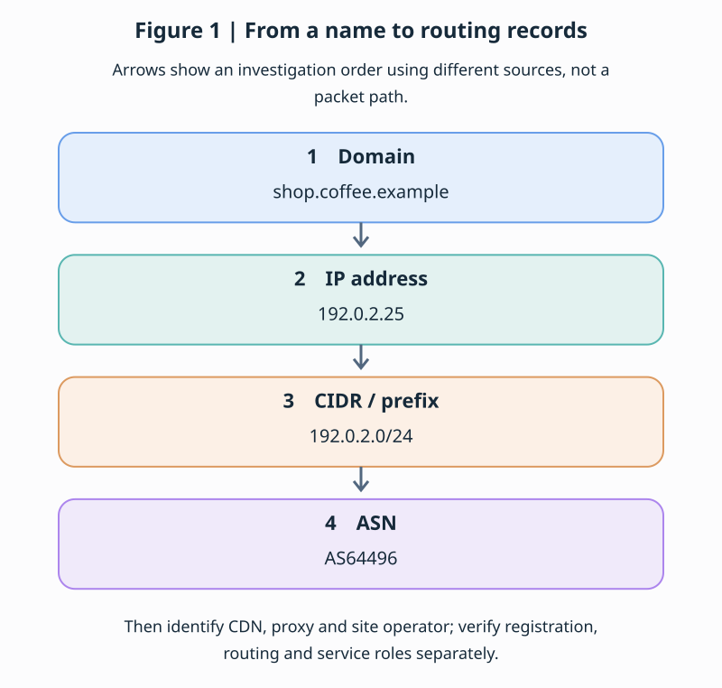
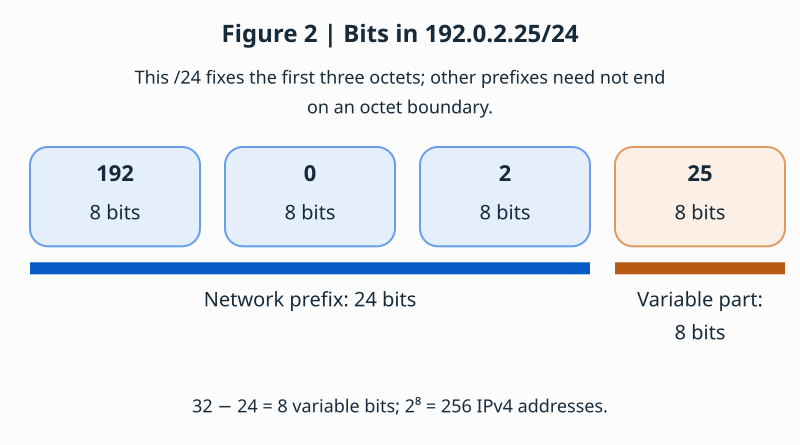
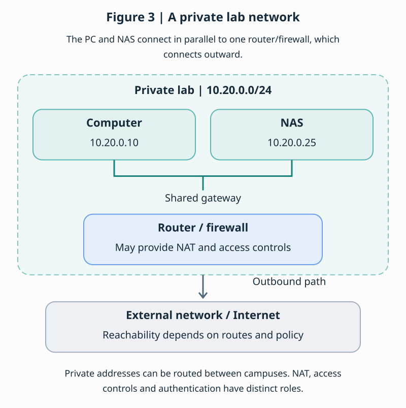
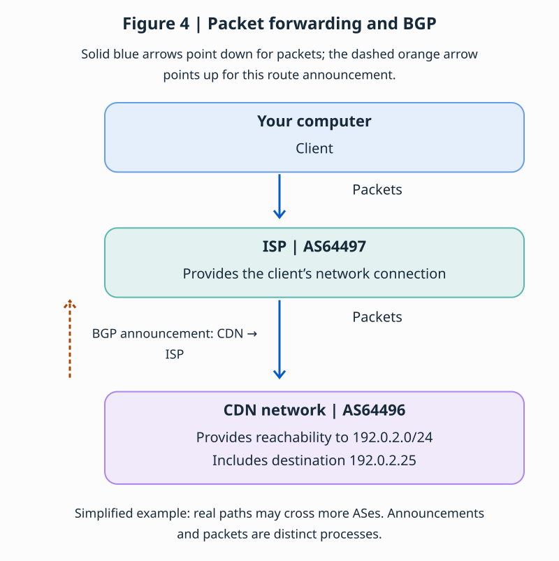
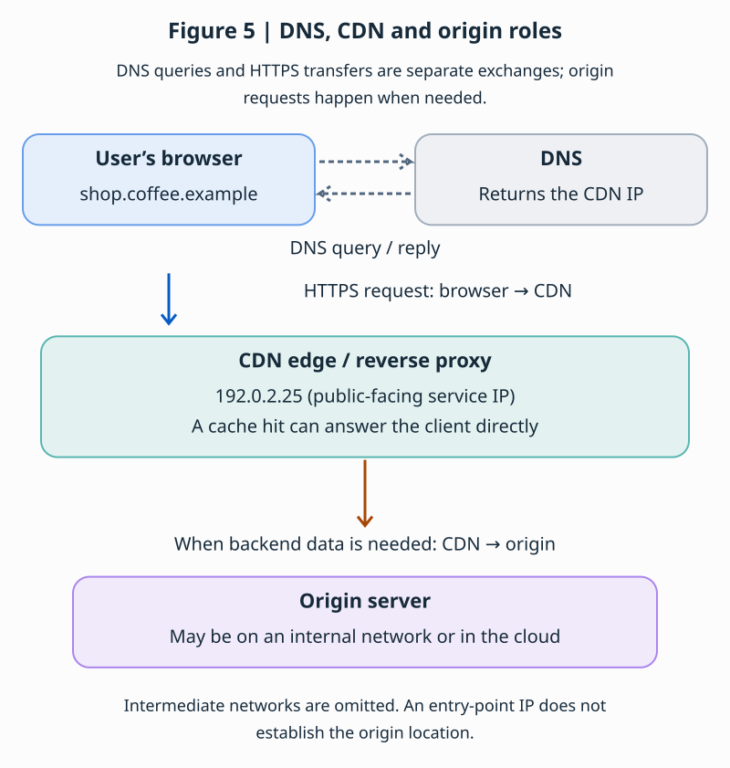
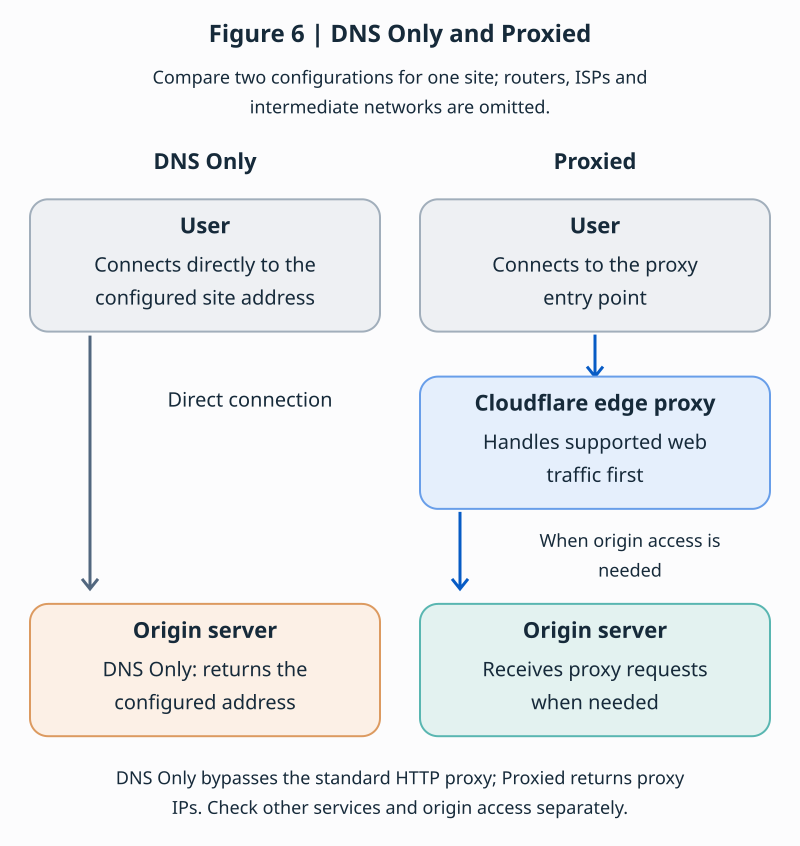
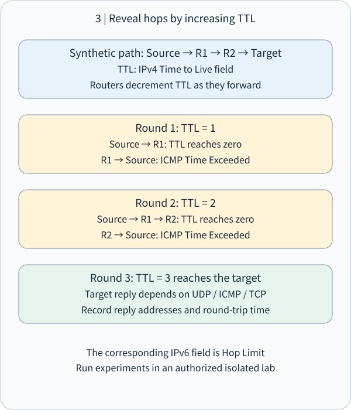
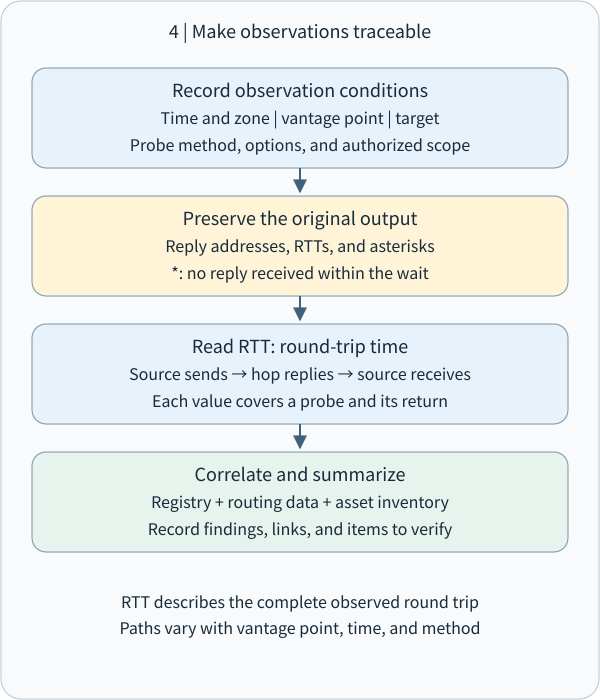

# CEH M02-06 | IP, ASN and Traceroute: Build an Evidence-Based Network Map

## 1 | The central idea

**Network footprinting connects addresses, prefixes, routing administration and path observations into a map with sources, timestamps and vantage points.** IP identifies a network destination; prefixes group addresses; an ASN identifies an autonomous routing system; traceroute reports responses to a particular sequence of probes.

Imagine investigating a coffee shop's deliveries. The shop name helps people find it, the street address guides delivery, a district groups addresses, a carrier manages routes, and tracking records describe an individual shipment. Each item contributes a different part of the picture.

This lesson follows M02-04 DNS (Domain Name System) and M02-05 email paths. We now move from names and messages to addresses and networks. Diagram addresses, ASNs and path outputs are synthetic. Optional local and public-record queries are recorded with their actual time and observation point. Active measurements belong to a separately approved, owned, isolated lab.

## 2 | IP addresses and prefixes: addresses and ranges

When you enter a website name, DNS, addresses and routing answer different questions. Use a parcel-delivery analogy to build the map, then verify each relationship.



| Concept | Analogy | Actual role |
|---|---|---|
| DNS | Address directory | Resolves domain names to IP addresses and other records |
| IP | Delivery address | Identifies network source and destination addresses |
| CIDR / prefix | Neighborhood or address range | Represents a range of IP addresses |
| AS / ASN | A delivery operator’s routing system and identifier | Identifies a network with a common external routing policy |
| BGP | Route information exchanged between operators | Exchanges network reachability information between ASes |
| CDN | Distributed delivery centers | Provides content or proxy services at edge nodes |

A website name, network address, resource registrant, routing operator and website operator may belong to different organizations. Sections 2–4 explain how to connect these roles with evidence.

### 2.1 What is an IP address, and why do computers need one?

Sending a parcel requires a destination address. Similarly, computers exchange packets using IP source and destination addresses. For example, 192.0.2.25 is an IPv4 address with four decimal octets, each from 0 to 255.

| Type | Example | Length |
|---|---|---|
| IPv4 | 192.0.2.25 | 32 bits |
| IPv6 | 2001:db8::25 | 128 bits |

A bit has two possible values, 0 and 1. An IP address is usually assigned to a network interface; it can also serve a virtual service, load balancer or shared entry point. It does not permanently identify one computer.

### 2.2 What is a subnet or network prefix?

If an IP address is a street address, a prefix describes a neighborhood. Consider three lab devices:

```text
192.0.2.10   Computer A
192.0.2.20   Computer B
192.0.2.25   Computer C
```

They share the first three octets, 192.0.2. CIDR (Classless Inter-Domain Routing) expresses a range as an address and prefix length, such as 192.0.2.0/24.



IPv4 has 32 bits; /24 fixes the first 24 as the common network prefix. This leaves 32 − 24 = 8 variable bits and 2⁸ = 256 addresses, from 192.0.2.0 through 192.0.2.255.

A conventional IPv4 /24 LAN reserves its network and broadcast addresses, commonly leaving 254 host addresses. The “subtract two” rule does not apply to every prefix or use case.

### 2.3 Why do /24, /25 and /26 describe different ranges?

| Prefix | Address range | Total addresses |
|---|---|---|
| 192.0.2.0/24 | .0 through .255 | 256 |
| 192.0.2.0/25 | .0 through .127 | 128 |
| 192.0.2.0/26 | .0 through .63 | 64 |
| 192.0.2.0/27 | .0 through .31 | 32 |

Moving from /24 to /25 fixes one additional bit, halving the range. It does not add one address. Use the simulator beneath the bit diagram to see the containing prefix for the fixed address 192.0.2.25, from /24 through /30. It displays the prefix, count and endpoints; the /24 default remains readable without JavaScript.

A prefix is a rule for describing and matching address ranges, not a physical box. Routers compare a destination with available forwarding entries. When prefixes overlap, longest-prefix matching selects the most specific matching entry. [CIDR and longest-prefix matching](https://www.rfc-editor.org/rfc/rfc4632).

### 2.4 How do private and public IP addresses differ?

Consider a lab with a computer, a NAS and a router:



10.20.0.25 is a private IPv4 address. The private ranges are 10.0.0.0/8, 172.16.0.0/12 and 192.168.0.0/16. Organizations can reuse them internally; these addresses are not routed as destinations on the global public Internet.

Private addressing does not establish safety or restrict access to the same room. Another campus can reach the NAS if inter-campus routing exists and the firewall permits it.

NAT (Network Address Translation) can let multiple internal devices communicate through fewer public addresses. Address translation does not replace firewall policy or authentication. Addresses and prefixes help define permitted sources, destinations and segmentation boundaries.

192.0.2.0/24 is reserved for documentation, not for deploying a public website. 2001:db8::/32 is the IPv6 documentation range. [Private IPv4](https://www.rfc-editor.org/rfc/rfc1918), [IPv4 documentation addresses](https://www.rfc-editor.org/rfc/rfc5737), [IPv6 documentation addresses](https://www.rfc-editor.org/rfc/rfc3849).

## 3 | ASN: who manages a common routing policy?

ASN connects an address range to external routing policy.

### 3.1 Why do we need ASNs as well as IP addresses?

A parcel sent from Taiwan to Tokyo may pass between delivery operators. Likewise, your computer can connect through an ISP, other operators’ networks and finally the destination network. Independently managed networks need a way to exchange which destinations are reachable through which neighbors.

An AS (Autonomous System) presents a common external routing policy. Its ASN (Autonomous System Number) identifies that system. AS64496 is a documentation example, not an IP address or a computer number. One AS can announce many prefixes, and one company can operate multiple ASes. [AS definition](https://www.rfc-editor.org/rfc/rfc1930), [documentation ASNs](https://www.rfc-editor.org/rfc/rfc5398).

### 3.2 How does BGP exchange reachability information?

BGP (Border Gateway Protocol) exchanges network reachability information. Suppose a CDN operates AS64496 and provides reachability to 192.0.2.0/24. It can announce that route to a neighboring AS, allowing other networks to learn a path to the prefix.



BGP exchanges route information; routers forward packets using selected forwarding entries. BGP does not ask the entire Internet for directions for every user packet. Policy, business relationships, network configuration and route attributes affect selection, so the chosen route need not be geographically shortest. [BGP specification](https://www.rfc-editor.org/rfc/rfc4271).

### 3.3 Does an ASN identify the website operator?

Consider this synthetic record:

```text
IP: 192.0.2.25
Containing prefix: 192.0.2.0/24
IP resource registrant: Example Edge
BGP origin AS: AS64496
```

It associates the prefix with Example Edge’s registration and shows AS64496 as the origin in the queried routing data. It does not establish that Example Edge operates the website. A coffee shop could operate the site while Example Edge supplies CDN, cloud or network services.

| Source | Question it answers |
|---|---|
| DNS | Which addresses or names does the domain resolve to? |
| RDAP / IP registration | Who is the IP resource registered to? |
| BGP routing data | Which origin AS is observed announcing the prefix? |
| Website and internal settings | Who operates the website and manages its backend? |

RDAP (Registration Data Access Protocol) is a standard for accessing domain, IP and ASN registration data. BGP AS_PATH is an announcement attribute, not a measured traceroute; keep these observations separate. [ARIN RDAP](https://www.arin.net/resources/registry/whois/rdap/).

## 4 | Connect DNS, IP, CDN and service roles

Why might a website’s resolved IP identify an entry point rather than its backend server?

### 4.1 Start with the website name

Suppose you visit shop.coffee.example. The browser uses DNS resolution to obtain address information. Three common record types are:

| Record | Purpose | Example |
|---|---|---|
| A | Name to IPv4 address | 192.0.2.25 |
| AAAA | Name to IPv6 address | 2001:db8::25 |
| CNAME | Name to another name | cdn.coffee.example |

If the reply is 192.0.2.25, the browser can use that destination for a subsequent connection. With a CDN, it may be an edge-service address instead of the coffee shop’s origin host.

[DNS A/CNAME](https://www.rfc-editor.org/rfc/rfc1035), [AAAA](https://www.rfc-editor.org/rfc/rfc3596).

### 4.2 What do a CDN and reverse proxy do?

A CDN (Content Delivery Network) resembles distributed delivery centers: it can cache content, reduce response latency and reduce origin load. A reverse proxy receives client requests in front of a server and determines whether to forward them to a backend.



The browser first obtains a CDN address through DNS, then sends an HTTPS request to the CDN. A cache hit can answer directly; a request needing backend data may reach the origin. The resolved address can therefore be an entry point rather than the host storing data or running the application.

### 4.3 When does Cloudflare conceal the origin address?

DNS Only: in this example DNS returns the configured origin IP, and traffic bypasses the standard Cloudflare HTTP proxy.

Proxied: DNS returns proxy IPs; supported web traffic reaches Cloudflare first and is forwarded to the origin when needed.



If an origin IP remains exposed and accepts direct external connections, a client may bypass the HTTP proxy. Review origin firewall rules, access controls and other exposure paths as well as the proxy setting.

The standard Cloudflare HTTP proxy does not automatically protect SMB or SSH. Those services need an appropriate connection design, such as a VPN or a Cloudflare Zero Trust private network with authentication and access policies. [Proxy status](https://developers.cloudflare.com/dns/proxy-status/), [origin protection](https://developers.cloudflare.com/fundamentals/security/protect-your-origin-server/).

[Cloudflare private networks](https://developers.cloudflare.com/cloudflare-one/networks/connectors/cloudflare-tunnel/private-net/).

### 4.4 Why can the same IP lead to different servers?

Anycast allows service nodes in multiple locations to announce the same IP prefix. Think of delivery offices in Taipei, Tokyo and Singapore sharing one service address: routing policy directs a connection to one location.

Two users seeing the same CDN IP need not reach the same data center. Anycast follows routing decisions and does not guarantee the geographically nearest node. Record observation time and location. [Anycast operation](https://www.rfc-editor.org/rfc/rfc4786).

[Download the six diagrams in both languages](https://learn.cs-kairos.com/downloads/ceh-m02-06-network-svg.zip).

## 5 | Traceroute: ask different hops to report

Traceroute actively sends probes with progressively larger hop allowances and organizes returned responses. A hop is a routing forwarding step. Imagine sending several test parcels: one reaches the first station, another reaches the second, and later parcels extend the observation.

IPv4 TTL (Time to Live) decreases by at least one during router forwarding. On expiration the router discards the packet and normally returns ICMP Time Exceeded. ICMP (Internet Control Message Protocol) carries network control and error information. IPv6 uses the field name Hop Limit. [IPv4 router TTL behavior](https://www.rfc-editor.org/rfc/rfc1812), [IPv6 Hop Limit](https://www.rfc-editor.org/rfc/rfc8200)

Consider a workstation → R1 → R2 → destination path. A TTL=1 probe expires at R1; TTL=2 expires at R2; TTL=3 reaches the destination and obtains the response appropriate to the probing method. Each is a newly sent probe. The tool arranges response addresses and timings into rows.

Implementations support different methods. Windows `tracert` uses ICMP Echo probes. The Linux traceroute project supports UDP, ICMP and TCP, among others; consult the installed version for defaults and options. Intermediate responses commonly use Time Exceeded. Destination detection depends on the method, such as ICMP Echo Reply or a destination Port Unreachable for traditional UDP probing. Record tool version, protocol and parameters. [Windows tracert](https://learn.microsoft.com/en-us/windows-server/administration/windows-commands/tracert), [Linux traceroute project](https://traceroute.sourceforge.net/)

RTT (Round-Trip Time), commonly expressed in milliseconds, runs from sending a probe to receiving its response. Each value includes travel toward the responding node and travel back to the observer. Interpret it as that probe's round-trip observation.



## 6 | Read a synthetic output

This is a paper exercise with startup messages omitted. Three values represent three probes using the same hop allowance.

```text
Observer: workstation in an isolated teaching network
Destination: 203.0.113.80
Time: 2026-11-01 08:00 +08:00
Method: ICMP Echo; synthetic output

hop   probe 1   probe 2   probe 3   responding address
 1      1 ms      1 ms      2 ms   10.20.0.1
 2      *         *         *      —
 3     17 ms     18 ms     16 ms   198.51.100.9
 4     21 ms     20 ms     22 ms   203.0.113.80
```

Row one records replies from `10.20.0.1`, with round trips of approximately 1–2 ms. It is a private address; the teaching topology establishes its specific role in this lab.

Row two's stars indicate that the expected responses were absent within the waiting period. Possible explanations include response filtering, rate limiting, return-path conditions or loss. Later responses remain useful observations. [Microsoft's explanation of stars](https://learn.microsoft.com/en-us/windows-server/administration/windows-commands/tracert)

Rows three and four contain intermediate and destination responses. The last row's 20–22 ms values describe this measurement's destination RTT. Repeated measurements under consistent conditions and end-to-end application monitoring can identify sustained changes.

If hop three instead reports 80 ms and the destination reports 20 ms, preserve both observations and examine response prioritization, device load, return paths and sampling differences. Router response processing affects measured values. Each hop's RTT includes its own outbound and return portions and deserves separate interpretation.

Load balancing and route changes can produce different responding addresses for probes at the same hop allowance. A single output is a snapshot; measurements from different times and locations extend the picture. RFC 2330 emphasizes explicit measurement methods, samples and uncertainty. [IP performance measurement framework](https://www.rfc-editor.org/rfc/rfc2330)

## 7 | Turn observations into defensive evidence

A practical network footprint record can contain these fields:

| Field | What to preserve |
|---|---|
| Purpose and scope | Owned-service inventory, authorized targets and methods |
| Time and vantage | Date, timezone, source network, IPv4 or IPv6 |
| Names and addresses | DNS results, resolver and query time |
| Registration and routing | RDAP source, prefix, ASN and route-data time |
| Path observation | Tool version, parameters, probe protocol, raw output |
| Service roles | Confirmed owned asset, provider edge, proxy or other role |
| Interpretation and next step | Observations, role inference and settings to verify |

For example: “At 08:00 the teaching network obtained A record192.0.2.25 for shop.coffee.example. Owned configuration identifies an edge proxy. Next, correlate its console and the asset inventory to establish backend and administrator roles.” Each statement has a source and the next action is clear.

Defenders can then ask whether public DNS points to intended services, retired addresses and vendors have been removed, administration interfaces follow planned access boundaries, and cloud, CDN, routing and application responsibilities have named owners. This connects M01 controls with later M13 server and M19 cloud responsibilities.

Active tracing follows approved targets, frequency and stop conditions. Public RDAP and previously collected routing data can be consulted as records. Traceroute sends packets into the measured path, making it an active interaction under M02-01. Share appropriately redacted extracts and retain originals under the organization's policy.



## 8 | Offline practice and knowledge checks

Use Python's standard `ipaddress` library for local range calculations. This program performs only local numeric operations:

```python
from ipaddress import ip_network, ip_address

network = ip_network("192.0.2.0/24")
address = ip_address("192.0.2.25")
print(network.num_addresses)
print(network.network_address, network.broadcast_address)
print(address in network)
```

```text
256
192.0.2.0 192.0.2.255
True
```

First predict the count; then run and compare. Change the prefix to `192.0.2.128/25` and predict membership of `.25`. Finally record the prefix, range and membership. Close the program when finished; retain or delete any saved practice file as appropriate. [Python ipaddress documentation](https://docs.python.org/3/library/ipaddress.html)

Check one: How many addresses does `192.0.2.0/24` contain? A.24; B.128; C.256; D.One.

Check two: What does an ASN identify most directly? A.An individual user; B.An autonomous routing system; C.Every webpage URL; D.A TCP port.

Check three: Hop two contains only stars, while hop four returns a destination response. Record the hop-two observation in one sentence and name one cause to investigate.

Check four: A website resolves to a cloud edge address. Which three records would you preserve to establish its relationship with your service? Include sources and timestamps.

Reference explanations accompany the website lesson. Actual learner responses can be recorded separately to guide further explanation.

The following observations apply to Ubuntu. DNS and public-record queries send external requests. Local interface output may reveal private addresses; de-identify it before sharing. These commands do not change settings or scan services. The Python calculation is offline.

### 8.1 | Query website DNS addresses

```sh
dig +short A learn.cs-kairos.com
dig +short AAAA learn.cs-kairos.com
dig +short CNAME learn.cs-kairos.com
```

The commands query IPv4, IPv6 and observable CNAME records respectively. An empty AAAA or CNAME result can reflect an absent record, flattening or proxy behavior. Remove +short to inspect status, resolver and response timing; an empty display alone does not prove absence. If dig is unavailable, begin with the offline exercise.

### 8.2 | Inspect local addresses and routes

```sh
ip -br address
ip route
```

The first command lists interface addresses; the second shows IPv4 routes. Identify private addresses such as 192.168.x.x or 10.x.x.x and the default gateway. Record actual output rather than assuming a gateway address.

### 8.3 | Parse a prefix with Python

```python
from ipaddress import ip_interface

interface = ip_interface("192.0.2.25/24")
network = interface.network
print("IP:", interface.ip)
print("Network:", network)
print("Start:", network.network_address)
print("End:", network.broadcast_address)
print("Addresses:", network.num_addresses)
```

Save as cidr.py and run python3 cidr.py. Expect IP: 192.0.2.25, Network: 192.0.2.0/24, Start: 192.0.2.0, End: 192.0.2.255 and Addresses: 256, on separate lines. Then use /30 and verify .24–.27 with four addresses. Remove cidr.py when finished if it is no longer needed.

### 8.4 | Look up ASN evidence

For a real public IP, use [RIPEstat](https://stat.ripe.net/) to inspect prefix and BGP information, and [RDAP](https://rdap.org/) or the relevant regional Internet registry to cross-check registration. These tools answer different questions; a single lookup does not establish the website operator, device location or security state.

### 8.5 | Apply the evidence to NAS access

For a lab NAS, organize the evidence into three layers. First, identify its private IP, VLAN, subnet mask, gateway and inter-subnet rules. Second, check public addressing, NAT, port forwarding, VPN and other remote-access paths. Third, connect DNS and proxy settings to actual services: identify which devices and policies protect SMB, SSH and HTTPS.

This lets you ask which source networks can reach each service and which controls actually lie on that packet path. Record reachability, service roles and control placement separately so later acceptance has specific evidence to inspect.

### 8.6 | Integrated case check

A website resolves to the documentation address 192.0.2.25, inside 192.0.2.0/24. Routing data shows origin AS64496, and its operator reports using a CDN.

Question 1: How many IPv4 addresses does /24 contain? Is 192.0.2.25 inside it?

Question 2: Does AS64496 prove that its operator also operates the website? Why?

Question 3: Does DNS pointing to a CDN reveal the actual origin IP? What further evidence is needed?

Question 4: Does Cloudflare in front of the website establish equal protection for SMB on the same host?

Write your reasoning, then open the integrated-case reference answers below. No answer is transmitted or saved as learner progress.

## 9 | What to take away

**Names connect to addresses, addresses belong to prefixes, prefixes connect to registration and routing, and measurements add observations from a particular time and vantage point.** That is the backbone of network footprinting.

Ask four questions: Which kind of data is this? Who produced it? Which time and vantage does it describe? Which setting or record will establish the relationship next? These questions make IP, ASN and traceroute evidence reproducible and clarify service responsibilities.

This lesson covers the complete compound M02-06 unit. Next, M02-07 turns to social media, people search and dark-web sources, carrying forward source, time, scope and corroboration practices.
