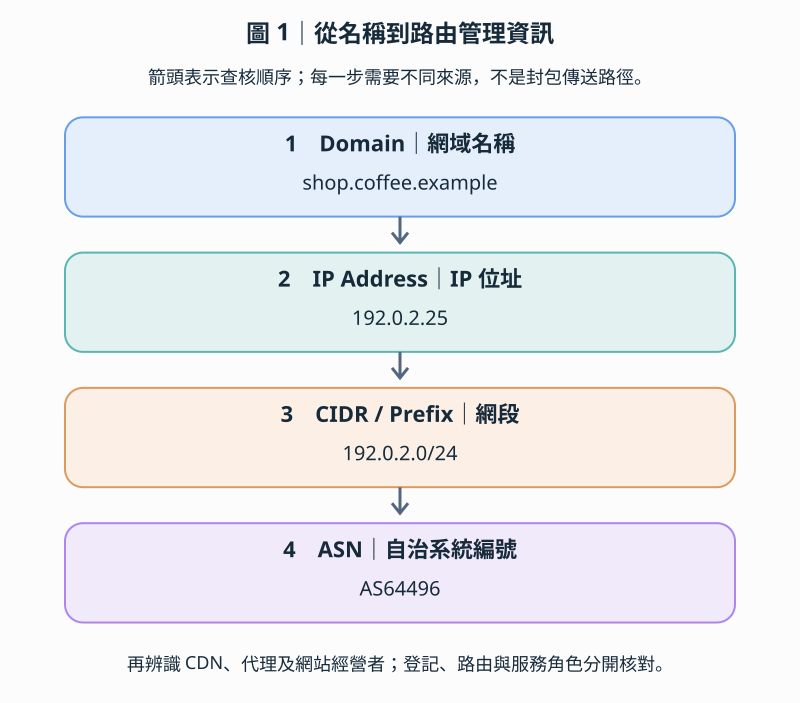
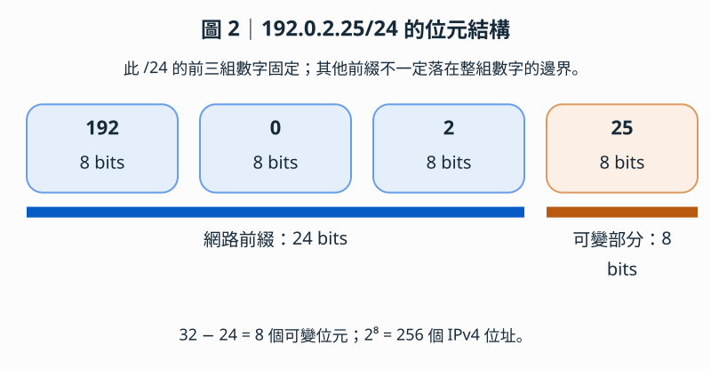
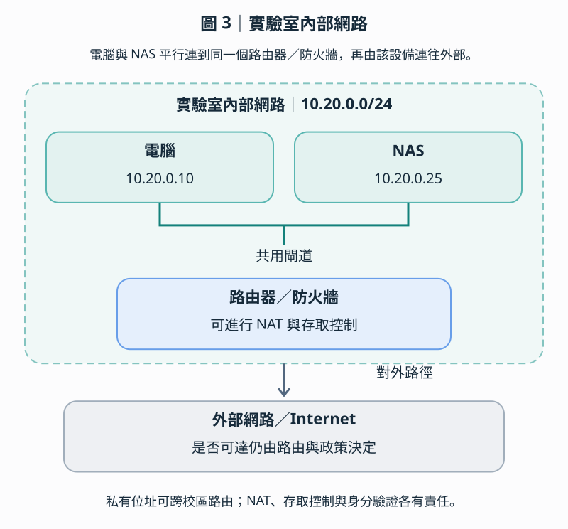
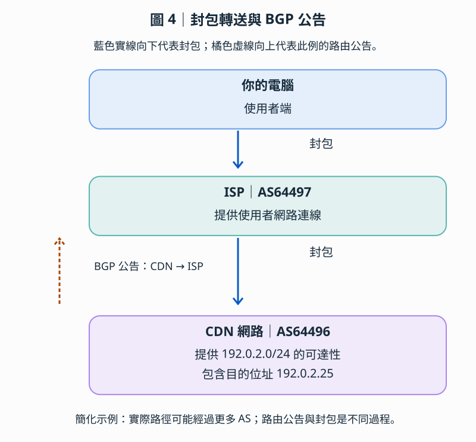
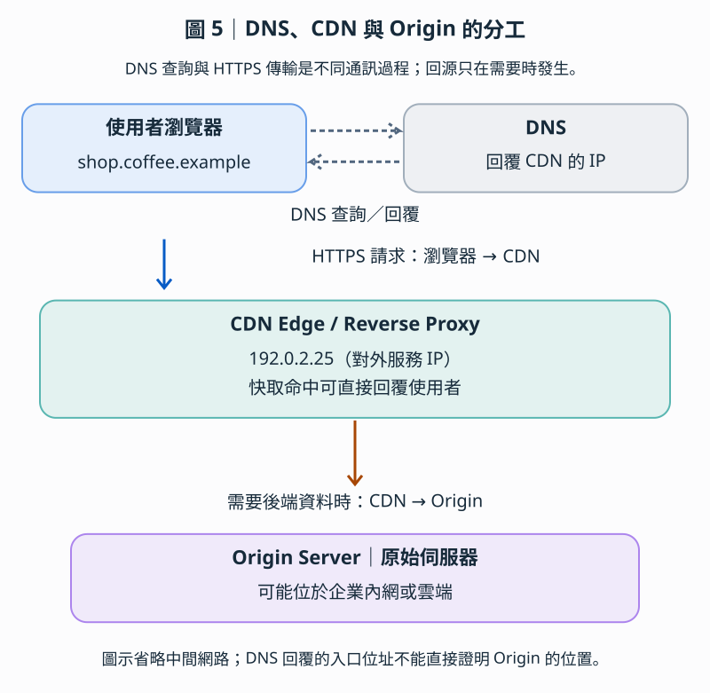
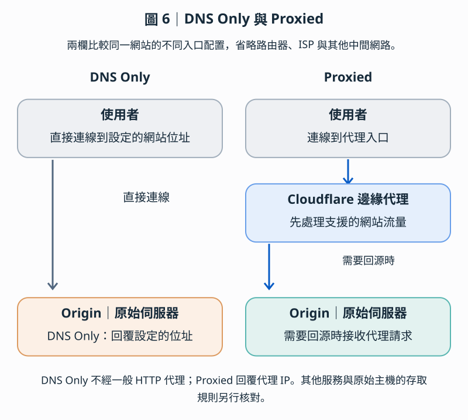
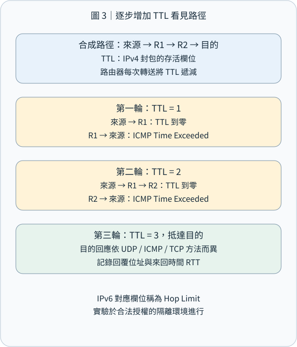
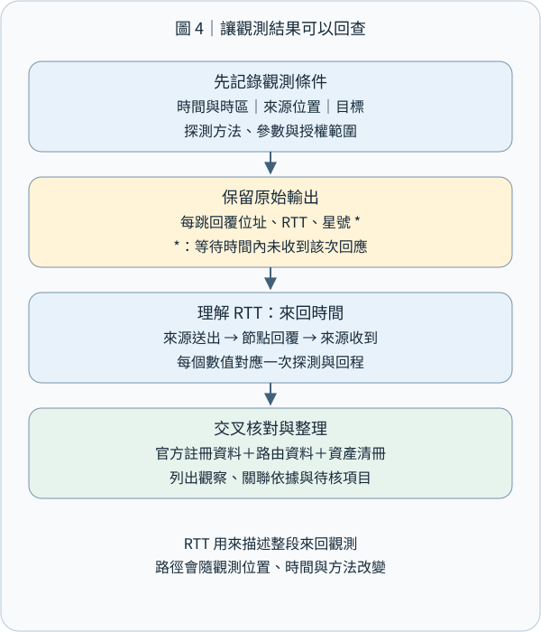

# CEH M02-06｜IP、ASN 與 Traceroute：把網路線索串成有依據的地圖

## 1｜摘要

**網路足跡蒐集（Network Footprinting）是把位址、網段、路由管理與路徑觀察連起來，建立一張附有來源、時間與觀察位置的網路地圖。** IP 告訴我們資料送往哪個網路位址；網段把位址整理成範圍；ASN 辨識路由政策的管理單位；Traceroute 呈現某次探測所收到的逐跳回覆。

想像你要了解一間咖啡店的配送：店名方便人找到它，街道地址方便配送，街區用來整理範圍，物流業者管理運送路線，配送紀錄則描述某次實際經過的節點。這五種資訊放在一起，才容易看清楚關係。

本課接續 M02-04 的 DNS（Domain Name System，網域名稱系統）與 M02-05 的郵件路徑。這次從「名字與郵件」轉向「位址與網路」。示意位址、ASN 與路徑輸出採合成教材；另列本機與公開資料查詢練習，實際結果依查詢時間與位置記錄。主動量測以另行核定的自有隔離實驗環境為範圍。

## 2｜IP 與網段：先學會看地址和範圍

當你在瀏覽器輸入網址，DNS、位址與路由各自回答不同問題。先用寄送包裹的比喻建立全圖，再逐步查核。



| 概念      | 白話比喻            | 真正的功能            |
| ------- | --------------- | ---------------- |
| DNS     | 查地址的通訊錄         | 將網域名稱解析為 IP 等紀錄  |
| IP      | 收件地址            | 指定封包要送往的網路位址     |
| CIDR／網段 | 街區或地址範圍         | 把一群 IP 位址表示成一個範圍 |
| AS／ASN  | 物流公司的路由管理體系與編號  | 識別具有共同對外路由政策的網路  |
| BGP     | 物流公司之間交換的運送路線資訊 | 讓自治系統交換網路可達性資訊   |
| CDN     | 分散各地的配送中心       | 在邊緣節點提供內容或代理服務   |

網站名稱、網路位址、位址的登記者、路由營運者和網站經營者，不一定是同一個單位。

第 2–4 節依序建立這些角色之間的關係。

### 2.1 IP 是什麼？為什麼電腦需要 IP？

想像你要寄包裹給朋友。

你需要知道朋友的收件地址，物流公司才能將包裹送到正確的位置。

網際網路也是如此。電腦彼此交換資料時，需要使用 IP 位址作為來源與目的地的識別資訊。

例如：

`192.0.2.25`

這是一個 IPv4 位址。它由四組數字組成，每組數字範圍為 0～255。

我們常見的 IP 有兩種格式：

| 類型   | 地址範例           | 長度       |
| ---- | -------------- | -------- |
| IPv4 | `192.0.2.25`   | 32 bits  |
| IPv6 | `2001:db8::25` | 128 bits |

這裡的 bit（位元）是電腦儲存資訊的最小單位之一，只有 `0` 或 `1` 兩種值。

IP 不是直接代表一台永久固定的電腦。它通常配置在網路介面上，也可能代表虛擬服務、負載平衡器或其他網路入口。

### 2.2 什麼是網段（Subnet / Network Prefix）？

如果 IP 是一個門牌地址，那麼網段就是一整個街區。

假設有三台實驗室設備：

```
192.0.2.10   電腦 A
192.0.2.20   電腦 B
192.0.2.25   電腦 C
```

它們的 IP 有共同部分：`192.0.2`。

我們可以使用 CIDR（Classless Inter-Domain Routing）來表示一段位址範圍。

例如：

`192.0.2.0/24`

這裡最難理解的是 `/24`。



IPv4 總共 32 位元，而 `/24` 表示前 24 位元用來識別共同的網路前綴。

因此：

32 − 24 = 8

剩下 8 位元可以變化。每個位元只有 0 或 1，因此總共有：

2⁸ = 256

也就是 `192.0.2.0` 到 `192.0.2.255`，總共 256 個位址。

在傳統的 IPv4 `/24` 區域網路配置中，通常會保留第一個網路位址和最後一個廣播位址，因此常見的可用主機位址數量為 254。但不是所有前綴都能直接套用「減二」規則。

### 2.3 為什麼 /24、/25、/26 的範圍不同？

請觀察以下比較。

| 網段             | IP 範圍         | 總位址數 |
| -------------- | ------------- | ---- |
| `192.0.2.0/24` | `.0` ～ `.255` | 256  |
| `192.0.2.0/25` | `.0` ～ `.127` | 128  |
| `192.0.2.0/26` | `.0` ～ `.63`  | 64   |
| `192.0.2.0/27` | `.0` ～ `.31`  | 32   |

這代表 `/25` 並不是比 `/24` 多一個 IP，而是網路前綴多固定了一個位元，讓涵蓋的位址範圍縮小一半。

你可以操作下面的模擬器，觀察同一個 `192.0.2.25` 在不同前綴下，所屬的網段如何改變。

模擬器以 192.0.2.25 為固定 IP，可選 /24 到 /30；結果顯示所屬網段、總位址數與範圍。無 JavaScript 時仍可閱讀 /24 的預設結果。

網段不是一個實體盒子，而是一套用來描述及比對 IP 範圍的規則。

路由器可以藉此判斷某個目的 IP 符合哪些路由前綴，再依路由表決定下一站。當不同路由前綴重疊時，通常先依最長前綴比對（Longest Prefix Match），選擇最精確的符合項目。

[CIDR 與最長前綴比對](https://www.rfc-editor.org/rfc/rfc4632)。

### 2.4 私有 IP 和公開 IP 有什麼不同？

假設你的實驗室裡有 NAS、電腦和路由器：



像 `10.20.0.25` 就是私有 IPv4 位址。

常見的私有 IPv4 位址範圍有：

`10.0.0.0/8`、`172.16.0.0/12`、`192.168.0.0/16`。

這些位址可以在不同組織的內部網路重複使用，不會直接在全球公開網際網路上被當作目的地路由。

私有 IP 不代表安全，也不代表只有同一個房間才能存取。

例如，位於其他校區的電腦，如果校園網路有建立適當的路由，而且防火牆允許，仍然可能存取你的 NAS。

NAT（Network Address Translation，網路位址轉換）則可以讓多台內部設備透過較少的公開 IP 對外通訊。它是一種位址轉換機制，不能單獨取代防火牆與身分驗證。

因此，在資安管理上，IP 和網段讓我們有能力精確定義：哪些來源可以連線、哪些目的地允許存取，以及不同網段之間是否需要隔離。

本節使用的 `192.0.2.0/24` 是文件保留位址，用於教學；不是可直接拿來部署公開網站的位址範圍。

[私有 IPv4](https://www.rfc-editor.org/rfc/rfc1918)、[IPv4 文件位址](https://www.rfc-editor.org/rfc/rfc5737)、[IPv6 文件位址](https://www.rfc-editor.org/rfc/rfc3849)。

## 3｜ASN：誰管理這一組路由政策？

ASN 把前面的位址範圍連到對外路由政策。

### 3.1 為什麼有 IP 還需要 ASN？

假設你知道朋友的住址在日本東京。

你要從台灣寄一個包裹過去，光是知道目的地地址還不夠。包裹需要由不同的物流業者接力運送。

網際網路同樣如此。

你的電腦可能先連上中華電信或其他網路供應商，再經過其他業者管理的網路，最終到達網站所在的網路。

但這裡存在一個問題：

這些網路由不同組織管理，大家要怎麼協調哪些目的地可以經由誰抵達？

因此，我們需要了解兩個概念：

- AS（Autonomous System，自治系統）：在對外路由上呈現一致政策的網路體系。
- ASN（Autonomous System Number，自治系統編號）：識別這個自治系統的號碼。

例如 `AS64496` 是教材用的示例編號，不是 IP，也不是電腦編號。

一個 AS 可以管理或宣告許多不同的網段；同一家公司也可能營運多個 AS。

[AS 定義](https://www.rfc-editor.org/rfc/rfc1930)、[文件用 ASN](https://www.rfc-editor.org/rfc/rfc5398)。

### 3.2 什麼是 BGP？不同 AS 如何交換路由資訊？

BGP（Border Gateway Protocol，邊界閘道協定）可以理解成不同網路營運者之間交換的「可達目的地資訊」。

假設 CDN 業者營運 `AS64496`，其網路可以提供 `192.0.2.0/24` 這個目的位址範圍的連線服務。

它會透過 BGP 向相鄰的 AS 宣告相關路由資訊，讓其他網路知道如何到達這個前綴。



BGP 負責交換路由資訊；路由器則依照選定的路由資訊轉送實際封包。

BGP 不會替每一個使用者封包重新向全世界詢問一次怎麼走。它維護和交換路由資訊，讓路由設備能建立可用的轉送決策。

而且 BGP 選路也不一定是物理距離最短的路線。商業關係、路由政策、網路配置和其他屬性都可能影響選擇。

[BGP 規範](https://www.rfc-editor.org/rfc/rfc4271)。

### 3.3 查到 ASN，就知道網站是誰的嗎？

不一定。這是 CEH 網路足跡蒐集裡非常容易誤判的地方。

假設我們得到：

```
IP：192.0.2.25
所屬前綴：192.0.2.0/24
IP 網段登記者：Example Edge
BGP Origin AS：AS64496
```

我們可以合理地說，資料顯示這個網段與 Example Edge 的登記資料有關，而且在所查詢的路由資料中，`AS64496` 是它的起源自治系統（Origin AS）。

但我們還不能因此斷定 Example Edge 就是網站經營者。

因為使用這個 IP 的網站可能是某間咖啡店，而 Example Edge 只是它所使用的 CDN、雲端或網路服務供應商。

實務上必須把幾種證據分開：

| 資料來源         | 可以回答的問題           |
| ------------ | ----------------- |
| DNS          | 網域目前解析到哪些位址或名稱？   |
| RDAP／IP 登記資料 | IP 資源登記給誰？        |
| BGP 路由資料     | 哪個 AS 正在宣告這個網路前綴？ |
| 網站與組織內部設定    | 誰實際經營網站、管理後端服務？   |

RDAP（Registration Data Access Protocol）是查詢網域、IP 與 ASN 等登記資料的重要標準之一。

至於 BGP 的 `AS_PATH`，則是公告中的路由屬性，不是 Traceroute 實測結果；不能直接把兩者視為相同的網路行經紀錄。

[ARIN RDAP](https://www.arin.net/resources/registry/whois/rdap/)。

## 4｜把 DNS、IP、CDN 與服務角色連起來

這一節要回答的問題是：

當你查到一個網站的 IP，為什麼這個 IP 有時候不是網站真正的伺服器？

### 4.1 從你輸入網址開始

假設你要進入一家咖啡店網站：

`shop.coffee.example`

第一步，瀏覽器需要知道這個網域所對應的 IP。

因此，它會透過 DNS 解析機制取得資料。

這裡最常見的三種 DNS 紀錄是：

| DNS 紀錄 | 用途        | 示意                   |
| ------ | --------- | -------------------- |
| A      | 名稱對應 IPv4 | `192.0.2.25`         |
| AAAA   | 名稱對應 IPv6 | `2001:db8::25`       |
| CNAME  | 名稱指向另一個名稱 | `cdn.coffee.example` |

如果 DNS 回覆 `192.0.2.25`，你的瀏覽器便可以使用這個目的位址建立後續連線。

但如果咖啡店有使用 CDN，這個 IP 可能其實屬於 CDN 的邊緣服務節點，而不是咖啡店真正的主機。

[DNS A／CNAME](https://www.rfc-editor.org/rfc/rfc1035)、[AAAA](https://www.rfc-editor.org/rfc/rfc3596)。

### 4.2 CDN 與 Reverse Proxy 到底在做什麼？

CDN（Content Delivery Network，內容傳遞網路）可以想成分散在各地的配送中心。它可以快取網站內容、降低回應延遲，並減輕原始伺服器的負載。

Reverse Proxy（反向代理）則像站在伺服器前面的接待櫃檯：由它先接收訪客的請求，再決定是否轉送後端。



當你透過 CDN 訪問網站時，可能發生以下情況：

瀏覽器先透過 DNS 取得 CDN 的 IP，之後向 CDN 發送 HTTPS 請求。

如果 CDN 已經快取了所需內容，它可以直接回覆；如果需要動態資料，便可能向原始伺服器（Origin Server）取得內容。

因此，DNS 回覆的 IP 可以是服務入口，而不是最終儲存資料或執行應用程式的主機。

### 4.3 為什麼 Cloudflare 有時能隱藏原始 IP，有時不能？

這裡用 Cloudflare 的兩種設定作比較。

DNS Only

在此示例，DNS 回覆設定的 Origin IP；流量不經一般的 Cloudflare HTTP 代理。

Proxied

DNS 對外回覆代理 IP；支援的網站流量先經 Cloudflare，必要時才轉送 Origin。



這項差異也影響 Origin 的存取控制。

如果使用 Cloudflare 的 HTTP 反向代理，但原始伺服器的 IP 仍然公開、而且可以從外部直接連線，攻擊者可能繞過 Cloudflare，直接攻擊 Origin。

所以除了代理設定，還必須考慮 Origin 的防火牆、存取控制及其他暴露途徑。

另外，一般 Cloudflare HTTP Proxy 不會自動保護 SMB、SSH 等非 HTTP 服務。這類服務需要考慮不同的安全連線方案，例如具備身分驗證與存取政策的 VPN 或 Cloudflare Zero Trust 私有網路。

[Cloudflare 代理狀態](https://developers.cloudflare.com/dns/proxy-status/)、[Origin 保護](https://developers.cloudflare.com/fundamentals/security/protect-your-origin-server/)。

[Cloudflare 私有網路](https://developers.cloudflare.com/cloudflare-one/networks/connectors/cloudflare-tunnel/private-net/)。

### 4.4 同一個 IP，為什麼不同地方會連到不同伺服器？

這與 Anycast（任播）有關。

想像一家物流公司，在台北、東京和新加坡各設立一個服務據點，但是對外使用同一個服務地址。

網際網路中的 Anycast 允許多個不同位置的服務節點宣告同一個 IP 前綴，使連線可以依當下路由政策被送往其中一個位置。

因此，即使兩個人查到完全相同的 CDN IP，也不代表兩個人的封包必然抵達同一棟資料中心。

必須注意：Anycast 並不保證送到地理距離最近的節點，而是依網路路由決策選擇可達路徑。

[任播服務運作](https://www.rfc-editor.org/rfc/rfc4786)。

[下載這六張圖的中英 SVG](https://learn.cs-kairos.com/downloads/ceh-m02-06-network-svg.zip)。

## 5｜Traceroute 原理：讓封包在不同站回報

Traceroute（路徑追蹤）會主動送出探測封包，逐步增加它能經過的跳數，藉回覆整理沿途節點。Hop（一跳）可以先理解為一次路由轉送。把它想成寄出多個測試包裹：第一個請第一站回報，第二個走到第二站再回報，逐步延伸。

IPv4 標頭裡的 TTL（Time to Live，存活時間）在路由轉送時至少減少 1；歸零時，路由器丟棄該封包，通常送回 ICMP Time Exceeded。ICMP（Internet Control Message Protocol，網際網路控制訊息協定）用來回報網路控制與錯誤資訊。IPv6 對應欄位稱為 Hop Limit（跳數限制）。[IPv4 路由器 TTL 規則](https://www.rfc-editor.org/rfc/rfc1812)、[IPv6 Hop Limit](https://www.rfc-editor.org/rfc/rfc8200)

假設路徑是「電腦 → R1 → R2 → 目的主機」：TTL=1 的探測在 R1 到期，R1 回覆；TTL=2 的探測在 R2 到期，R2 回覆；TTL=3 的探測到達目的主機，依探測方式取得終點回覆。工具把各次收到的來源位址與時間排成清單。這裡每次都是新的探測封包。

不同實作可以使用不同探測方式。Windows 的 `tracert` 使用 ICMP Echo 探測；Linux 的 traceroute 實作可支援 UDP、ICMP、TCP 等方式，實際預設與選項以安裝版本的說明為準。中間節點常見的回報是 Time Exceeded；終點判定則依探測方式，例如 ICMP Echo Reply，或傳統 UDP 探測收到目的端的 Port Unreachable。測試紀錄應寫明工具、版本、探測協定與參數。[Windows tracert](https://learn.microsoft.com/en-us/windows-server/administration/windows-commands/tracert)、[Linux traceroute 專案](https://traceroute.sourceforge.net/)

RTT（Round-Trip Time，往返時間）從送出探測算到收到回覆，通常以毫秒 ms 表示。每一列的時間包含探測前往回覆節點，以及回覆回到觀察端的過程；解讀時將它視為「這次探測的往返時間」。



## 6｜實際讀一段合成輸出

以下是紙上教材，省略工具啟動訊息；三個數值代表同一跳數的三次探測。

```text
觀察端：隔離教學網路的工作站
目的地：203.0.113.80
時間：2026-11-01 08:00 +08:00
方式：ICMP Echo，合成輸出

hop   probe 1   probe 2   probe 3   responding address
 1      1 ms      1 ms      2 ms   10.20.0.1
 2      *         *         *      —
 3     17 ms     18 ms     16 ms   198.51.100.9
 4     21 ms     20 ms     22 ms   203.0.113.80
```

第一列：跳數 1 的探測取得 `10.20.0.1` 回覆，三次往返時間約 1–2 ms。這是一個私有位址，結合教學拓撲可確認它在這個實驗中的角色。

第二列：星號代表對應探測在等待時間內沒有收到預期回覆。原因可包含回覆過濾、速率限制、回程狀況或封包遺失；後續有回覆時，可以繼續整理後面的觀察結果。[tracert 對星號的說明](https://learn.microsoft.com/en-us/windows-server/administration/windows-commands/tracert)

第三列與第四列：探測分別收到中間節點與終點回覆。第四列這三次往返約 20–22 ms，適合記為本次量測的終點 RTT。比較效能時，可用一致條件重複量測，結合端到端應用程式監測，觀察是否有持續變化。

若第三跳是 80 ms、第四跳反而只有 20 ms，可先把這兩組實測值保留，再確認中間設備回應探測的優先序、負載、回程與取樣差異。路由器處理回覆的方式會影響數值；每一跳的 RTT 也各自包含往返路徑，適合分別分析。

負載平衡與路由變動，可能讓同一跳數的多次探測收到不同位址。單次輸出是一份觀察快照；串聯不同時間與位置的紀錄，可以得到更完整的網路輪廓。RFC 2330 的網路量測框架，也強調量測方法、樣本與不確定性的清楚定義。[網路效能量測框架](https://www.rfc-editor.org/rfc/rfc2330)

## 7｜把線索整理成可用的防護證據

一份網路足跡紀錄可以有以下欄位：

| 欄位 | 這次要保存的內容 |
|---|---|
| 目的與範圍 | 自家服務盤點、授權目標與允許的方法 |
| 時間與觀察端 | 日期、時區、來源網路、IPv4／IPv6 |
| 名稱與位址 | DNS 查詢結果、解析器與查詢時間 |
| 登記與路由 | RDAP 來源、前綴、ASN、路由資料時間 |
| 路徑觀察 | 工具版本、參數、探測協定、原始輸出 |
| 服務角色 | 自家資產、供應商邊緣、代理或其他已確認角色 |
| 判讀與下一步 | 已觀察事實、角色推論、需要補核的設定 |

例如可以寫：「08:00 從教學網路取得 shop.coffee.example 的 A 紀錄192.0.2.25；自家設定顯示使用邊緣代理，後續對照代理控制台與資產清單，確認後端服務及管理者。」每一句都能找到來源，也讓下一步明確。

防守方可以利用這張圖檢查：公開 DNS 是否仍指向預期服務？停用的位址與供應商是否已從設定移除？管理入口是否放在規劃的存取邊界？雲端、CDN、路由與應用程式各由誰負責？再把答案接到 M01 的安全控制，以及後續 M13、M19 的伺服器與雲端責任。

主動追蹤路徑需要遵循核定目標、探測頻率與停止條件。公開 RDAP 或既有路由資料可先作資料查詢；Traceroute 的封包會實際進入量測路徑，屬於 M02-01 的主動互動。完成紀錄後，分享去識別化節錄，原始資料依組織規則保存。



## 8｜離線練習與小檢核

先用本機 Python 標準函式庫 `ipaddress` 計算範圍。這段程式只做本機數值運算：

```python
from ipaddress import ip_network, ip_address

network = ip_network("192.0.2.0/24")
address = ip_address("192.0.2.25")
print(network.num_addresses)
print(network.network_address, network.broadcast_address)
print(address in network)
```

```text
256
192.0.2.0 192.0.2.255
True
```

練習步驟：先預測位址數；執行程式比對；把前綴改成 `192.0.2.128/25`，再預測 `.25` 的歸屬；最後整理一行「前綴、範圍、是否包含該位址」。完成後可關閉程式，若另存測試檔則自行保留或刪除。[Python ipaddress 官方文件](https://docs.python.org/3/library/ipaddress.html)

小檢核一：`192.0.2.0/24` 有幾個位址？A.24；B.128；C.256；D.只有一個。

小檢核二：ASN 最直接識別哪個角色？A.單一使用者；B.路由政策的自主系統；C.每個網頁網址；D.單一 TCP 連接埠。

小檢核三：第二跳全是星號，第四跳收到終點回覆。請用一句話記錄第二跳觀察，再列出一項可進一步查核的原因。

小檢核四：某個網站解析到雲端邊緣 IP。你會保留哪三項資料，來確認它和自家服務的關係？請把資料來源與時間一起寫出來。

參考解析隨網站教材提供；你的作答可另外留下，方便依理解程度接續補充。

以下觀察適用 Ubuntu。DNS 與公開資料查詢會對外送出請求；本機介面資訊可能包含私人位址，分享前先去識別化。這些指令不修改設定，不執行服務掃描；離線 Python 範例不需連線。

### 8.1｜查詢網站的 DNS 位址

```
dig +short A learn.cs-kairos.com
dig +short AAAA learn.cs-kairos.com
dig +short CNAME learn.cs-kairos.com
```

第一行查詢 IPv4；第二行查詢 IPv6；第三行查詢是否能觀察到 CNAME。

若沒有取得 AAAA 或 CNAME，不一定是錯誤，也可能沒有這類紀錄、名稱被展平，或代理機制改變回覆。需要判讀狀態時移除 +short，檢查狀態碼、解析器與回覆時間；不要把空白輸出直接當作不存在。若沒有 dig，可先完成離線練習。

### 8.2｜觀察自己電腦的 IP 和路由

```
ip -br address
ip route
```

第一個指令顯示本機網路介面的位址；第二個顯示 IPv4 路由資訊。

可以觀察自己的電腦是否使用 `192.168.x.x` 或 `10.x.x.x` 這類私有位址，以及預設路由指向哪個閘道器。

### 8.3｜用 Python 解析網段

```
from ipaddress import ip_interface

interface = ip_interface("192.0.2.25/24")
network = interface.network
print("IP:", interface.ip)
print("Network:", network)
print("Start:", network.network_address)
print("End:", network.broadcast_address)
print("Addresses:", network.num_addresses)
```

將程式存成 cidr.py，執行 python3 cidr.py。預期依序輸出 IP: 192.0.2.25、Network: 192.0.2.0/24、Start: 192.0.2.0、End: 192.0.2.255、Addresses: 256。再改成 /30，核對範圍 .24–.27 與總數 4；完成後可刪除 cidr.py。

### 8.4｜進一步查詢 ASN

取得某個公開 IP 後，可以使用 [RIPEstat](https://stat.ripe.net/) 觀察其網路前綴與 BGP 相關資訊，再利用 [RDAP 查詢入口](https://rdap.org/) 或適當的區域網際網路註冊管理機構，交叉核對登記資料。

這些工具回答的是不同層次的問題，不應只靠單一查詢就認定網站真正的經營者、設備所在位置或安全狀態。

### 8.5｜把線索用在 NAS 存取判斷

如果日後你要檢查一台實驗室 NAS，可以沿用這次學到的架構：

網路資產與暴露面分析

第一層｜設備與網段

確認 NAS 的私有 IP、所在 VLAN、子網路遮罩、閘道器與跨網段存取規則。

第二層｜外部路由與服務入口

確認是否有公開 IP、NAT、連接埠轉送、VPN 或其他遠端存取路徑。

第三層｜DNS、代理與實際服務

查明網域是否經 CDN 或反向代理，以及 SMB、SSH、HTTPS 分別由哪些設備與政策保護。

這時候你就不會只問「NAS 有沒有公開 IP」，而能進一步判斷：哪些來源網路能夠抵達它、有哪些服務可被連線、哪些安全控制真正位在封包路徑上。

把可達性、服務與控制位置分開記錄，能讓後續驗收找到對應證據。

### 8.6｜整合案例理解檢核

假設某網站的 DNS 顯示 `192.0.2.25`（教材示例），所屬前綴為 `192.0.2.0/24`，路由資料顯示 Origin AS64496。網站負責人告訴你，他們有使用 CDN。

問題 1

這個 /24 前綴包含多少個 IPv4 位址？192.0.2.25 是否在範圍內？

問題 2

AS64496 能證明網站經營者就是這個自治系統的管理者嗎？為什麼？

問題 3

如果 DNS 指向 CDN，能否直接得知真正的 Origin Server IP？還需要哪些證據？

問題 4

如果網站前面有 Cloudflare，能否推論同一台主機的 SMB 服務也受到相同的保護？

先寫下判斷，再展開下方「整合案例」參考解答；答案不會傳送或寫入學習進度。

## 9｜今天帶走的觀念

**名字連到位址，位址放進網段，網段連到登記與路由，路徑量測再補上特定時間與位置的觀察。** 這就是網路足跡的基本骨架。

讀圖時記住四個問題：我查的是哪種資料？誰產生它？它描述哪個時間與位置？接下來用哪項設定或紀錄確認關係？這套方法讓 IP、ASN 與 Traceroute 成為可重現的證據，而每個服務角色也有清楚的責任對應。

本課完整涵蓋新路線 M02-06 複合單元；下一課 M02-07 轉向社群媒體、人員搜尋與暗網來源，沿用來源、時間、範圍與交叉查核的整理方式。
