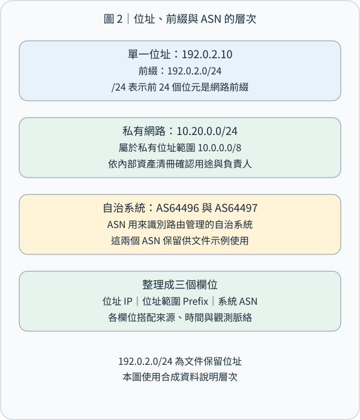
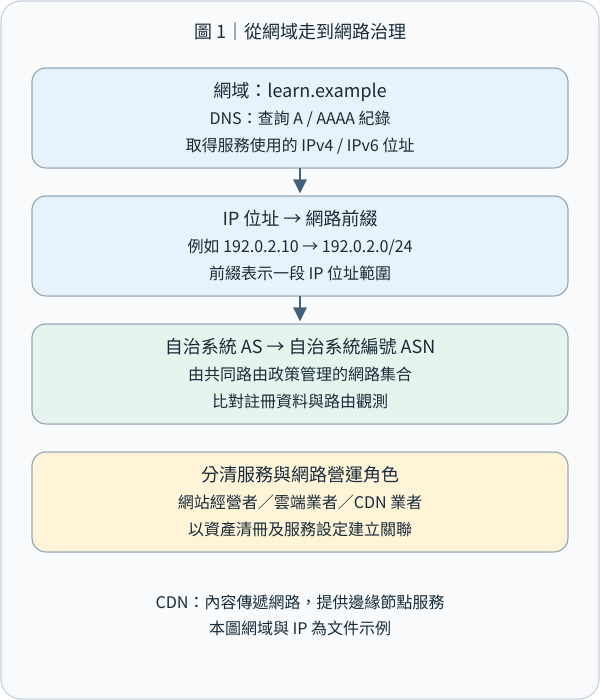

# CEH M02-06｜IP、ASN 與 Traceroute：把網路線索串成有依據的地圖

## 1｜先記住這個結論

**網路足跡蒐集（Network Footprinting）是把位址、網段、路由管理與路徑觀察連起來，建立一張附有來源、時間與觀察位置的網路地圖。** IP 告訴我們資料送往哪個網路位址；網段把位址整理成範圍；ASN 辨識路由政策的管理單位；Traceroute 呈現某次探測所收到的逐跳回覆。

想像你要了解一間咖啡店的配送：店名方便人找到它，街道地址方便配送，街區用來整理範圍，物流業者管理運送路線，配送紀錄則描述某次實際經過的節點。這五種資訊放在一起，才容易看清楚關係。

本課接續 M02-04 的 DNS（Domain Name System，網域名稱系統）與 M02-05 的郵件路徑。這次從「名字與郵件」轉向「位址與網路」。所有位址、ASN、網域與輸出都是合成教材；練習採離線判讀與本機計算。主動量測以另行核定的自有隔離實驗環境為範圍。

## 2｜IP 與網段：先學會看地址和範圍

IP（Internet Protocol，網際網路協定）負責以來源與目的位址傳送資料。資料在網路上被裝成 Packet（封包）；Router（路由器）依路由資訊，把封包送向下一站。網路位址可以配置給介面，服務也可以透過共享或虛擬位址對外提供。

IPv4 位址長度是 32 位元，常寫成四段十進位數字，例如 `192.0.2.25`。IPv6 使用 128 位元，例如 `2001:db8::25`；雙冒號表示一段連續的零。同一個網站可以同時提供 IPv4 與 IPv6，分析時分開保存兩組結果。[IPv4 規範](https://www.rfc-editor.org/rfc/rfc791)、[IPv6 規範](https://www.rfc-editor.org/rfc/rfc8200)

CIDR（Classless Inter-Domain Routing，無類別網域間路由）用「位址／前綴長度」表示網段。`192.0.2.0/24` 的 `/24` 表示前 24 位元是共同前綴，剩餘 8 位元形成 `2^8 = 256` 個位址，範圍從 `192.0.2.0` 到 `192.0.2.255`。這裡計算的是整個位址範圍；實際可配置給設備的數量，再依子網用途與配置規則判斷。[CIDR 規範](https://www.rfc-editor.org/rfc/rfc4632)

同樣方法，IPv4 `/25` 留下 7 位元，有 128 個位址；`/24` 留下 8 位元，有 256 個位址。前綴長度越大，指定的範圍越小。把它想成地址寫得越精細，涵蓋的街區就越小。

| 資訊 | 合成例子 | 讀法 |
|---|---|---|
| 單一位址 | 192.0.2.25 | 一個網路位址 |
| 網路前綴 | 192.0.2.0/24 | 包含這個位址的一段範圍 |
| 私有網路 | 10.20.0.0/24 | 組織內部可配置的一段私有位址 |
| IPv6 文件位址 | 2001:db8::25 | 供教材使用的 IPv6 位址 |

RFC 1918 的私有 IPv4 範圍是 `10.0.0.0/8`、`172.16.0.0/12`、`192.168.0.0/16`，不同組織可各自使用。NAT（Network Address Translation，網路位址轉換）讓內外部位址之間建立轉換關係；多人或多台設備可能共用對外位址。實務追查會把外部 IP、精確時間、連接埠與相關系統紀錄一起比對。[私有位址](https://www.rfc-editor.org/rfc/rfc1918)、[傳統 NAT](https://www.rfc-editor.org/rfc/rfc3022)

本課的 `192.0.2.0/24`、`198.51.100.0/24`、`203.0.113.0/24` 是文件示例範圍，`2001:db8::/32` 是 IPv6 文件範圍，適合用於說明與離線計算。[IPv4 文件位址](https://www.rfc-editor.org/rfc/rfc5737)、[IPv6 文件位址](https://www.rfc-editor.org/rfc/rfc3849)



## 3｜ASN：誰管理這一組路由政策？

AS（Autonomous System，自主系統）是一組對外呈現一致路由政策的網路；ASN（Autonomous System Number，自主系統號碼）是它的識別號碼，例如教材中的 `AS64496`。可以把 AS 想成有自己運送規則的物流體系，ASN 就是體系的識別編號。[AS 定義](https://www.rfc-editor.org/rfc/rfc1930)

ISP（Internet Service Provider，網際網路服務供應商）、雲端平台、大型企業或學術網路，都可能營運 AS。一個 AS 可以宣告多個網路前綴；同一組織也可能管理多個 AS。ASN 與 IP 位址各有角色：前者辨識路由管理，後者供封包定址。

不同 AS 之間透過 BGP（Border Gateway Protocol，邊界閘道協定）交換可到達哪些前綴的資訊。BGP 的 AS_PATH 是路由公告中的 AS 路徑屬性；Traceroute 則透過探測封包的回覆觀察路徑。把兩種資料分欄保存，就能分別理解「路由公告」與「某次量測」。[BGP 規範](https://www.rfc-editor.org/rfc/rfc4271)

查網路資源時，可使用 RIR（Regional Internet Registry，區域網際網路註冊管理機構）提供的 RDAP（Registration Data Access Protocol，註冊資料存取協定）查詢。RDAP 可以提供 IP 網段、ASN、登記組織、聯絡角色與更新資訊；實際欄位依資料庫而定。[ARIN 的 RDAP 說明](https://www.arin.net/resources/registry/whois/rdap/)

例如合成紀錄顯示：`192.0.2.0/24` 登記給 Example Edge，路由資料將該前綴關聯到 AS64496。報告可以分別寫「登記組織」與「觀察到的路由起源 AS」，再用服務合約、雲端控制台與資產清單確認組織自己的服務關係。教材採用的 AS64496、AS64497 屬於文件示例保留範圍。[文件用 ASN](https://www.rfc-editor.org/rfc/rfc5398)

## 4｜把 DNS、IP、CDN 與服務角色連起來

延續咖啡店案例，假設已取得以下合成資料：

```text
取得時間：2026-11-01 08:00 +08:00
DNS：shop.coffee.example A 192.0.2.25
資源登記：192.0.2.0/24 → Example Edge
路由資料：192.0.2.0/24 → origin AS64496
自家服務設定：shop.coffee.example 使用邊緣代理
```

DNS 的 A 紀錄連到 IPv4；AAAA 紀錄連到 IPv6。這份資料把網站名稱連到邊緣服務位址，再連到網段與路由資訊。CDN（Content Delivery Network，內容傳遞網路）可以讓多個邊緣節點提供內容；Reverse Proxy（反向代理）則在用戶端與後端服務之間接收、轉送請求。對外解析位址可能對應這些服務節點。[Cloudflare 代理 DNS 的運作](https://developers.cloudflare.com/dns/proxy-status/)

整理時，請分清楚四個角色：網域的管理者、IP 資源的登記者、提供路由的網路、實際營運應用程式的人。雲端共享環境中，這些角色可能由不同單位負責。接續的查核工作，就是用各角色的官方或自家紀錄建立連結。

同一網站也可能因觀察地點、時間、IPv4／IPv6、負載平衡而得到不同位址。Anycast（任播）讓同一位址可由多個位置提供服務，網路路由會把流量引向其中的節點。紀錄「從哪裡、何時看到什麼」，就能保留量測的實際意義。[任播服務運作](https://www.rfc-editor.org/rfc/rfc4786)



## 5｜Traceroute 原理：讓封包在不同站回報

Traceroute（路徑追蹤）會主動送出探測封包，逐步增加它能經過的跳數，藉回覆整理沿途節點。Hop（一跳）可以先理解為一次路由轉送。把它想成寄出多個測試包裹：第一個請第一站回報，第二個走到第二站再回報，逐步延伸。

IPv4 標頭裡的 TTL（Time to Live，存活時間）在路由轉送時至少減少 1；歸零時，路由器丟棄該封包，通常送回 ICMP Time Exceeded。ICMP（Internet Control Message Protocol，網際網路控制訊息協定）用來回報網路控制與錯誤資訊。IPv6 對應欄位稱為 Hop Limit（跳數限制）。[IPv4 路由器 TTL 規則](https://www.rfc-editor.org/rfc/rfc1812)、[IPv6 Hop Limit](https://www.rfc-editor.org/rfc/rfc8200)

假設路徑是「電腦 → R1 → R2 → 目的主機」：TTL=1 的探測在 R1 到期，R1 回覆；TTL=2 的探測在 R2 到期，R2 回覆；TTL=3 的探測到達目的主機，依探測方式取得終點回覆。工具把各次收到的來源位址與時間排成清單。這裡每次都是新的探測封包。

不同實作可以使用不同探測方式。Windows 的 `tracert` 使用 ICMP Echo 探測；Linux 的 traceroute 實作可支援 UDP、ICMP、TCP 等方式，實際預設與選項以安裝版本的說明為準。中間節點常見的回報是 Time Exceeded；終點判定則依探測方式，例如 ICMP Echo Reply，或傳統 UDP 探測收到目的端的 Port Unreachable。測試紀錄應寫明工具、版本、探測協定與參數。[Windows tracert](https://learn.microsoft.com/en-us/windows-server/administration/windows-commands/tracert)、[Linux traceroute 專案](https://traceroute.sourceforge.net/)

RTT（Round-Trip Time，往返時間）從送出探測算到收到回覆，通常以毫秒 ms 表示。每一列的時間包含探測前往回覆節點，以及回覆回到觀察端的過程；解讀時將它視為「這次探測的往返時間」。


## 6｜實際讀一段合成輸出

以下是紙上教材，省略工具啟動訊息；三個數值代表同一跳數的三次探測。

```text
觀察端：隔離教學網路的工作站
目的地：203.0.113.80
時間：2026-11-01 08:00 +08:00
方式：ICMP Echo，合成輸出

hop   probe 1   probe 2   probe 3   responding address
 1      1 ms      1 ms      2 ms   10.20.0.1
 2      *         *         *      —
 3     17 ms     18 ms     16 ms   198.51.100.9
 4     21 ms     20 ms     22 ms   203.0.113.80
```

第一列：跳數 1 的探測取得 `10.20.0.1` 回覆，三次往返時間約 1–2 ms。這是一個私有位址，結合教學拓撲可確認它在這個實驗中的角色。

第二列：星號代表對應探測在等待時間內沒有收到預期回覆。原因可包含回覆過濾、速率限制、回程狀況或封包遺失；後續有回覆時，可以繼續整理後面的觀察結果。[tracert 對星號的說明](https://learn.microsoft.com/en-us/windows-server/administration/windows-commands/tracert)

第三列與第四列：探測分別收到中間節點與終點回覆。第四列這三次往返約 20–22 ms，適合記為本次量測的終點 RTT。比較效能時，可用一致條件重複量測，結合端到端應用程式監測，觀察是否有持續變化。

若第三跳是 80 ms、第四跳反而只有 20 ms，可先把這兩組實測值保留，再確認中間設備回應探測的優先序、負載、回程與取樣差異。路由器處理回覆的方式會影響數值；每一跳的 RTT 也各自包含往返路徑，適合分別分析。

負載平衡與路由變動，可能讓同一跳數的多次探測收到不同位址。單次輸出是一份觀察快照；串聯不同時間與位置的紀錄，可以得到更完整的網路輪廓。RFC 2330 的網路量測框架，也強調量測方法、樣本與不確定性的清楚定義。[網路效能量測框架](https://www.rfc-editor.org/rfc/rfc2330)

## 7｜把線索整理成可用的防護證據

一份網路足跡紀錄可以有以下欄位：

| 欄位 | 這次要保存的內容 |
|---|---|
| 目的與範圍 | 自家服務盤點、授權目標與允許的方法 |
| 時間與觀察端 | 日期、時區、來源網路、IPv4／IPv6 |
| 名稱與位址 | DNS 查詢結果、解析器與查詢時間 |
| 登記與路由 | RDAP 來源、前綴、ASN、路由資料時間 |
| 路徑觀察 | 工具版本、參數、探測協定、原始輸出 |
| 服務角色 | 自家資產、供應商邊緣、代理或其他已確認角色 |
| 判讀與下一步 | 已觀察事實、角色推論、需要補核的設定 |

例如可以寫：「08:00 從教學網路取得 shop.coffee.example 的 A 紀錄192.0.2.25；自家設定顯示使用邊緣代理，後續對照代理控制台與資產清單，確認後端服務及管理者。」每一句都能找到來源，也讓下一步明確。

防守方可以利用這張圖檢查：公開 DNS 是否仍指向預期服務？停用的位址與供應商是否已從設定移除？管理入口是否放在規劃的存取邊界？雲端、CDN、路由與應用程式各由誰負責？再把答案接到 M01 的安全控制，以及後續 M13、M19 的伺服器與雲端責任。

主動追蹤路徑需要遵循核定目標、探測頻率與停止條件。公開 RDAP 或既有路由資料可先作資料查詢；Traceroute 的封包會實際進入量測路徑，屬於 M02-01 的主動互動。完成紀錄後，分享去識別化節錄，原始資料依組織規則保存。


## 8｜離線練習與小檢核

先用本機 Python 標準函式庫 `ipaddress` 計算範圍。這段程式只做本機數值運算：

```python
from ipaddress import ip_network, ip_address

network = ip_network("192.0.2.0/24")
address = ip_address("192.0.2.25")
print(network.num_addresses)
print(network.network_address, network.broadcast_address)
print(address in network)
```

```text
256
192.0.2.0 192.0.2.255
True
```

練習步驟：先預測位址數；執行程式比對；把前綴改成 `192.0.2.128/25`，再預測 `.25` 的歸屬；最後整理一行「前綴、範圍、是否包含該位址」。完成後可關閉程式，若另存測試檔則自行保留或刪除。[Python ipaddress 官方文件](https://docs.python.org/3/library/ipaddress.html)

小檢核一：`192.0.2.0/24` 有幾個位址？A.24；B.128；C.256；D.只有一個。

小檢核二：ASN 最直接識別哪個角色？A.單一使用者；B.路由政策的自主系統；C.每個網頁網址；D.單一 TCP 連接埠。

小檢核三：第二跳全是星號，第四跳收到終點回覆。請用一句話記錄第二跳觀察，再列出一項可進一步查核的原因。

小檢核四：某個網站解析到雲端邊緣 IP。你會保留哪三項資料，來確認它和自家服務的關係？請把資料來源與時間一起寫出來。

參考解析隨網站教材提供；你的作答可另外留下，方便依理解程度接續補充。

## 9｜今天帶走的觀念

**名字連到位址，位址放進網段，網段連到登記與路由，路徑量測再補上特定時間與位置的觀察。** 這就是網路足跡的基本骨架。

讀圖時記住四個問題：我查的是哪種資料？誰產生它？它描述哪個時間與位置？接下來用哪項設定或紀錄確認關係？這套方法讓 IP、ASN 與 Traceroute 成為可重現的證據，而每個服務角色也有清楚的責任對應。

本課完整涵蓋新路線 M02-06 複合單元；下一課 M02-07 轉向社群媒體、人員搜尋與暗網來源，沿用來源、時間、範圍與交叉查核的整理方式。
