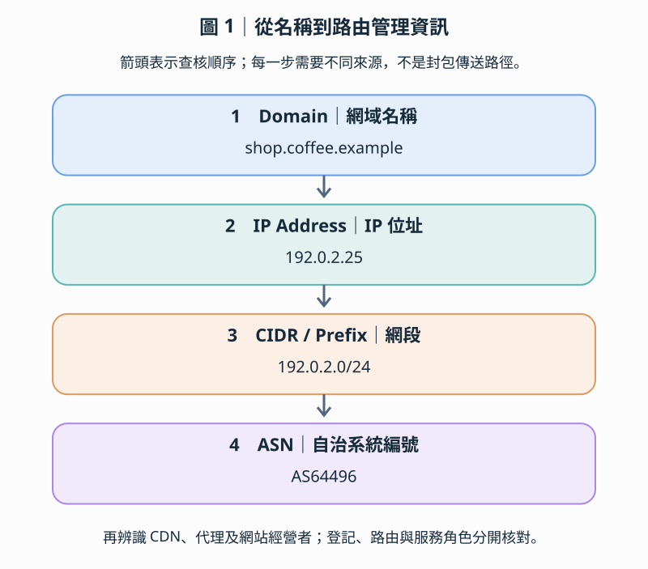
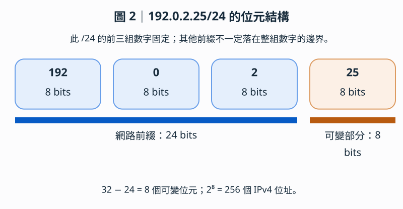
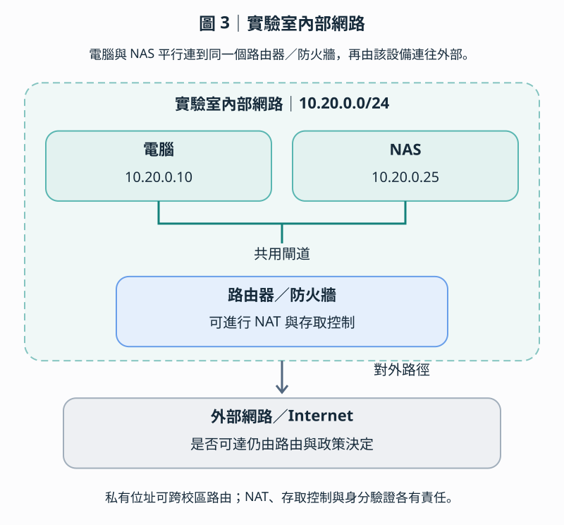
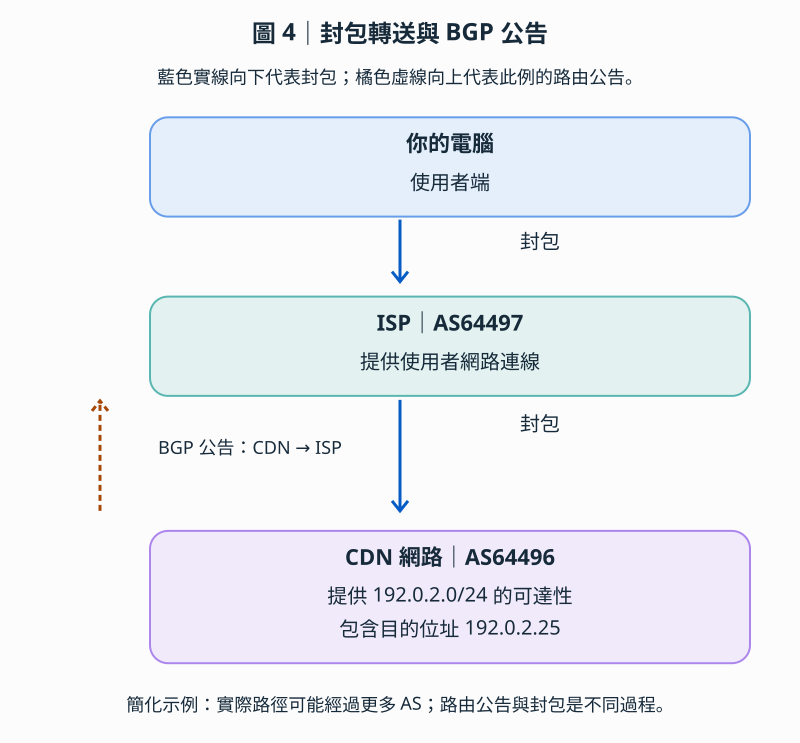
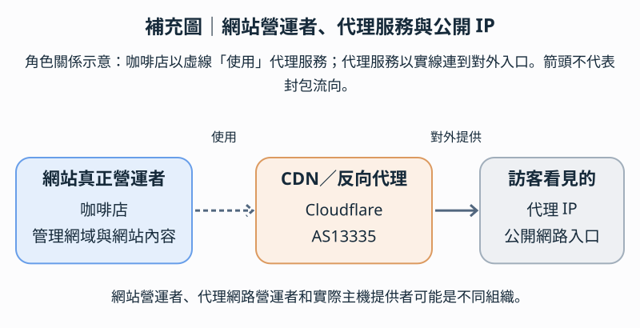
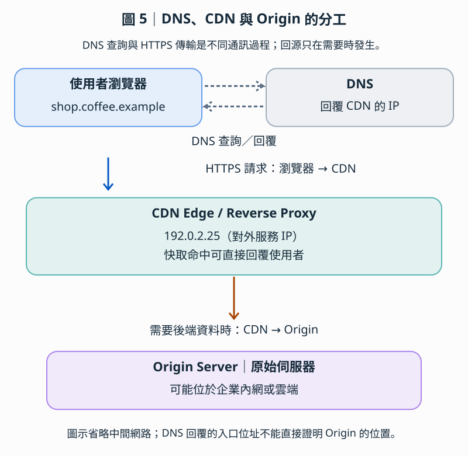
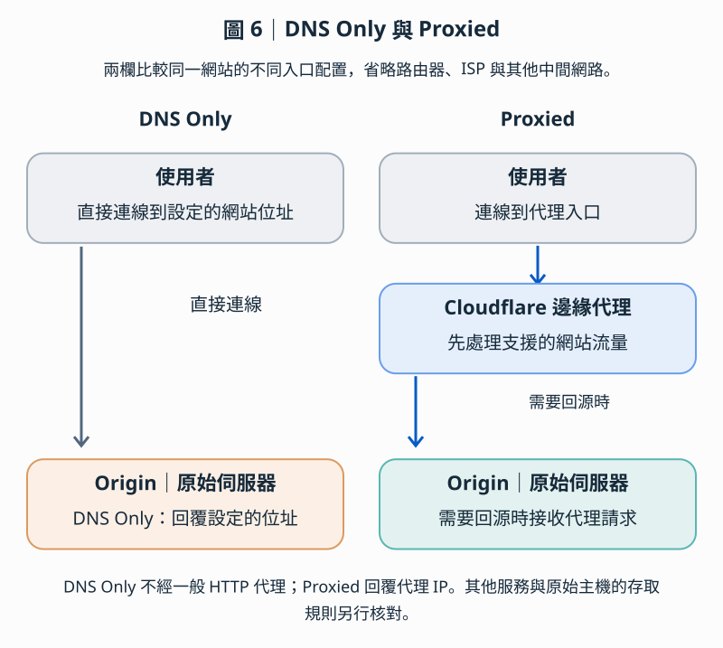
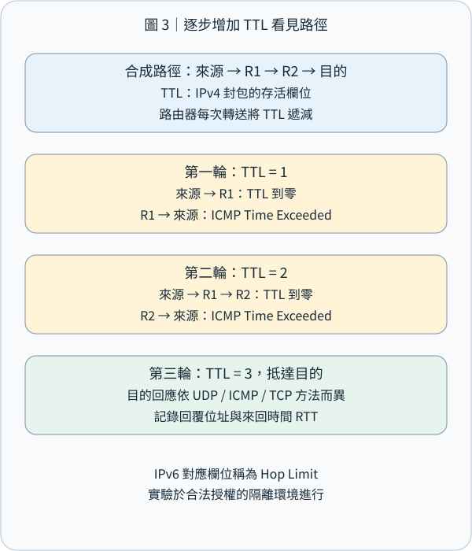
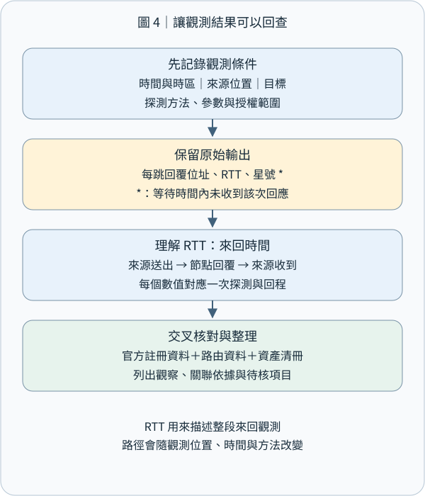

# CEH M02-06｜IP、ASN 與 Traceroute：把網路線索串成有依據的地圖

## 1｜摘要

**網路足跡蒐集（Network Footprinting）是把位址、網段、路由管理與路徑觀察連起來，建立一張附有來源、時間與觀察位置的網路地圖。** IP 告訴我們資料送往哪個網路位址；網段把位址整理成範圍；ASN 辨識路由政策的管理單位；Traceroute 呈現某次探測所收到的逐跳回覆。

想像你要了解一間咖啡店的配送：店名方便人找到它，街道地址方便配送，街區用來整理範圍，物流業者管理運送路線，配送紀錄則描述某次實際經過的節點。這五種資訊放在一起，才容易看清楚關係。

本課接續 M02-04 的 DNS（Domain Name System，網域名稱系統）與 M02-05 的郵件路徑。這次從「名字與郵件」轉向「位址與網路」。示意位址、ASN 與路徑輸出採合成教材；另列本機與公開資料查詢練習，實際結果依查詢時間與位置記錄。主動量測以另行核定的自有隔離實驗環境為範圍。

## 2｜IP 與網段：先學會看地址和範圍

當你在瀏覽器輸入網址，DNS、位址與路由各自回答不同問題。先用寄送包裹的比喻建立全圖，再逐步查核。



| 概念      | 白話比喻            | 真正的功能            |
| ------- | --------------- | ---------------- |
| DNS     | 查地址的通訊錄         | 將網域名稱解析為 IP 等紀錄  |
| IP      | 收件地址            | 指定封包要送往的網路位址     |
| CIDR／網段 | 街區或地址範圍         | 把一群 IP 位址表示成一個範圍 |
| AS／ASN  | 物流公司的路由管理體系與編號  | 識別具有共同對外路由政策的網路  |
| BGP     | 物流公司之間交換的運送路線資訊 | 讓自治系統交換網路可達性資訊   |
| CDN     | 分散各地的配送中心       | 在邊緣節點提供內容或代理服務   |

網站名稱、網路位址、位址的登記者、路由營運者和網站經營者，不一定是同一個單位。

第 2–4 節依序建立這些角色之間的關係。

### 2.1 IP 是什麼？為什麼電腦需要 IP？

想像你要寄包裹給朋友。

你需要知道朋友的收件地址，物流公司才能將包裹送到正確的位置。

網際網路也是如此。電腦彼此交換資料時，需要使用 IP 位址作為來源與目的地的識別資訊。

例如：

`192.0.2.25`

這是一個 IPv4 位址。它由四組數字組成，每組數字範圍為 0～255。

我們常見的 IP 有兩種格式：

| 類型   | 地址範例           | 長度       |
| ---- | -------------- | -------- |
| IPv4 | `192.0.2.25`   | 32 bits  |
| IPv6 | `2001:db8::25` | 128 bits |

這裡的 bit（位元）是電腦儲存資訊的最小單位之一，只有 `0` 或 `1` 兩種值。

IP 不是直接代表一台永久固定的電腦。它通常配置在網路介面上，也可能代表虛擬服務、負載平衡器或其他網路入口。

### 2.2 什麼是網段（Subnet / Network Prefix）？

如果 IP 是一個門牌地址，那麼網段就是一整個街區。

假設有三台實驗室設備：

```
192.0.2.10   電腦 A
192.0.2.20   電腦 B
192.0.2.25   電腦 C
```

它們的 IP 有共同部分：`192.0.2`。

我們可以使用 CIDR（Classless Inter-Domain Routing）來表示一段位址範圍。

例如：

`192.0.2.0/24`

這裡最難理解的是 `/24`。



IPv4 總共 32 位元，而 `/24` 表示前 24 位元用來識別共同的網路前綴。

因此：

32 − 24 = 8

剩下 8 位元可以變化。每個位元只有 0 或 1，因此總共有：

2⁸ = 256

也就是 `192.0.2.0` 到 `192.0.2.255`，總共 256 個位址。

在傳統的 IPv4 `/24` 區域網路配置中，通常會保留第一個網路位址和最後一個廣播位址，因此常見的可用主機位址數量為 254。但不是所有前綴都能直接套用「減二」規則。

### 2.3 為什麼 /24、/25、/26 的範圍不同？

請觀察以下比較。

| 網段             | IP 範圍         | 總位址數 |
| -------------- | ------------- | ---- |
| `192.0.2.0/24` | `.0` ～ `.255` | 256  |
| `192.0.2.0/25` | `.0` ～ `.127` | 128  |
| `192.0.2.0/26` | `.0` ～ `.63`  | 64   |
| `192.0.2.0/27` | `.0` ～ `.31`  | 32   |

這代表 `/25` 並不是比 `/24` 多一個 IP，而是網路前綴多固定了一個位元，讓涵蓋的位址範圍縮小一半。

你可以操作下面的模擬器，觀察同一個 `192.0.2.25` 在不同前綴下，所屬的網段如何改變。

模擬器以 192.0.2.25 為固定 IP，可選 /24 到 /30；結果顯示所屬網段、總位址數與範圍。無 JavaScript 時仍可閱讀 /24 的預設結果。

網段不是一個實體盒子，而是一套用來描述及比對 IP 範圍的規則。

路由器可以藉此判斷某個目的 IP 符合哪些路由前綴，再依路由表決定下一站。當不同路由前綴重疊時，通常先依最長前綴比對（Longest Prefix Match），選擇最精確的符合項目。

[CIDR 與最長前綴比對](https://www.rfc-editor.org/rfc/rfc4632)。

### 2.4 私有 IP 和公開 IP 有什麼不同？

假設你的實驗室裡有 NAS、電腦和路由器：



像 `10.20.0.25` 就是私有 IPv4 位址。

常見的私有 IPv4 位址範圍有：

`10.0.0.0/8`、`172.16.0.0/12`、`192.168.0.0/16`。

這些位址可以在不同組織的內部網路重複使用，不會直接在全球公開網際網路上被當作目的地路由。

私有 IP 不代表安全，也不代表只有同一個房間才能存取。

例如，位於其他校區的電腦，如果校園網路有建立適當的路由，而且防火牆允許，仍然可能存取你的 NAS。

NAT（Network Address Translation，網路位址轉換）則可以讓多台內部設備透過較少的公開 IP 對外通訊。它是一種位址轉換機制，不能單獨取代防火牆與身分驗證。

因此，在資安管理上，IP 和網段讓我們有能力精確定義：哪些來源可以連線、哪些目的地允許存取，以及不同網段之間是否需要隔離。

本節使用的 `192.0.2.0/24` 是文件保留位址，用於教學；不是可直接拿來部署公開網站的位址範圍。

[私有 IPv4](https://www.rfc-editor.org/rfc/rfc1918)、[IPv4 文件位址](https://www.rfc-editor.org/rfc/rfc5737)、[IPv6 文件位址](https://www.rfc-editor.org/rfc/rfc3849)。

## 3｜ASN、AS 與 BGP 白話文教學

**核心觀念：IP 告訴我們「目的地在哪裡」，ASN 告訴我們「是哪一個自治網路」，BGP 則讓不同網路交換「如何抵達目的地」的路由資訊。**

你可以把網際網路想像成由許多不同物流公司共同建立的全球配送系統。

- **IP Address**：收件地址。
- **IP Prefix（網段）**：一整片配送區域。
- **AS（Autonomous System，自治系統）**：具有自己運送政策的物流體系。
- **ASN（Autonomous System Number）**：該物流體系的識別號碼。
- **BGP（Border Gateway Protocol）**：不同物流體系互相交換可達路線資訊的規則。

[AS 定義](https://www.rfc-editor.org/rfc/rfc1930)。

### 3.1 為什麼有 IP 還需要 ASN？

假設你想要瀏覽一個咖啡店網站：

`shop.coffee.example`

電腦透過 DNS，取得網站對應的 IP 位址：

`192.0.2.25`

但是這時候，我們只知道網路上的目的位址，**還不知道哪個網路能幫我們把封包送到那裡。**

本節沿用教材的合成範例。192.0.2.0/24 與 AS64496–AS64498 都是文件示例資源，不代表真實網站或實際路由公告。[文件用 IPv4](https://www.rfc-editor.org/rfc/rfc5737)、[文件用 ASN](https://www.rfc-editor.org/rfc/rfc5398)。

**為什麼不能只靠 IP？**

想像你住在宜蘭，要把包裹寄到東京。

你已經知道東京收件人的地址，但你還需要知道：哪一家物流公司可以運送？它能和哪些物流公司合作？跨國後由誰接手？

網際網路也是如此。

假設世界上有三個不同網路：

- 網路 A：你所使用的 ISP（網際網路服務供應商）。
- 網路 B：國際網路骨幹或轉接業者。
- 網路 C：網站所在的網路。

每個網路有自己的路由政策（Routing Policy），例如願意和誰交換路由、接受哪些路由，以及偏好使用哪一條線路。

為了讓其他網路能夠識別它們，就使用 ASN。

**AS 是網路體系本身；ASN 是這個體系的號碼。** 一個 AS 可以宣告多個網段；同一家公司也可能營運多個 AS。

這也解釋了為什麼電信業者、雲端業者、大型企業及學術網路可能擁有 ASN，而普通家庭或一般網站不需要自己申請一個 ASN。因為後者通常使用上游 ISP 或服務商的網路。[BGP 規範](https://www.rfc-editor.org/info/rfc4271/)、[Cloudflare AS 說明](https://www.cloudflare.com/learning/network-layer/what-is-an-autonomous-system/)

### 3.2 什麼是 BGP？不同 AS 如何交換路由資訊？

BGP 全名是 Border Gateway Protocol，中文常稱為**邊界閘道協定**。

它的工作不是替每一個封包預先規劃完整旅程，而是讓網路之間交換：

「我知道如何抵達哪些 IP 網段，你可以透過我前往那些地方。」



圖 4 的藍色實線表示封包傳送，橘色虛線表示 BGP 路由公告，兩者方向相反。圖中用戶透過 ISP 到達 CDN；下列三個 AS 的例子另外加入網路 A，逐步說明路由如何傳遞；B 在此為 A 提供轉接服務。A 是 AS64498，B 是 AS64497，C 是 AS64496；這是簡化的外部 BGP（eBGP）示例。

**第一步：AS64496 宣布「我能抵達這個網段」**

網站所在的網路 C，透過與鄰近網路 B 建立的 BGP 連線，公告：

「`192.0.2.0/24` 這個網段可以透過我抵達。」

這個動作稱為 Route Advertisement（路由公告）。

**第二步：AS64497 告訴 AS64498**

網路 B 收到公告後，依照自己的路由政策，決定是否把這條路由繼續傳給網路 A。

如果傳出去，A 可能收到這樣的路由資訊：

```text
目的網段：192.0.2.0/24
AS_PATH：64497 64496
```

這裡的 `AS_PATH` 就是 BGP 的重要屬性。

它表示這筆路由資訊所記載的 AS 路徑。按照這個例子，從 A 的角度看，公告所列的路線會經過 AS64497，最後抵達起源的 AS64496。

注意：AS_PATH 記錄的是 **AS 層級的路徑，不是每一台路由器，也不保證和某一次封包的實際路徑完全一致**。[BGP 規範](https://www.rfc-editor.org/rfc/rfc4271)

**第三步：網路 A 選擇適合的路由**

假設 A 同時收到兩條路由：

| 候選路由 | AS 路徑 |
|--------|--------|
| 路線 1 | A → B → C |
| 路線 2 | A → D → E → C |

你可能會想：路線 1 比較短，當然應該選它。

**但 BGP 並不是單純選擇最短或最快的路。**

網路業者可能根據商業合作關係、路由偏好、政策限制，以及其他 BGP 屬性來選擇路由。即使一條路線經過比較多個 AS，仍然可能被優先採用。[BGP 適用性說明](https://datatracker.ietf.org/doc/rfc1655/)、[Cisco BGP 選路說明](https://docs.manage.security.cisco.com/cdfmc/c_bgp_path_selection.html)

**第四步：真正的 IP 封包開始傳送**

一旦選定可用路由，路由器便可以依其轉送表（Forwarding Table）將封包送到下一站。

這裡必須區分兩件事情：

| 比較項目 | BGP | IP 封包轉送 |
|--------|--------|--------|
| 主要目的 | 交換可達路由資訊 | 把實際資料送出去 |
| 所屬概念 | 控制平面（Control Plane） | 資料平面（Data Plane） |
| 白話比喻 | 物流公司交換配送路線 | 貨車真的運送包裹 |
| 主要資訊 | Prefix、AS_PATH、NEXT_HOP 等 | 目的 IP、轉送表與下一跳 |

這就是為什麼第三節先教 ASN 與 BGP，後面才教 Traceroute。

BGP 讓我們研究「網路公開宣告哪些路由」，而 Traceroute 幫助我們觀察「某次探測有哪些路由器回覆」。

兩者並不相同。

### 3.3 查到 ASN，就知道網站是誰的嗎？

**不一定。這是 CEH 足跡蒐集（Footprinting）非常重要的判讀界線。**

假設你正在調查一家咖啡店網站，發現它使用 Cloudflare 的代理服務。

**Cloudflare 使用的 ASN 包括 AS13335。** [Cloudflare ASN 文件](https://developers.cloudflare.com/byoip/concepts/loa/)。

這表示你可能觀察到 Cloudflare 對外提供的網路服務，但不能因此認定 Cloudflare 擁有該網站。[Cloudflare AS 說明](https://www.cloudflare.com/learning/network-layer/what-is-an-autonomous-system/)



架構示意，箭頭代表角色關係而非封包流向。Cloudflare 開啟代理後，DNS 可回覆 Cloudflare 的 Anycast IP，而不是原始伺服器 IP。[Cloudflare 代理狀態](https://developers.cloudflare.com/dns/proxy-status/)

也就是說，當我們發現某個 IP 的 Origin ASN 是 AS13335，能夠合理推論的，是該位址所屬前綴在觀察到的 BGP 路由資訊中由 Cloudflare 的 AS 起源公告。

但不能單憑這個結果推論：

- 網站的所有權屬於 Cloudflare。
- 網站的原始伺服器就放在 Cloudflare。
- 網站經營者的真實身分。
- 網站所有服務都使用同一個 ASN。

**那我們究竟要查什麼？**

實務上要把四種不同的身分分開確認。

| 查詢資料 | 可以知道什麼 | 不能直接證明什麼 |
|--------|--------|--------|
| DNS | 網域目前解析到哪些 IP | IP 背後真正的網站經營者 |
| RDAP | IP 網段或 ASN 的登記資料 | 網站的真正所有權 |
| BGP / Origin ASN | 某網段由哪個 AS 起源公告 | 真正的應用程式主機在哪裡 |
| 服務合約、雲端管理後台、資產清冊 | 網站、網路服務與管理者的實際關係 | 仍須確認資料是否完整且最新 |

其中 RDAP（Registration Data Access Protocol，登記資料存取協定）是查詢網路資源登記資訊的標準化方式；RIPEstat 則能查詢公開路由資訊與路由起源 AS。[ARIN RDAP](https://www.arin.net/resources/registry/whois/rdap/)、[RIPEstat 路由狀態](https://stat.ripe.net/docs/data-api/api-endpoints/routing-status)

### 3.4 練習：依序查 DNS、Origin ASN 與登記資料

環境：具備 `dig` 的 Linux／macOS，或已安裝 DNS 工具的終端機，以及瀏覽器。以 `example.com` 或你有權查詢的網域練習；只查 DNS、公開路由及登記資訊。下列步驟不使用合成 IP 做真實查詢。

**第一步：查 DNS**

使用 `dig` 觀察網域解析出的 IP。可先用公開測試網域練習。

```sh
dig +short A example.com
```

**第二步：查 IP 對應的 Origin ASN**

打開 [RIPEstat](https://stat.ripe.net/)，輸入剛取得的 IP，查詢路由前綴及起源 AS。

**第三步：查登記資料**

使用 [RDAP](https://www.arin.net/resources/registry/whois/rdap/) 或對應區域網際網路註冊管理機構的查詢服務，確認網路資源登記組織。記錄時間、資料來源，並把「已觀察到的事實」與「尚未確認的所有權」分開。

預期結果：記錄實際查到的 IP、前綴、Origin ASN、登記組織、查詢時間與來源。DNS 結果可能隨時間改變；若 `dig +short` 空白，改用 `dig A example.com` 查回覆狀態，不把空白當作網站不存在。若查無公開路由或登記資料，記為未查得，不補成推測。

小檢查：確認每一項結論都能指回查詢來源，並另列尚未確認的網站所有權。清理：本練習不更改網路設定；依需要移除本機暫存查詢檔。這三個步驟建立的是初步網路足跡。

### 3.5 判讀重點與路由安全

1. **IP 是目的位址；ASN 是自治系統的識別編號。** 它們回答不同的問題。
2. **BGP 是網路之間交換路由資訊的協定。** 它依政策選擇路由，不是單純尋找最短距離。
3. **ASN 不是網站的身分證。** 查到路由業者，不等於查到網站實際營運者。

另外，從資安角度來看，BGP 路由公告本身也存在遭到錯誤或惡意宣告的風險。RPKI（Resource Public Key Infrastructure，資源公開金鑰基礎建設）與 ROA（Route Origin Authorization，路由起源授權）可以協助驗證某個 ASN 是否獲授權起源公告特定 IP 前綴，但它們並不能證明網站所有權。[APNIC RPKI](https://www.apnic.net/community/security/resource-certification/)

### 3.6 理解檢核

假設某網站的 DNS 解析到一個 IP，而你查到：

- Prefix：`192.0.2.0/24`
- Origin ASN：`AS64496`
- AS_PATH：`64497 64496`
- RDAP 登記組織：Example Edge

以上都是合成教材資料。

**問題一：** `AS64496` 和 `AS64497` 分別在這條路由中扮演什麼角色？

**問題二：** 你能不能因此斷言 Example Edge 就是這個網站的真正經營者？為什麼？

先自行回答，再展開參考解答，比對路由角色與網站所有權所需的證據。

## 4｜把 DNS、IP、CDN 與服務角色連起來

這一節要回答的問題是：

當你查到一個網站的 IP，為什麼這個 IP 有時候不是網站真正的伺服器？

### 4.1 從你輸入網址開始

假設你要進入一家咖啡店網站：

`shop.coffee.example`

第一步，瀏覽器需要知道這個網域所對應的 IP。

因此，它會透過 DNS 解析機制取得資料。

這裡最常見的三種 DNS 紀錄是：

| DNS 紀錄 | 用途        | 示意                   |
| ------ | --------- | -------------------- |
| A      | 名稱對應 IPv4 | `192.0.2.25`         |
| AAAA   | 名稱對應 IPv6 | `2001:db8::25`       |
| CNAME  | 名稱指向另一個名稱 | `cdn.coffee.example` |

如果 DNS 回覆 `192.0.2.25`，你的瀏覽器便可以使用這個目的位址建立後續連線。

但如果咖啡店有使用 CDN，這個 IP 可能其實屬於 CDN 的邊緣服務節點，而不是咖啡店真正的主機。

[DNS A／CNAME](https://www.rfc-editor.org/rfc/rfc1035)、[AAAA](https://www.rfc-editor.org/rfc/rfc3596)。

### 4.2 CDN 與 Reverse Proxy 到底在做什麼？

CDN（Content Delivery Network，內容傳遞網路）可以想成分散在各地的配送中心。它可以快取網站內容、降低回應延遲，並減輕原始伺服器的負載。

Reverse Proxy（反向代理）則像站在伺服器前面的接待櫃檯：由它先接收訪客的請求，再決定是否轉送後端。



當你透過 CDN 訪問網站時，可能發生以下情況：

瀏覽器先透過 DNS 取得 CDN 的 IP，之後向 CDN 發送 HTTPS 請求。

如果 CDN 已經快取了所需內容，它可以直接回覆；如果需要動態資料，便可能向原始伺服器（Origin Server）取得內容。

因此，DNS 回覆的 IP 可以是服務入口，而不是最終儲存資料或執行應用程式的主機。

### 4.3 為什麼 Cloudflare 有時能隱藏原始 IP，有時不能？

這裡用 Cloudflare 的兩種設定作比較。

DNS Only

在此示例，DNS 回覆設定的 Origin IP；流量不經一般的 Cloudflare HTTP 代理。

Proxied

DNS 對外回覆代理 IP；支援的網站流量先經 Cloudflare，必要時才轉送 Origin。



這項差異也影響 Origin 的存取控制。

如果使用 Cloudflare 的 HTTP 反向代理，但原始伺服器的 IP 仍然公開、而且可以從外部直接連線，攻擊者可能繞過 Cloudflare，直接攻擊 Origin。

所以除了代理設定，還必須考慮 Origin 的防火牆、存取控制及其他暴露途徑。

另外，一般 Cloudflare HTTP Proxy 不會自動保護 SMB、SSH 等非 HTTP 服務。這類服務需要考慮不同的安全連線方案，例如具備身分驗證與存取政策的 VPN 或 Cloudflare Zero Trust 私有網路。

[Cloudflare 代理狀態](https://developers.cloudflare.com/dns/proxy-status/)、[Origin 保護](https://developers.cloudflare.com/fundamentals/security/protect-your-origin-server/)。

[Cloudflare 私有網路](https://developers.cloudflare.com/cloudflare-one/networks/connectors/cloudflare-tunnel/private-net/)。

### 4.4 同一個 IP，為什麼不同地方會連到不同伺服器？

這與 Anycast（任播）有關。

想像一家物流公司，在台北、東京和新加坡各設立一個服務據點，但是對外使用同一個服務地址。

網際網路中的 Anycast 允許多個不同位置的服務節點宣告同一個 IP 前綴，使連線可以依當下路由政策被送往其中一個位置。

因此，即使兩個人查到完全相同的 CDN IP，也不代表兩個人的封包必然抵達同一棟資料中心。

必須注意：Anycast 並不保證送到地理距離最近的節點，而是依網路路由決策選擇可達路徑。

[任播服務運作](https://www.rfc-editor.org/rfc/rfc4786)。

[下載這六張圖的中英 SVG](https://learn.cs-kairos.com/downloads/ceh-m02-06-network-svg.zip)。

## 5｜Traceroute 原理：讓封包在不同站回報

Traceroute（路徑追蹤）會主動送出探測封包，逐步增加它能經過的跳數，藉回覆整理沿途節點。Hop（一跳）可以先理解為一次路由轉送。把它想成寄出多個測試包裹：第一個請第一站回報，第二個走到第二站再回報，逐步延伸。

IPv4 標頭裡的 TTL（Time to Live，存活時間）在路由轉送時至少減少 1；歸零時，路由器丟棄該封包，通常送回 ICMP Time Exceeded。ICMP（Internet Control Message Protocol，網際網路控制訊息協定）用來回報網路控制與錯誤資訊。IPv6 對應欄位稱為 Hop Limit（跳數限制）。[IPv4 路由器 TTL 規則](https://www.rfc-editor.org/rfc/rfc1812)、[IPv6 Hop Limit](https://www.rfc-editor.org/rfc/rfc8200)

假設路徑是「電腦 → R1 → R2 → 目的主機」：TTL=1 的探測在 R1 到期，R1 回覆；TTL=2 的探測在 R2 到期，R2 回覆；TTL=3 的探測到達目的主機，依探測方式取得終點回覆。工具把各次收到的來源位址與時間排成清單。這裡每次都是新的探測封包。

不同實作可以使用不同探測方式。Windows 的 `tracert` 使用 ICMP Echo 探測；Linux 的 traceroute 實作可支援 UDP、ICMP、TCP 等方式，實際預設與選項以安裝版本的說明為準。中間節點常見的回報是 Time Exceeded；終點判定則依探測方式，例如 ICMP Echo Reply，或傳統 UDP 探測收到目的端的 Port Unreachable。測試紀錄應寫明工具、版本、探測協定與參數。[Windows tracert](https://learn.microsoft.com/en-us/windows-server/administration/windows-commands/tracert)、[Linux traceroute 專案](https://traceroute.sourceforge.net/)

RTT（Round-Trip Time，往返時間）從送出探測算到收到回覆，通常以毫秒 ms 表示。每一列的時間包含探測前往回覆節點，以及回覆回到觀察端的過程；解讀時將它視為「這次探測的往返時間」。



## 6｜實際讀一段合成輸出

以下是紙上教材，省略工具啟動訊息；三個數值代表同一跳數的三次探測。

```text
觀察端：隔離教學網路的工作站
目的地：203.0.113.80
時間：2026-11-01 08:00 +08:00
方式：ICMP Echo，合成輸出

hop   probe 1   probe 2   probe 3   responding address
 1      1 ms      1 ms      2 ms   10.20.0.1
 2      *         *         *      —
 3     17 ms     18 ms     16 ms   198.51.100.9
 4     21 ms     20 ms     22 ms   203.0.113.80
```

第一列：跳數 1 的探測取得 `10.20.0.1` 回覆，三次往返時間約 1–2 ms。這是一個私有位址，結合教學拓撲可確認它在這個實驗中的角色。

第二列：星號代表對應探測在等待時間內沒有收到預期回覆。原因可包含回覆過濾、速率限制、回程狀況或封包遺失；後續有回覆時，可以繼續整理後面的觀察結果。[tracert 對星號的說明](https://learn.microsoft.com/en-us/windows-server/administration/windows-commands/tracert)

第三列與第四列：探測分別收到中間節點與終點回覆。第四列這三次往返約 20–22 ms，適合記為本次量測的終點 RTT。比較效能時，可用一致條件重複量測，結合端到端應用程式監測，觀察是否有持續變化。

若第三跳是 80 ms、第四跳反而只有 20 ms，可先把這兩組實測值保留，再確認中間設備回應探測的優先序、負載、回程與取樣差異。路由器處理回覆的方式會影響數值；每一跳的 RTT 也各自包含往返路徑，適合分別分析。

負載平衡與路由變動，可能讓同一跳數的多次探測收到不同位址。單次輸出是一份觀察快照；串聯不同時間與位置的紀錄，可以得到更完整的網路輪廓。RFC 2330 的網路量測框架，也強調量測方法、樣本與不確定性的清楚定義。[網路效能量測框架](https://www.rfc-editor.org/rfc/rfc2330)

## 7｜把線索整理成可用的防護證據

一份網路足跡紀錄可以有以下欄位：

| 欄位 | 這次要保存的內容 |
|---|---|
| 目的與範圍 | 自家服務盤點、授權目標與允許的方法 |
| 時間與觀察端 | 日期、時區、來源網路、IPv4／IPv6 |
| 名稱與位址 | DNS 查詢結果、解析器與查詢時間 |
| 登記與路由 | RDAP 來源、前綴、ASN、路由資料時間 |
| 路徑觀察 | 工具版本、參數、探測協定、原始輸出 |
| 服務角色 | 自家資產、供應商邊緣、代理或其他已確認角色 |
| 判讀與下一步 | 已觀察事實、角色推論、需要補核的設定 |

例如可以寫：「08:00 從教學網路取得 shop.coffee.example 的 A 紀錄192.0.2.25；自家設定顯示使用邊緣代理，後續對照代理控制台與資產清單，確認後端服務及管理者。」每一句都能找到來源，也讓下一步明確。

防守方可以利用這張圖檢查：公開 DNS 是否仍指向預期服務？停用的位址與供應商是否已從設定移除？管理入口是否放在規劃的存取邊界？雲端、CDN、路由與應用程式各由誰負責？再把答案接到 M01 的安全控制，以及後續 M13、M19 的伺服器與雲端責任。

主動追蹤路徑需要遵循核定目標、探測頻率與停止條件。公開 RDAP 或既有路由資料可先作資料查詢；Traceroute 的封包會實際進入量測路徑，屬於 M02-01 的主動互動。完成紀錄後，分享去識別化節錄，原始資料依組織規則保存。



## 8｜離線練習與小檢核

先用本機 Python 標準函式庫 `ipaddress` 計算範圍。這段程式只做本機數值運算：

```python
from ipaddress import ip_network, ip_address

network = ip_network("192.0.2.0/24")
address = ip_address("192.0.2.25")
print(network.num_addresses)
print(network.network_address, network.broadcast_address)
print(address in network)
```

```text
256
192.0.2.0 192.0.2.255
True
```

練習步驟：先預測位址數；執行程式比對；把前綴改成 `192.0.2.128/25`，再預測 `.25` 的歸屬；最後整理一行「前綴、範圍、是否包含該位址」。完成後可關閉程式，若另存測試檔則自行保留或刪除。[Python ipaddress 官方文件](https://docs.python.org/3/library/ipaddress.html)

小檢核一：`192.0.2.0/24` 有幾個位址？A.24；B.128；C.256；D.只有一個。

小檢核二：ASN 最直接識別哪個角色？A.單一使用者；B.路由政策的自主系統；C.每個網頁網址；D.單一 TCP 連接埠。

小檢核三：第二跳全是星號，第四跳收到終點回覆。請用一句話記錄第二跳觀察，再列出一項可進一步查核的原因。

小檢核四：某個網站解析到雲端邊緣 IP。你會保留哪三項資料，來確認它和自家服務的關係？請把資料來源與時間一起寫出來。

參考解析隨網站教材提供；你的作答可另外留下，方便依理解程度接續補充。

以下觀察適用 Ubuntu。DNS 與公開資料查詢會對外送出請求；本機介面資訊可能包含私人位址，分享前先去識別化。這些指令不修改設定，不執行服務掃描；離線 Python 範例不需連線。

### 8.1｜查詢網站的 DNS 位址

```
dig +short A learn.cs-kairos.com
dig +short AAAA learn.cs-kairos.com
dig +short CNAME learn.cs-kairos.com
```

第一行查詢 IPv4；第二行查詢 IPv6；第三行查詢是否能觀察到 CNAME。

若沒有取得 AAAA 或 CNAME，不一定是錯誤，也可能沒有這類紀錄、名稱被展平，或代理機制改變回覆。需要判讀狀態時移除 +short，檢查狀態碼、解析器與回覆時間；不要把空白輸出直接當作不存在。若沒有 dig，可先完成離線練習。

### 8.2｜觀察自己電腦的 IP 和路由

```
ip -br address
ip route
```

第一個指令顯示本機網路介面的位址；第二個顯示 IPv4 路由資訊。

可以觀察自己的電腦是否使用 `192.168.x.x` 或 `10.x.x.x` 這類私有位址，以及預設路由指向哪個閘道器。

### 8.3｜用 Python 解析網段

```
from ipaddress import ip_interface

interface = ip_interface("192.0.2.25/24")
network = interface.network
print("IP:", interface.ip)
print("Network:", network)
print("Start:", network.network_address)
print("End:", network.broadcast_address)
print("Addresses:", network.num_addresses)
```

將程式存成 cidr.py，執行 python3 cidr.py。預期依序輸出 IP: 192.0.2.25、Network: 192.0.2.0/24、Start: 192.0.2.0、End: 192.0.2.255、Addresses: 256。再改成 /30，核對範圍 .24–.27 與總數 4；完成後可刪除 cidr.py。

### 8.4｜進一步查詢 ASN

取得某個公開 IP 後，可以使用 [RIPEstat](https://stat.ripe.net/) 觀察其網路前綴與 BGP 相關資訊，再利用 [RDAP 查詢入口](https://rdap.org/) 或適當的區域網際網路註冊管理機構，交叉核對登記資料。

這些工具回答的是不同層次的問題，不應只靠單一查詢就認定網站真正的經營者、設備所在位置或安全狀態。

### 8.5｜把線索用在 NAS 存取判斷

如果日後你要檢查一台實驗室 NAS，可以沿用這次學到的架構：

網路資產與暴露面分析

第一層｜設備與網段

確認 NAS 的私有 IP、所在 VLAN、子網路遮罩、閘道器與跨網段存取規則。

第二層｜外部路由與服務入口

確認是否有公開 IP、NAT、連接埠轉送、VPN 或其他遠端存取路徑。

第三層｜DNS、代理與實際服務

查明網域是否經 CDN 或反向代理，以及 SMB、SSH、HTTPS 分別由哪些設備與政策保護。

這時候你就不會只問「NAS 有沒有公開 IP」，而能進一步判斷：哪些來源網路能夠抵達它、有哪些服務可被連線、哪些安全控制真正位在封包路徑上。

把可達性、服務與控制位置分開記錄，能讓後續驗收找到對應證據。

### 8.6｜整合案例理解檢核

假設某網站的 DNS 顯示 `192.0.2.25`（教材示例），所屬前綴為 `192.0.2.0/24`，路由資料顯示 Origin AS64496。網站負責人告訴你，他們有使用 CDN。

問題 1

這個 /24 前綴包含多少個 IPv4 位址？192.0.2.25 是否在範圍內？

問題 2

AS64496 能證明網站經營者就是這個自治系統的管理者嗎？為什麼？

問題 3

如果 DNS 指向 CDN，能否直接得知真正的 Origin Server IP？還需要哪些證據？

問題 4

如果網站前面有 Cloudflare，能否推論同一台主機的 SMB 服務也受到相同的保護？

先寫下判斷，再展開下方「整合案例」參考解答；答案不會傳送或寫入學習進度。

## 9｜今天帶走的觀念

**名字連到位址，位址放進網段，網段連到登記與路由，路徑量測再補上特定時間與位置的觀察。** 這就是網路足跡的基本骨架。

讀圖時記住四個問題：我查的是哪種資料？誰產生它？它描述哪個時間與位置？接下來用哪項設定或紀錄確認關係？這套方法讓 IP、ASN 與 Traceroute 成為可重現的證據，而每個服務角色也有清楚的責任對應。

本課完整涵蓋新路線 M02-06 複合單元；下一課 M02-07 轉向社群媒體、人員搜尋與暗網來源，沿用來源、時間、範圍與交叉查核的整理方式。
