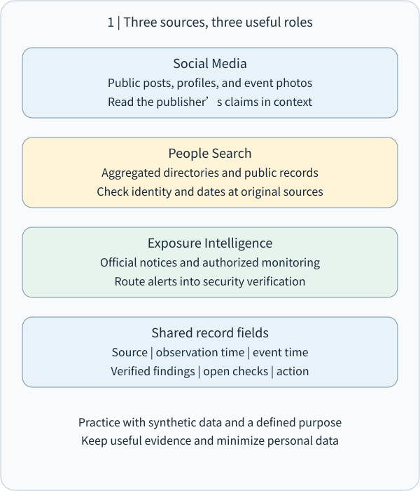
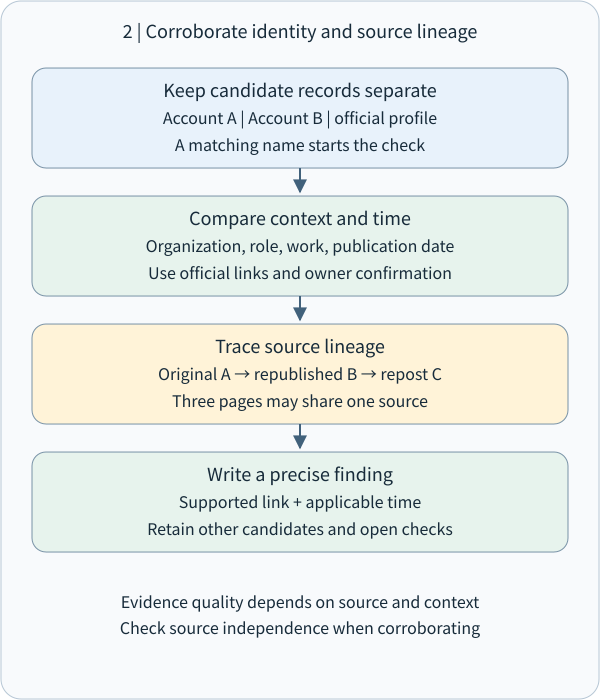
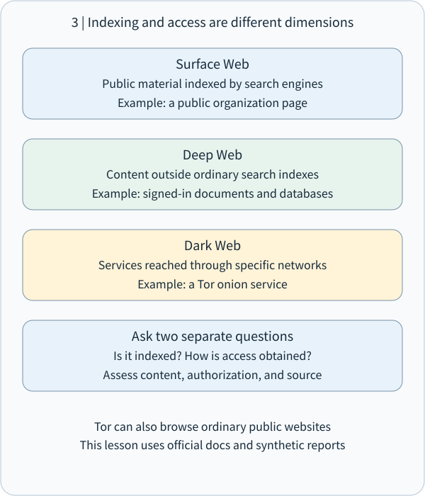
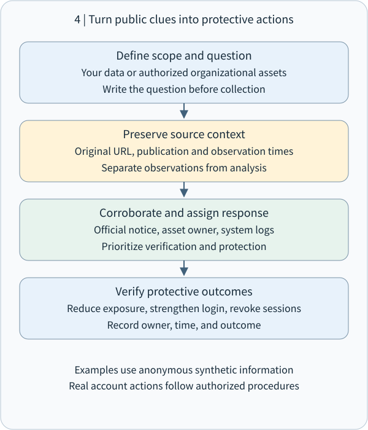

# CEH M02-07 | Social Media, People Search, and Dark Web Sources: Turning Public Clues into Verifiable Defensive Information

## 1 | Start with this conclusion

**Social media, people search, and dark web sources offer clues about public activities, identity relationships, and possible exposure. Recording their origin, time, identity context, and verification makes them useful for defense.**

Imagine the fictional Greenfield Coffee preparing to open a branch. Its official account announces the opening date, an employee shares a workplace photograph, and a job advertisement names a system in use. Each is a piece of a puzzle. Together, they may reveal workflows, contact roles, and services. A security analyst identifies suitable public information, material that needs adjustment, and reliable channels for checking impersonation attempts.

OSINT, or Open-Source Intelligence, is the purposeful collection, evaluation, and analysis of publicly available information. This lesson builds on source validation in M02-02 and focuses on people, accounts, and exposure clues. Every exercise uses synthetic records and tabletop analysis. Real assessments focus on the learner's own assets or explicitly authorized organizations.

## 2 | Social media: Read the account, post, and time together

Social media clues include profiles, public posts, comments, photographs, events, recruitment notices, and links to official websites. A digital footprint is observable information left by the use of digital services.

A record has at least three dimensions: what it says, which account published it, and what time it describes. For example, preserve a post's date and context when it says, “I am helping train the new branch next week.” Interpret “next week” relative to that date. When an old post is shared again, record both the original publication and the new sharing time to reconstruct the sequence.

Public job titles, event names, and partner brands can make impersonation messages sound familiar. Defensive workflows route payment requests, account changes, and sensitive-document sharing through verified contact channels and approval procedures. This connects to pretexting and independent verification in M09.

A photograph provides two kinds of information: visible content and metadata, which describes the file. Visible content may include system names on a whiteboard or an identification badge. Metadata may include capture time or location. Available metadata depends on the original file, platform processing, and downloaded version. Record which version was examined; review both the image background and file information before publication.

In this lesson, “the public account says purchasing manager” is recorded as an account's self-description. “The organization's current official directory lists a purchasing manager” is recorded as that directory's dated entry. Precise source wording makes each record's role clear.

## 3 | People search: Keep candidate identities separate, then establish links

People search uses names, accounts, organizations, and public professional information to find related records. Sources include organizational directories, conference speaker pages, public publications, and aggregation services. Data brokers combine information from multiple sources. The US FTC explains that people-search sites may aggregate public social profiles, public records, and other data brokers' information.[FTC explanation of people-search sites](https://consumer.ftc.gov/articles/what-know-about-people-search-sites-sell-your-information)

Entity resolution asks whether two records refer to the same person or account, or to different entities. Keep candidate records separate first, then establish evidence-backed relationships.

Consider two fictional accounts named “Greenfield Ming.” The coffee company's official website links directly to one; the other uses the same photograph. Record “account A is linked from the official website; account B uses the same photograph and its relationship awaits verification.” Matching names, photographs, or usernames provide search leads. Establishing a formal relationship uses official links, organizational confirmation, and consistent time context.

Ask four questions:

- Identity: How are the name, account, and organization connected?
- Time: When was the record published or updated, and which employment or activity period does it describe?
- Source: Is it a self-description, an organizational record, or an aggregator's republication?
- Independence: Did the sources obtain information separately, or copy the same article?

Three websites republishing one speaker biography can be recorded as “one original source, three publication locations.” A separately maintained current official directory adds a different confirmation path. Record source count and independence separately to avoid counting duplicated text as multiple confirmations.

In a relationship diagram, a node represents a person, account, organization, or document. An edge names a specific relationship such as “linked by official website,” “self-described by author,” or “listed on event page.” Give each edge its source and date. This is the lesson's recording method; the Berkeley Protocol provides a professional framework for identifying, preserving, verifying, and analyzing digital open-source information.[UC Berkeley's open-source investigation framework](https://humanrights.berkeley.edu/projects/developing-the-berkeley-protocol-on-digital-open-source-investigations/)

## 4 | Surface web, deep web, and dark web: Understand discovery and access

The surface web commonly means public pages that ordinary search engines can index, such as public news and company introductions.

The deep web commonly means content outside ordinary search-engine indexes, such as authenticated mailboxes, internal business systems, or database-query results. Users access it under the service's authentication and permission rules. Search discoverability and access rights are separate dimensions, connecting to noindex and access control in M02-03.

The dark web commonly refers to hidden services accessed with particular software, networks, or configuration. Tor is a familiar example. Tor onion services use .onion addresses and are accessed through the Tor network. They also support journalistic tips, private communications, and safer sharing.[Tor's onion-service explanation](https://support.torproject.org/about-tor/onion-services/what-is-a-dot-onion/)

Tor Browser can also open ordinary websites. Distinguish the browser being used from the type of service being accessed. The .onion suffix is a special-use name handled by Tor-aware software.[RFC 7686: The .onion special-use name](https://www.rfc-editor.org/rfc/rfc7686)

An onion-service address is associated with its cryptographic keys, allowing the connection mechanism to authenticate the service at that address. To connect the service to a real organization, compare the address with one published on that organization's independently established official website. Evaluate content through its publisher, evidence, and independent checks.[How Tor onion services work](https://community.torproject.org/onion-services/overview/)

## 5 | Dark web and exposure intelligence: Turn claims into verification tasks

An organization may receive a report that a discussion-board post claims to sell its data. Begin by preserving the minimum necessary report information: claimant, publication time, named organization, data categories, source location, and how the report was obtained. Record its state as “exposure claim received; verification in progress,” then route it through the authorized incident-response process.

Possible corroboration includes the organization's own account and system logs, authorized data-classification inventory, formal vendor incident announcements, and lawfully supplied exposure notifications. The goal is to determine which owned assets may be affected and what protection is needed. Collect and share only what serves that goal.

Have I Been Pwned, or HIBP, is an example of an exposure-notification source. It labels incidents and data categories, including unverified or potentially fabricated records. Some sensitive incidents are visible only to a verified account holder, and domain-wide searches have an authorization-verification process.[HIBP official FAQ](https://haveibeenpwned.com/FAQs)

Record the incident date, service ingestion date, and notification-receipt date separately. Redistributed old data and a new intrusion call for different follow-up. Old passwords may raise reuse concerns; recent suspicious logins call for current authentication and session records.

This exercise uses synthetic notices only. Operational investigation is performed by authorized personnel using approved sources and environments. Suspected credentials, personal data, or malicious files follow incident-response and preservation procedures, with masking and minimum necessary excerpts in working records. This supports useful risk assessment, data protection, and traceability.

## 6 | Worked example: Four Greenfield Coffee evidence cards

All people, organizations, content, and dates below are synthetic teaching data. The task is to review Greenfield Coffee's public-information exposure.

Card A: On November 1, the company's personnel page lists “Yi-An Lin, purchasing contact” and links to social account A.

Card B: On October 20, account A posts “Our new purchasing system goes live next month.” The photograph's background includes an internal project name.

Card C: Three aggregators list “Yi-An Lin, branch manager.” All cite the same introduction published in 2023.

Card D: On November 1, an exposure-notification service reports an unverified post claiming to hold Greenfield employee data. The claimed data year is 2022.

Organize the analysis in three layers:

First, direct observations. A records a dated official listing and cross-link. B records the post and visible background. C records a common old source. D records a service's report of a claim and its status.

Second, inferences. B's project name and launch timing could make a fake system notice more persuasive. C is better suited to historical role context. D merits comparison with owned account data and formal incident records.

Third, defensive actions. Have the content owner review the photograph, provide a verified system-announcement entry point, use independent approval for payments and account changes, and route the exposure claim through authorized verification.

A compact report could say: “The November 1 official directory lists Yi-An Lin as purchasing contact and links to account A. An October 20 post exposes a system launch window and project name; review the photograph and publish the official system entry point. Three old job-title records share a 2023 source and are retained as historical information. The exposure claim awaits verification by incident response.”

Each conclusion connects to evidence, and the next action is clear.

## 7 | Convert findings into controls and observable acceptance checks

A public-footprint review can start with four areas:

- Public content: Check directories, job titles, contact roles, and update dates. Review photograph backgrounds, badges, whiteboards, and file information.
- Identity and process: Provide official announcement channels. Verify payment, verification-code, and access requests through known channels.
- Account protection: Use unique passwords, a password manager, and multi-factor authentication. When supported, assess phishing-resistant authentication, which binds authentication to the legitimate service. This is an important control in NIST's digital-identity guidance.[NIST SP 800-63B-4](https://pages.nist.gov/800-63-4/sp800-63b.html)
- Exposure handling: Establish the affected accounts and data, then follow incident response to replace affected authenticators, handle sessions, and examine login records.

Attach an observable acceptance check to each improvement. Examples include “the revised photograph is visible from a public-visitor view,” “the contact page identifies an owner and update date,” and “the exposure report has an assigned handler and next review time.” Public copies and republication have their own lifecycle; track removal from aggregators where necessary. The FTC recommends periodic rechecks because information can reappear.[FTC removal and follow-up guidance](https://consumer.ftc.gov/articles/what-know-about-people-search-sites-sell-your-information)

Use consistent fields: purpose, approved scope, source URL and producer, publication and collection times with time zone, direct observations, inferences, missing evidence, owner, and acceptance result. Keep original data under applicable access and retention rules; share only material needed for the task.

## 8 | Offline exercise and understanding checks

Use the four synthetic cards. Write one direct observation per card, connect records with supported relationships, and propose one verifiable defensive action for each risk. Keep your reasoning when finished and organize or discard scratch notes as appropriate. The exercise needs no searches for real people or external-service login.

Check 1: Three websites cite the same 2023 biography. How should the source be recorded? A. Three independent confirmations; B. One original source, three publication locations; C. A current directory; D. Choose the job title by article count.

Check 2: Which concept best describes the ordinary search-index status of a private authenticated mailbox? A. A public surface-web article; B. Deep-web content; C. Necessarily a Tor onion service; D. Necessarily leaked data.

Check 3: A notice is labeled “unverified exposure claim.” Name two details to preserve and one owned source of evidence to check next.

Check 4: A public post reveals a new system's launch date and an internal project name in a photograph. Suggest one content adjustment and one process safeguard.

Reference answers accompany the website lesson. Actual responses and understanding are recorded separately.

## 9 | Take this idea with you

**After finding information, establish who published it, what time it describes, which identity it concerns, and how it connects to other sources. Then turn the result into a concrete protective action.**

Social media supplies activity and context; people search develops candidate relationships; dark web and exposure sources supply risk signals to verify and prioritize. All three use the same method: a clear purpose, appropriate scope, source validation, layered records, and minimum necessary sharing.

This covers the full M02-07 composite unit. M02-08 will integrate footprinting countermeasures and evidence records. Public-source lookup and direct interaction with a target each follow their approved scope, continuing M02-01's passive/active reconnaissance distinction.
