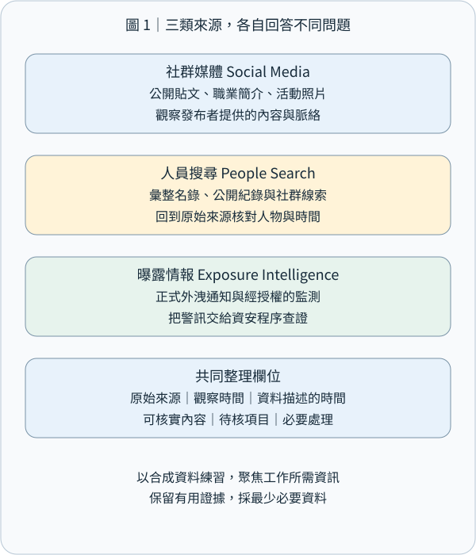
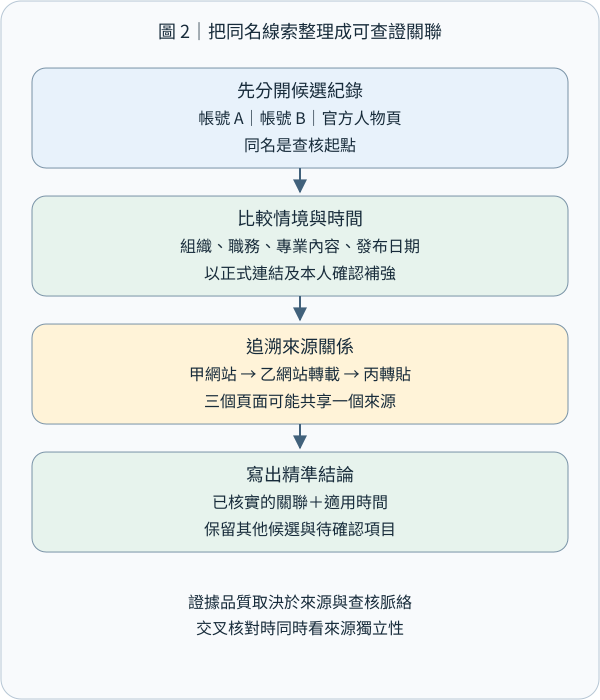
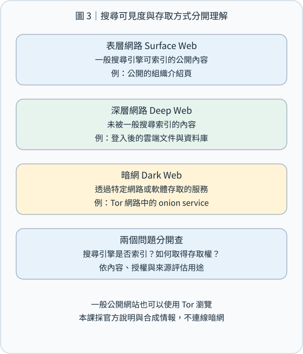
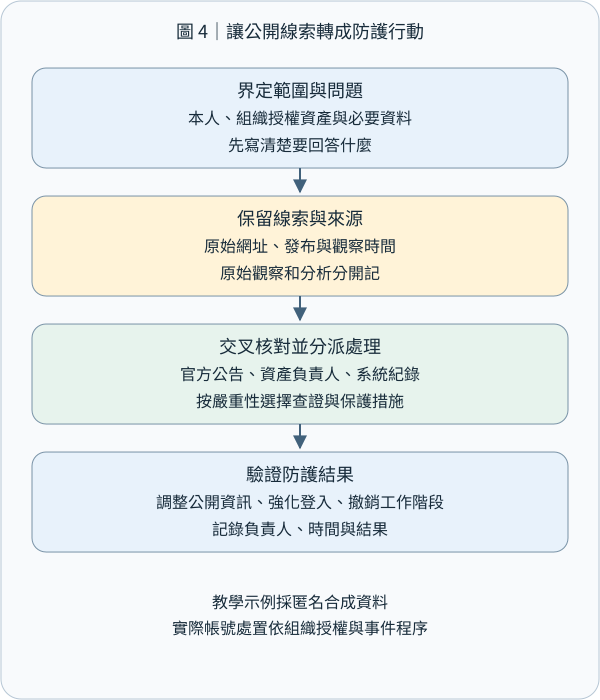

# CEH M02-07｜社群媒體、人員搜尋與暗網來源：把公開線索變成可查核的防護資訊

## 1｜先記住這個結論

**社群媒體、人員搜尋與暗網來源，分別提供公開活動、身分關聯與外洩風險線索；把來源、時間、身分與查核結果整理清楚，就能用來改善組織防護。**

想像一家合成的「青禾咖啡」準備開新分店。官方帳號公布開幕日期，員工分享工作照片，徵才頁列出使用的系統。每一則都是一小片拼圖；放在一起，就可能看出工作流程、對外窗口與使用中的服務。資安人員的工作，是找出哪些資訊適合公開、哪些需要調整，以及遇到冒名訊息時要到哪裡查證。

OSINT（Open-Source Intelligence，公開來源情資）是依目的蒐集、評估與分析可公開取得的資料。本課延續 M02-02 的來源驗證，把焦點放在人、帳號與資料外洩線索。練習全部使用合成案例與紙上資料，查核範圍以本人或已授權組織為主。

## 2｜社群媒體：讀懂帳號、貼文與時間

Social Media（社群媒體）上的線索包括帳號簡介、公開貼文、留言、照片、活動、招募公告，以及連往官方網站的網址。Footprint（數位足跡）可以理解為使用服務時留下、能被觀察到的資料痕跡。

同一份資料至少有三個面向：內容寫了什麼、由哪個帳號發布、描述什麼時間。例如「下週到新店協助教育訓練」，記錄時應保留貼文日期與原始上下文，將「下週」對應到當時的時間。舊貼文重新被轉貼時，保留原發布時間與本次轉貼時間，才能重建事件順序。

公開職稱、活動名稱與合作品牌，可以讓假冒訊息更貼近收件人的日常。防守上的重點是：把付款、帳號變更與敏感文件分享，接回已核實的聯絡管道和核准流程。這也串連 M09 的情境編造與獨立查證。

照片可分成「畫面可見資訊」與 Metadata（中繼資料）兩類。前者例如白板上的系統名稱或識別證；後者例如檔案內可能保存的拍攝時間與位置。實際可取得哪些中繼資料，依原檔、平台處理與下載版本而定。每次判讀都註明讀到的是哪個版本；對外發布則先檢查照片背景與檔案資訊。

本課將「公開帳號寫著採購主管」記為帳號自述；「公司目前的官方名錄列出採購主管」記為該名錄的當期紀錄。用精確的文字描述資料來源，讀者自然能理解每份資料的用途。

## 3｜人員搜尋：先整理候選身分，再確認關係

People Search（人員搜尋）是以姓名、帳號、組織與公開專業資訊尋找關聯資料。來源可以是組織名錄、研討會講者頁、公開著作或資料彙整網站。Data Broker（資料仲介商）會從多個來源彙整資料；美國 FTC 說明，人員搜尋網站可能整合公開社群、公共紀錄與其他資料仲介來源。[FTC 人員搜尋網站說明](https://consumer.ftc.gov/articles/what-know-about-people-search-sites-sell-your-information)

Entity Resolution（實體辨識／資料對應）要回答：「這兩筆紀錄指向同一位人員、同一帳號，還是不同對象？」先把候選紀錄分開，再逐步建立有依據的連結。

以合成例子說明：兩個帳號都叫「青禾阿明」。其中一個由青禾咖啡官網直接連出，另一個只使用相同照片。可以先記下「帳號 A 有官網交叉連結；帳號 B 使用相同照片，關係待核」。姓名、照片或使用者名稱相同，是尋找下一份資料的線索；正式關聯則結合官網連結、組織確認與時間一致性。

查核時問四個問題：

- 身分：資料中的人名、帳號與組織如何連結？
- 時間：資料是在何時發布、更新，描述哪段任職或活動期間？
- 來源：這是本人自述、組織紀錄，還是彙整網站的轉載？
- 獨立性：幾份資料各自取得資訊，還是共同引用同一篇文章？

三個網站都轉載同一份講者介紹，適合記為「一個原始來源、三個刊載位置」。另一個有獨立維護流程的當期官方名錄，才新增一條不同來源的確認路徑。來源數量與來源獨立性分別記錄，能避免把重複內容算成多次確認。

整理圖時，Node（節點）表示人員、帳號、組織或文件；Edge（關係線）表示「官網連出」「作者自述」「活動頁列名」等具體關係。每條線加上來源與日期，比只寫「有關係」更有用。這是本課採用的紀錄方法；《Berkeley Protocol》提供公開來源資料辨識、保存、驗證與分析的專業框架。[UC Berkeley 公開來源調查框架](https://humanrights.berkeley.edu/projects/developing-the-berkeley-protocol-on-digital-open-source-investigations/)

## 4｜表層網路、深層網路與暗網：依可找到與可存取的方式理解

Surface Web（表層網路）通常指一般搜尋引擎可索引的公開網頁，例如公開新聞與公司介紹。

Deep Web（深層網路）通常指一般搜尋引擎索引之外的內容，例如登入後的信箱、企業內部系統或資料庫查詢結果。存取者依服務的登入與權限規則使用。用這種方式理解，就能看出「搜尋結果找不找得到」與「誰有權讀取」是兩個不同維度，也能接回 M02-03 的 noindex 與存取控制。

Dark Web（暗網）通常指需要特定軟體、網路或設定才能進入的隱藏服務。Tor 是常見例子；Tor 的 Onion Service（洋蔥服務）使用 .onion 位址，透過 Tor 網路連線。這類技術也用於新聞線索投遞、隱私通訊與安全分享。[Tor 官方洋蔥服務說明](https://support.torproject.org/about-tor/onion-services/what-is-a-dot-onion/)

Tor Browser（Tor 瀏覽器）也能開啟一般網站；使用的瀏覽器與網站所屬的服務類型分開判斷。.onion 則是特殊用途名稱，其連線與名稱處理由支援 Tor 的軟體完成。[RFC 7686：.onion 特殊用途名稱](https://www.rfc-editor.org/rfc/rfc7686)

洋蔥服務位址與其密碼學金鑰關聯，連線機制可確認目前連到該位址對應的服務。要把這項服務再連到某家實際機構，可核對該機構已確認的官方網站所公布的位址。內容可信度則繼續看發布者、資料來源與獨立查核。[Tor 洋蔥服務原理](https://community.torproject.org/onion-services/overview/)

## 5｜暗網與外洩情報：把「有人聲稱」轉成待核事件

資安實務可能接到「某討論區聲稱正在出售公司資料」的通報。第一步是保存最小必要的通報資訊：聲稱者、發布時間、涉及的組織名稱、資料類型、來源位置，以及取得這份通報的方式。分析狀態先寫成「收到外洩聲稱，正在核對」，接著交由授權的事件應變流程處理。

可核對的資料包括：組織自己的帳號與系統日誌、已授權的資料分類清單、供應商正式事件公告，以及合法提供的外洩風險通知。重點是判斷「哪些自家資產可能受影響、需要採取什麼保護措施」。取得與分享的資料量，以完成這個目的所需為準。

Have I Been Pwned（HIBP，帳號外洩查詢服務）是風險通知來源的例子。它會標示事件與資料類型，也區分尚待驗證、疑似拼湊等狀態；部分敏感事件只提供給經驗證的帳號持有人。網域層級查詢有相應的授權驗證流程。[HIBP 官方常見問題](https://haveibeenpwned.com/FAQs)

閱讀一則外洩通知時，將「事件發生時間」「服務收錄時間」「目前收到通知時間」分欄；舊資料重新出現與新的入侵事件，會有不同的處理重點。例如舊密碼資料涉及重複使用風險，近期異常登入則需要對照現在的驗證與工作階段紀錄。

在本課練習中，我們只閱讀合成通報。實務調查由有授權的人員使用核定的資料來源與環境；遇到疑似帳密、個資或惡意檔案，依事件應變與保存規範交接，紀錄中採遮罩與最小必要節錄。這樣能兼顧風險判斷、資料保護與後續追溯。

## 6｜完整案例：青禾咖啡的四張資料卡

以下人物、組織、內容與日期均為合成教學資料。任務是盤點青禾咖啡的公開資訊風險。

資料卡 A：公司官網在 11/1 的人員頁列出「林怡安，採購窗口」，並連往社群帳號 A。

資料卡 B：帳號 A 在 10/20 發布「下月啟用新採購系統」，照片背景含有內部專案名稱。

資料卡 C：三個彙整網站列出「林怡安，門市主管」，全部引用同一篇 2023 年的介紹。

資料卡 D：風險通知服務在 11/1 回報，一則未驗證貼文聲稱持有青禾咖啡員工資料；來源聲稱的資料年份是 2022 年。

可以分成三層整理：

第一層，觀察事實。A 記錄官網當期列名與交叉連結；B 記錄帳號發文與可見背景；C 記錄共同引用的舊來源；D 記錄通知服務轉述的外洩聲稱及其狀態。

第二層，分析推論。B 的專案名稱與上線時點，可增加假冒系統通知的說服力；C 比較適合補充歷史角色；D 值得核對自家帳號資料與正式事件紀錄。

第三層，防護行動。由資料負責人檢查公開照片、提供已確認的系統公告入口、要求付款與帳號異動走獨立核准管道，並把外洩聲稱送入授權查核流程。

一段精簡紀錄可寫成：「11/1 官網列林怡安為採購窗口並連往帳號 A。10/20 貼文公開新系統時程及專案名稱，建議調整照片並公告正式系統入口。三份舊職稱資料共同引用 2023 年來源，保留為歷史資訊。外洩聲稱列待查核，交由事件應變窗口比對。」

這份紀錄讓每個結論接到具體資料，也讓處理人員知道下一步。

## 7｜把蒐集成果轉成防護與驗收

公開足跡盤點可以從四件事開始：

- 公開內容：確認對外名錄、職稱、聯絡窗口與更新日期；照片先檢查背景、識別證、白板與檔案資訊。
- 身分與流程：提供正式公告入口；遇到付款、驗證碼或存取權限要求時，使用已知管道核對。
- 帳號保護：使用各站獨立密碼、密碼管理工具與多因素驗證；服務支援時優先評估抗釣魚的驗證方式。抗釣魚驗證將驗證行為與合法服務綁定，是 NIST 數位身分指引的重要控制。[NIST SP 800-63B-4](https://pages.nist.gov/800-63-4/sp800-63b.html)
- 暴露處理：確認外洩線索涉及的帳號與資料，再依事件應變程序更新受影響驗證材料、處理工作階段並查閱登入紀錄。

每項改善都附一個可驗收的結果。例如「照片修訂後，以公開訪客視角確認已更換」「官方窗口頁有負責人與更新日期」「已記錄外洩通報的受理人及下一次查核時間」。公開資料有副本與再刊載的生命週期，必要時再追蹤彙整網站的移除結果。FTC 也建議定期複查人員搜尋網站，因為資料可能再次出現。[FTC 移除與後續複查說明](https://consumer.ftc.gov/articles/what-know-about-people-search-sites-sell-your-information)

紀錄欄位可固定為：查核目的、核定範圍、來源網址與產生者、發布／取得時間及時區、直接觀察、分析推論、待補資料、處理人與驗收結果。原始資料依權限及保存規則保管，分享版本保留完成任務需要的內容。

## 8｜離線練習與小檢核

練習使用上面的四張合成資料卡：先各寫一句直接觀察，再將可連結的資料放在一起，最後替每項風險提出一個可驗收的防護行動。完成後保留自己的判讀，紙上草稿依需要整理即可；這份練習全程不需要查詢真實人員或登入外部服務。

小檢核一：三個網站引用同一篇 2023 年介紹，應如何整理來源？A.三個獨立確認；B.一個原始來源、三個刊載位置；C.直接視為當期名錄；D.以篇數決定職稱。

小檢核二：登入後的私人信箱，最適合用哪個概念描述其一般搜尋索引狀態？A.表層網路公開文章；B.深層網路內容；C.一定是 Tor 洋蔥服務；D.一定是外洩資料。

小檢核三：若一則通知標示「未驗證的外洩聲稱」，請寫出你會保存的兩項資訊，以及下一步可核對的一項自家證據。

小檢核四：社群貼文公開新系統上線日期，照片又露出內部專案名稱。你會提出哪一項內容調整與哪一項流程防護？

參考解答隨網站教材提供；作答與理解狀態依實際回覆另外整理。

## 9｜今天帶走的觀念

**找得到資料之後，接著確認「誰發布、何時的資料、描述哪個身分、與其他來源如何連結」，最後把結果轉成具體防護。**

社群媒體提供活動與情境；人員搜尋協助建立候選關聯；暗網與外洩來源提供需要分級查核的風險訊號。三者共用同一個工作方式：明確目的、適當範圍、來源查核、分層紀錄與最小必要分享。

本課涵蓋 M02-07 的完整複合單元；下一課 M02-08 將把足跡蒐集的防護措施與證據紀錄整合起來。公開來源查詢與主動對目標互動，各自依核定範圍進行，也延續 M02-01 的被動／主動偵察觀念。
