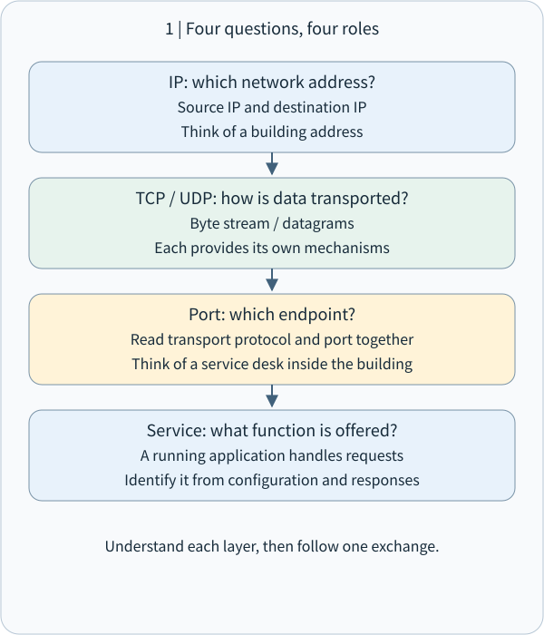
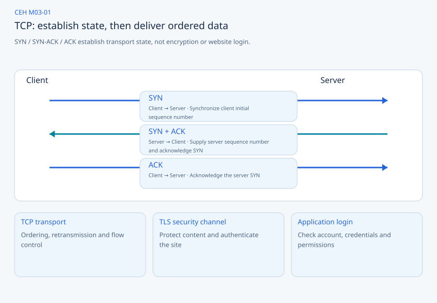
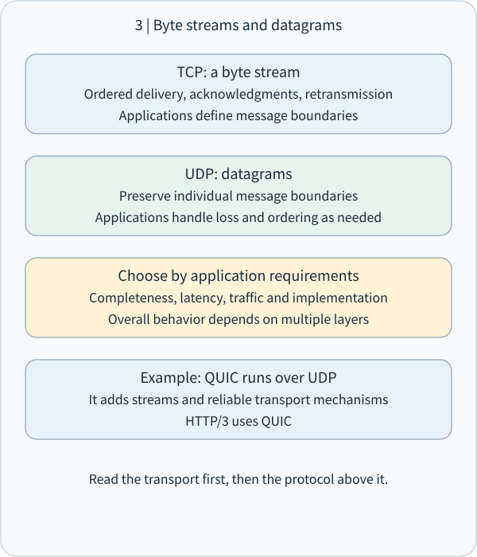
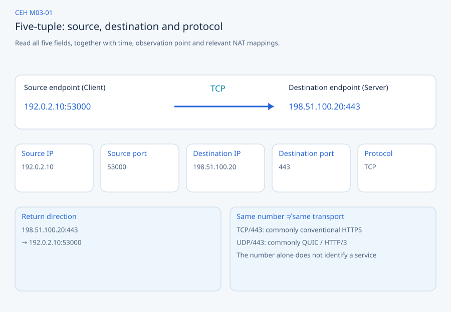

# CEH M03-01 | IP, TCP, UDP and Ports in Plain Language

These four concepts answer one question: when your computer communicates with another computer, how does the data reach the right place and the right program?

- IP: Which network address should the data reach?
- TCP: How can we transfer a reliable, ordered stream of bytes?
- UDP: How can we send individual datagrams without first establishing a TCP-style connection?
- Port: Which communication endpoint should receive the data after it reaches the computer?

These are foundations for CEH M03 Network Scanning. Understanding addresses, transport protocols and ports helps you interpret host discovery, port scans and service identification. [Kairos lesson](https://learn.cs-kairos.com/courses/ceh/v13/m03/concepts/m03-01/)

## 1 | The overall picture: an office building in a city

Imagine delivering documents to an office building. You need its location, a way to transport the documents, and the right desk inside. Network communication has similar responsibilities.



Suppose your computer connects to a website. Your computer has IP address `192.0.2.10`, and the server has `198.51.100.20`. These are documentation addresses, not claims about an operating public website. [RFC 5737](https://www.rfc-editor.org/rfc/rfc5737.html)

First, which host should receive the data? IP addresses that question.

Second, which transport mechanism should carry it? TCP or UDP addresses that question.

Third, which endpoint on the server should receive it? The port helps identify that endpoint.

Fourth, which program actually handles the request? That is the service.

This is a teaching sequence, not packet encapsulation order. On transmission, application data normally goes to TCP or UDP and is then carried in IP packets. Reception processes the layers in the opposite direction.

## 2 | IP: find a location on the network

### 2.1 What is IP?

IP stands for Internet Protocol. Think of an IP address as a logical network address, for example:

```text
192.168.1.10
```

An address can identify a network interface and help network devices decide where to forward data.

An IP address is an address, not a computer's permanent identity. One computer may have Wi-Fi, Ethernet and VPN interfaces with different addresses. Multiple devices may also share a public IP through Network Address Translation (NAT). A matching public IP in two records does not establish that they came from the same person or device.

### 2.2 What does IP do when you send data?

Your computer in Taiwan can contact a server overseas without knowing every router along the path in advance. The packet carries a destination IP; each router consults routing information to choose the next hop.

```text
Your computer: 192.0.2.10
    │ Destination IP: 198.51.100.20
    ▼
Home router
    ▼
Internet service provider network
    ▼
Routers in other networks
    ▼
Destination server: 198.51.100.20
```

A router usually needs the destination IP and routing information to forward a packet, rather than knowledge of which website button you clicked. Actual networks can also include firewalls, NAT, load balancers and other processing.

IP itself does not guarantee arrival, arrival order or automatic retransmission of lost packets. Other layers supply those capabilities when required. [RFC 791](https://www.rfc-editor.org/rfc/rfc791.html)

### 2.3 How are IP and DNS related?

You normally enter a name such as `google.com`, not an IP address. The Domain Name System (DNS) can resolve a name to an IP address. For a teaching example:

```text
shop.example
    │ DNS lookup
    ▼
198.51.100.20
    │ Subsequent connection
    ▼
Website server
```

The computer or browser may already have a cached answer, so a new lookup is not always necessary.

This connects to CEH M02: a domain name is a name; DNS resolves names; IP supports addressing; an Autonomous System Number (ASN) relates to autonomous-system routing policy. These are different objects.

### 2.4 What are IPv4 and IPv6?

`192.168.1.10` is an IPv4 address. IPv4 addresses contain 32 bits. `2001:db8::10` is an IPv6 example; IPv6 addresses contain 128 bits. A much larger address space is one purpose of IPv6. [RFC 8200](https://www.rfc-editor.org/rfc/rfc8200.html)

The central point is the responsibility: IP handles network addressing and packet forwarding. It does not directly select the application that handles data on a server. That is why we also need ports.

## 3 | TCP: an ordered byte stream with connection state

### 3.1 What is TCP?

TCP stands for Transmission Control Protocol. If IP supplies addresses and roads, TCP resembles a document-delivery system with acknowledgments and replacement deliveries.

An important document may travel in many pieces. The receiver needs the bytes in order, without missing pieces. TCP provides this transport capability.

TCP supplies a reliable, ordered byte stream while the connection operates. It does not promise unlimited retries until success under every possible network failure. [RFC 9293](https://www.rfc-editor.org/rfc/rfc9293.html)

### 3.2 Why establish a connection?

A browser and server normally start with the TCP three-way handshake.



Step one — SYN: the client sends a TCP segment with the SYN flag. In plain language, it asks to establish a connection. Technically, SYN synchronizes initial sequence-number information.

Step two — SYN-ACK: the server supplies its own synchronization information and acknowledges the client's SYN.

Step three — ACK: the client acknowledges the server's information. The endpoints establish the necessary TCP connection state and can normally exchange application data.

### 3.3 What is an ACK, and why is it needed?

ACK means acknowledgment. TCP sequence numbers identify byte positions so the receiver can track what has arrived and where data is missing.

```text
Expected: data 1 → data 2 → data 3
Arrives:  data 1 →          data 3
                       data 2 is lost
TCP detects the gap and retransmits data 2.
Application reads: data 1 → data 2 → data 3
```

For a research-paper PDF download, the application cannot treat a file with missing bytes as complete. Acknowledgment, retransmission and ordering help deliver the bytes correctly and in order.

TCP does not establish that the PDF is the version you intended, that its publisher is trustworthy, or that a website transaction completed. Applications and other security mechanisms address those questions.

### 3.4 What is a byte stream?

Suppose a program makes two writes:

```text
First write:  HELLO
Second write: WORLD
```

The receiver is not guaranteed two corresponding reads:

```text
First read:  HELLO
Second read: WORLD
```

It could instead read:

```text
First read:  HEL
Second read: LOWORLD
```

Or it could read all the data at once:

```text
HELLOWORLD
```

TCP preserves the ordered bytes, not the boundaries of individual application writes. Applications that need message boundaries define framing, such as a length prefix or delimiter. This matters when implementing network servers, WebSocket handling and custom protocols.

### 3.5 Does a TCP connection mean you have logged in?

No. Connecting a telephone call to a bank establishes a communication channel; it does not prove that you own a bank account.

Likewise, TCP establishes transport state. HTTPS also needs the appropriate TLS security channel. A website requiring login still needs application authentication and authorization.

TCP connection success ≠ TLS success ≠ user login success ≠ permission to perform an operation.

Keep this distinction when studying authentication, session management and session hijacking in CEH.

## 4 | UDP: send data as datagrams

### 4.1 What is UDP?

UDP stands for User Datagram Protocol. Its basic mechanism is simpler than TCP's. Imagine sending three separate notes: each note is an independent datagram. Sending does not first require TCP's three-way handshake.

If a note is lost, UDP itself supplies no TCP-style automatic acknowledgment, retransmission and ordered-stream delivery. Applications that require those features implement them above UDP or use another protocol built on it. [RFC 768](https://www.rfc-editor.org/rfc/rfc768.html)



### 4.2 Why not use TCP for everything?

Applications have different requirements. In a live voice call, the speaker might say, “Hello, can you hear me?” Audio data keeps arriving. If a small piece is lost, must playback wait for its retransmission before playing anything later? Not necessarily.

A piece of audio that arrives after its playback deadline may no longer be useful. Some real-time systems therefore carry media over UDP and handle loss, jitter buffering and audio concealment in the application.

This does not mean UDP is always faster. Its simpler datagram interface lets higher layers choose what is worth waiting for, acknowledging or retransmitting.

### 4.3 The core differences between TCP and UDP

| Property | TCP | UDP |
|---|---|---|
| Transport unit | Byte stream | Independent datagrams |
| Transport connection establishment | Yes | No |
| TCP three-way handshake | Yes | No |
| Built-in reliable transport | Yes | No |
| Built-in ordered delivery | Yes | No |
| Application message boundaries | Not preserved | Datagram boundaries preserved |
| Built-in encryption | No | No |
| Common applications | SSH, HTTP/1.1, HTTP/2 | DNS, real-time media, QUIC |
| Main characteristic | Reliable, ordered byte stream | Simple, independent datagram delivery |

Remember TCP's stream and UDP's datagram. DNS is listed as a common UDP application, not as a claim that DNS uses UDP exclusively.

### 4.4 Why does HTTP/3 use UDP?

Modern websites do not all use TCP. HTTP/3 uses QUIC, which runs over UDP.

```text
HTTP/3: web requests and responses
    ▼
QUIC: encryption, connection management, reliable streams
    ▼
UDP: datagram transport
    ▼
IP: addressing and packet forwarding
```

QUIC implements reliable streams, flow control and other mechanisms above UDP. UDP's lack of reliable delivery does not prevent a protocol using UDP from providing reliability. [RFC 9000](https://www.rfc-editor.org/rfc/rfc9000.html)

“TCP is reliable but slow; UDP is unreliable but fast” is an inadequate rule. Performance depends on network conditions, application protocols, loss, transport strategies and implementation.

## 5 | Ports: deliver data to the right program endpoint

### 5.1 Why do we need a port if we have an IP?

An Ubuntu machine can run a website, SSH administration and a database at the same time. They may share IP address `192.168.1.10`. The destination IP alone does not distinguish their communication endpoints.

TCP and UDP therefore include port numbers. Examples include:

```text
192.168.1.10:22
192.168.1.10:80
192.168.1.10:443
```

```text
One server: 192.168.1.10
    ├── TCP 22  → SSH
    ├── TCP 80  → HTTP
    └── TCP 443 → HTTPS
```

These are common configurations, not mandatory assignments. A port number is a logical protocol and operating-system identifier, not a physical USB or Ethernet socket on the computer case.

### 5.2 Why are port numbers 0–65535?

TCP and UDP port fields contain 16 bits. `2^16 = 65536` different values, starting from zero, give the range `0–65535`.

IANA defines three ranges:

| Port range | Category | Plain-language meaning |
|---|---|---|
| 0–1023 | System Ports | Range for common system and standard services |
| 1024–49151 | User Ports | Range available for application-service registration |
| 49152–65535 | Dynamic / Private Ports | Dynamic or private use |

Port 0 is reserved. An operating system's actual ephemeral-source-port selection range need not exactly match IANA's dynamic-port classification. [IANA registry](https://www.iana.org/assignments/service-names-port-numbers/service-names-port-numbers.xhtml)

### 5.3 What are source and destination ports?

Suppose your browser at `192.0.2.10` contacts an HTTPS service at `198.51.100.20` over TCP/443. Your operating system may choose ephemeral source port `53000`.

```text
Source:      192.0.2.10:53000
                 ↓ TCP
Destination: 198.51.100.20:443
```

The reply reverses the endpoints:

```text
198.51.100.20:443
         ↓ TCP
192.0.2.10:53000
```

Endpoint information helps both operating systems distinguish communications. One computer can have many website connections at the same time.



### 5.4 What is a five-tuple?

The five fields are source IP, source port, destination IP, destination port and transport protocol.

```text
192.0.2.10:53000
        ↓ TCP
198.51.100.20:443
```

| Field | Example |
|---|---|
| Source IP | 192.0.2.10 |
| Source Port | 53000 |
| Destination IP | 198.51.100.20 |
| Destination Port | 443 |
| Protocol | TCP |

Firewalls, monitoring systems and traffic-analysis tools can match or aggregate these fields. If traffic crosses NAT, addresses or ports may differ at different observation points. Investigations therefore also need time, observation location and any relevant NAT mappings.

### 5.5 Are TCP/443 and UDP/443 the same port?

The numbers match, but the transport endpoints differ. TCP and UDP have separate port spaces.

```text
TCP / 443 → commonly conventional HTTPS
UDP / 443 → commonly QUIC / HTTP/3
```

Inspect protocol plus port, not just `443`. Even TCP/443 does not prove that a service is HTTPS: applications can use different configured ports. Service identification requires more evidence than a port number.

## 6 | Observe IP, TCP and ports on Ubuntu

These exercises run on your own Ubuntu computer and do not scan anyone else's device.

Experiment one — inspect your IP addresses:

```bash
ip -br addr
```

An illustrative output is:

```text
lo       UNKNOWN 127.0.0.1/8
enp3s0   UP      192.168.1.10/24
```

`lo` is the loopback interface; `127.0.0.1` normally refers to this host. `enp3s0` is an example interface name. `192.168.1.10/24` is its IPv4 address with a network prefix length.

Inspect routes with:

```bash
ip route
```

The routing table helps explain which interface or gateway the system selects for other networks.

Experiment two — inspect local listening endpoints:

```bash
sudo ss -lntup
```

This shows local TCP/UDP listening or bound endpoints and available process information. An example TCP entry is:

```text
tcp LISTEN 0 128 127.0.0.1:8000
```

A process is listening on local TCP/8000. A bind address of `0.0.0.0:8000` normally covers all local IPv4 interfaces instead of only loopback. It does not prove external reachability: firewalls, NAT and other devices can still restrict access.

Experiment three — start your own web service:

```bash
python3 -m http.server 8000 --bind 127.0.0.1
```

This simple HTTP server listens only on loopback. In another terminal, inspect the listener:

```bash
ss -lntp | grep ':8000'
```

Then request response headers:

```bash
curl -I http://127.0.0.1:8000
```

You should see HTTP response headers. Here the IP is `127.0.0.1`, the transport is TCP, the destination port is `8000`, and the service is Python's HTTP server. Press `Ctrl+C` in the first terminal to stop it.

Listening on a port does not mean everyone on the network can access it. Scanning results depend on reachability, host configuration, firewalls and service responses.

## 7 | Put the concepts together: one website connection

Consider HTTPS using TCP:

```text
Enter website name
    ▼
DNS resolution if needed: obtain server IP
    ▼
IP: forward packets to destination
    ▼
TCP: establish connection and transport state
    ▼
Port 443: identify destination endpoint
    ▼
TLS: establish encryption and authentication mechanisms
    ▼
HTTP: send a website request
    ▼
Service: application handles the request
    ▼
Browser receives website content
```

This is a conceptual flow, not packet encapsulation order. DNS may use cached data, TCP, UDP or other transports. HTTP/3 has a different transport architecture.

| CEH topic | Connection to this lesson |
|---|---|
| M02 Footprinting | DNS, IP, ASN and network scope |
| M03 Network Scanning | Discover hosts, ports and services |
| M04 Enumeration | Learn what information or resources a service exposes |
| M08 Sniffing | Observe IP, TCP, UDP and packet contents |
| M11 Session Hijacking | Distinguish transport connections, encrypted channels and application sessions |
| M12 Firewalls | Control traffic using IP, protocol and port conditions |

These distinctions also inform NAS, server and Cloudflare protection design. Allowing an IP to reach TCP/443 is network access control. Permission to connect does not establish permission to log in, and login does not grant every operation. Authentication and authorization need their own mechanisms.

## 8 | Remember the architecture

| Concept | Question it answers | Key terms |
|---|---|---|
| IP | Which network address receives the data? | Address, Routing |
| TCP | How do we transfer reliable, ordered data? | Connection, Stream, ACK |
| UDP | How do we send independent datagrams? | Datagram |
| Port | Which communication endpoint receives the data? | Port Number, Socket |
| Service | Who actually handles the request? | Application, Listener |

IP locates the address, TCP or UDP supplies the transport, a port helps identify the program endpoint, and the service is the application providing the function.

## 9 | Check your understanding

Try these three questions without looking up an answer.

Question one: a server at `192.168.1.100` runs SSH, HTTP and HTTPS. Why is the IP address alone insufficient to choose which service to contact?

Question two: if your computer completes the TCP three-way handshake, does that mean you can log in to the website? Why?

Question three: in a live voice system, a small audio packet is lost while later audio has arrived. Should playback always wait for retransmission, or can it process later audio according to playback deadlines? Explain your reasoning.

These questions check IP/port responsibilities, the difference between TCP and authentication, and application-level TCP/UDP tradeoffs.
