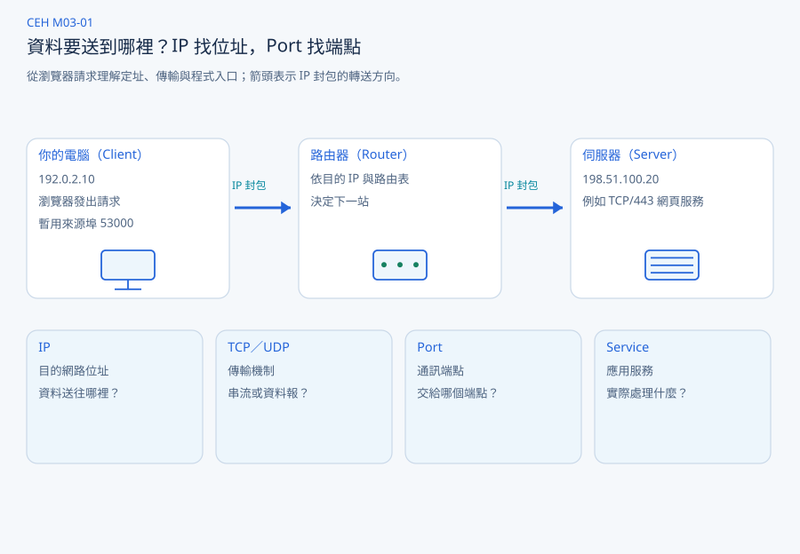
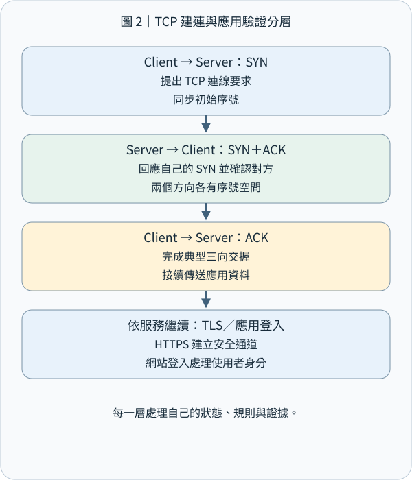
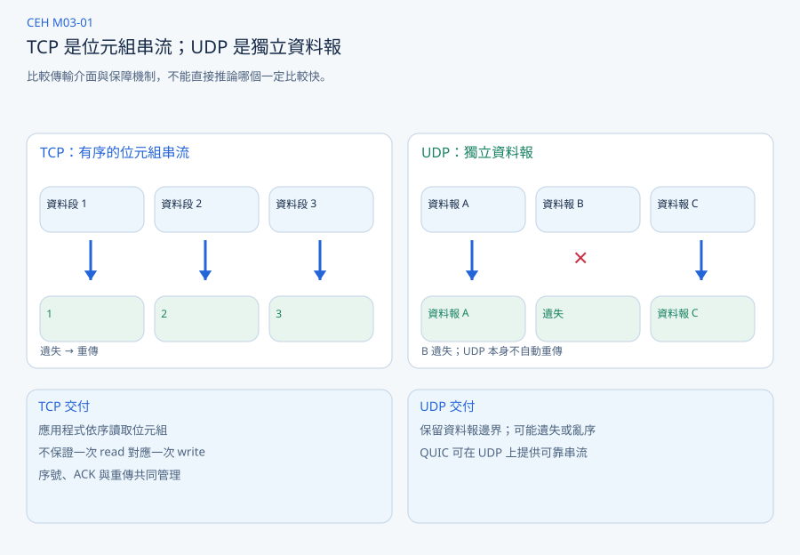
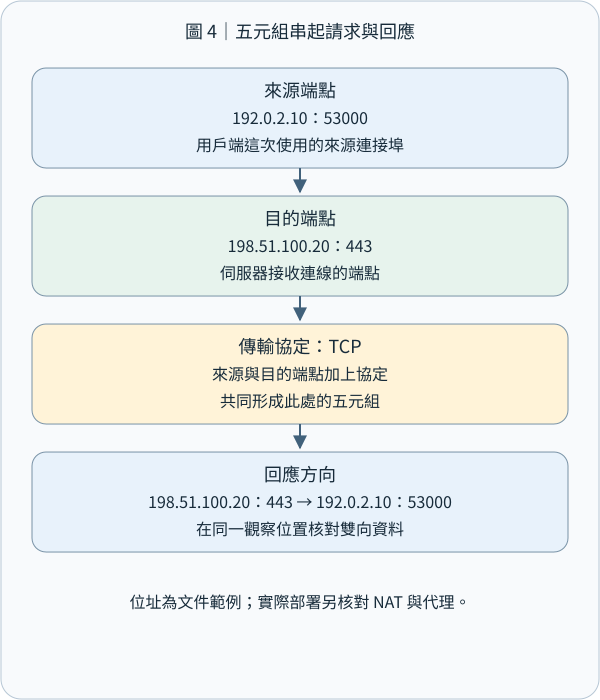

# CEH M03-01｜IP、TCP、UDP、Port 白話文教學

**這四個概念，其實都在回答同一個問題：當你的電腦想跟另一台電腦溝通時，資料究竟如何找到正確的地方，並交給正確的程式？**

你只要先記住四句話：

- **IP：** 資料要送到哪一個網路位址？
- **TCP：** 如何可靠地傳送一段連續、有順序的資料？
- **UDP：** 如何一份一份地傳送資料，而不預先建立 TCP 那樣的連線？
- **Port：** 資料抵達電腦後，要交給哪一個通訊端點？

這也是 CEH M03「Network Scanning（網路掃描）」的重要基礎。因為資安人員必須先理解 IP、傳輸協定與連接埠，才能正確判讀主機探索、Port Scanning 與服務辨識的結果。[learn.cs-kairos.com](https://learn.cs-kairos.com/courses/ceh/v13/m03/concepts/m03-01/)

---

## 1｜先建立整體概念：把網路想像成城市裡的辦公大樓

假設你今天要到一棟大樓辦理業務。

你需要知道大樓在哪裡、如何把文件送過去，以及文件抵達後要交給哪個窗口。

網路通訊也是一樣。



假設你的電腦要連上一個網站。

我們先設定這個情境：

你的電腦 IP 是 `192.0.2.10`，網站伺服器 IP 是 `198.51.100.20`。

這兩個 IP 是專門保留給文件與教學使用的示範位址，不代表實際運作中的公開網站。[RFC Editor](https://www.rfc-editor.org/rfc/rfc5737.html)

整個過程可以分成四個問題。

**第一個問題：資料要送到哪台主機？**

這是 IP 的工作。

**第二個問題：資料應該採用什麼傳輸方式？**

這是 TCP 或 UDP 的工作。

**第三個問題：資料抵達伺服器後，要交給哪個通訊端點？**

這是 Port 的工作。

**第四個問題：哪個程式真正處理這個請求？**

這是 Service（服務）的工作。

要注意，這四個問題是我們理解系統的順序，不代表實際封包會先處理 IP、再處理 TCP。傳送時，應用程式資料通常先交給 TCP／UDP，再封裝進 IP 封包；接收時則逐層往上處理。

接下來，我們逐一拆解。

---

## 2｜IP：先找到網路上的位置

### 2.1 IP 究竟是什麼？

IP 是 Internet Protocol（網際網路協定）。

你可以將 IP 位址想成一個**網路上的邏輯地址**。

例如：

```text
192.168.1.10
```

這個地址可以用來識別某個網路介面，讓網路設備知道資料應該往哪裡送。

但要區分兩件事：

**IP 位址是地址，不是電腦本身的永久身分證。**

同一台電腦可能同時有 Wi-Fi、乙太網路與 VPN，每個介面可能有不同 IP。

另一方面，很多設備也可能透過 NAT（網路位址轉換）共用同一個公開 IP。

因此，不能只因為兩筆紀錄的公開 IP 相同，就判斷一定來自同一個人或同一台設備。

### 2.2 當你發送資料時，IP 做了什麼？

假設你的電腦位於台灣，想連接海外某台伺服器。

你的電腦並不需要事先知道沿途每一台路由器。

IP 封包中會記錄目的 IP 位址，而路由器（Router）會根據路由表決定下一站。

可以把它想成：

```text
你的電腦
192.0.2.10
    │
    │ 目的 IP：198.51.100.20
    ▼
家中路由器
    │
    ▼
電信業者網路
    │
    ▼
其他網路的路由器
    │
    ▼
目的伺服器
198.51.100.20
```

這裡的重點是：

**路由器不需要知道你在網站上按了哪個按鈕，通常只需要根據目的 IP 與路由資訊決定如何轉送封包。**

當然，實際網路可能還有防火牆、NAT、負載平衡器及其他處理機制。

IP 本身並不保證封包一定送達、一定照順序到達，或遺失後自動重傳。這些工作需要由其他層次處理。[RFC Editor](https://www.rfc-editor.org/rfc/rfc791.html)

### 2.3 IP 跟 DNS 有什麼關係？

你可能會問：

「可是我平常打開網站，都是輸入 `google.com`，並沒有輸入 IP 啊？」

這時候就需要 DNS。

DNS（Domain Name System）可以協助將網域名稱解析成 IP 位址。

例如，假設某個網站的名稱是：

```text
shop.example
```

瀏覽器可能先透過 DNS 取得對應的 IP：

```text
shop.example
     │
     │ DNS 查詢
     ▼
198.51.100.20
     │
     │ 後續連線
     ▼
網站伺服器
```

不過，DNS 不一定每次都會重新查詢，因為電腦和瀏覽器可能已經有快取。

這也可以呼應先前 CEH M02 的內容：

**Domain Name、DNS、IP 與 ASN 並不是同一件事。**

Domain Name 是名稱，DNS 負責名稱解析，IP 用於網路定址，而 ASN 則與自治系統的路由政策有關。

### 2.4 IPv4 與 IPv6 是什麼？

你經常看到的：

`192.168.1.10`

就是 IPv4。

IPv4 使用 32 位元表示位址。

另一種：

`2001:db8::10`

則是 IPv6，使用 128 位元表示位址。

IPv6 的設計目的之一，是提供遠比 IPv4 更大的位址空間。[RFC Editor](https://www.rfc-editor.org/rfc/rfc8200.html)

這一節最重要的不是背誦位元數，而是理解：

**IP 解決的是網路位址與封包轉送問題，並不直接決定資料要由伺服器上的哪個應用程式處理。**

這就是為什麼還需要 Port。

---

## 3｜TCP：有連線狀態的有序位元組串流

### 3.1 TCP 是什麼？

TCP 是 Transmission Control Protocol（傳輸控制協定）。

如果 IP 像是在處理地址與道路，那麼 TCP 就像一套有確認與補送機制的文件傳輸制度。

假設你今天要寄送一份很重要的文件。

這份文件被拆成很多段，經過網路傳送。

你希望接收端最後拿到的內容：

內容正確、順序正確，而且沒有缺少任何一段。

TCP 就是用來提供這類傳輸能力的協定。

但有個重要細節：

**TCP 保證的是連線正常運作時，向應用程式提供可靠、有序的位元組串流，而不是承諾任何網路故障下都能無限重試直到成功。** [RFC Editor](https://www.rfc-editor.org/rfc/rfc9293.html)

### 3.2 TCP 為什麼需要建立連線？

假設你的瀏覽器想連接網站。

雙方通常會先進行 TCP Three-way Handshake（三向交握）。



我們逐步理解。

### 第一步：SYN

你的電腦傳送一個帶有 SYN 旗標的 TCP 封包。

你可以把它理解成：

「你好，我想跟你建立 TCP 連線。」

技術上，SYN 主要用來同步雙方的初始序號資訊。

### 第二步：SYN-ACK

伺服器收到請求後，回覆 SYN-ACK。

這代表伺服器提出自己的同步資訊，同時確認前面收到的 SYN。

可以理解成：

「我收到你想建立連線的請求，也把我的資訊告訴你。」

### 第三步：ACK

你的電腦再回覆 ACK。

雙方完成這次基本交握，建立必要的 TCP 連線狀態。

到這裡，兩端通常就可以透過這條連線交換應用程式資料。

### 3.3 ACK 是什麼？為什麼需要它？

ACK 是 Acknowledgment（確認）。

假設伺服器需要接收一段資料。

TCP 會使用序號（Sequence Number）標記位元組的位置，讓接收端知道目前收到了哪些資料、還缺少哪些資料。

例如：

```text
原本應該收到：

資料 1 → 資料 2 → 資料 3

實際網路傳送：

資料 1 → 資料 3
            ↑
          資料 2 遺失

TCP 偵測出缺口
            │
            ▼
        重傳資料 2
            │
            ▼
應用程式依序讀取：

資料 1 → 資料 2 → 資料 3
```

這種能力非常重要。

假設你正在下載一份研究論文 PDF。

如果中途遺失了某些資料，應用程式不能直接把缺少內容的資料視為完整文件。

TCP 的確認、重傳與排序機制，可以協助確保接收到的位元組內容正確且有序。

不過，這不代表 TCP 可以判斷你下載的 PDF 是不是你想要的版本、文件是否具有可信來源，或網站交易是否完成。

那些屬於應用程式與其他安全機制的責任。

### 3.4 「位元組串流」到底是什麼？

這是 TCP 最容易被初學者忽略的觀念。

假設有個程式想送出兩則訊息：

```text
第一次寫入：HELLO
第二次寫入：WORLD
```

你可能以為對方一定會分兩次收到：

```text
第一次讀取：HELLO
第二次讀取：WORLD
```

但 TCP 不保證這件事。

對方可能讀到：

```text
第一次讀取：HEL
第二次讀取：LOWORLD
```

或一次讀到：

```text
HELLOWORLD
```

原因是：

**TCP 提供的是連續位元組串流，而不是替應用程式保留每一次寫入的訊息邊界。**

如果應用程式需要知道一則訊息在哪裡結束，就必須自己制定規則，例如在訊息前加入長度資訊，或使用特定分隔符號。

這在開發 WebSocket、網路伺服器及各種自訂網路協定時非常重要。

### 3.5 TCP 建立連線，是否代表已經登入網站？

不是。

這是學習 CEH 時必須建立的關鍵區分。

想像你打電話給銀行。

電話接通，代表通訊管道建立。

但是銀行不會因為電話接通，就認定你是某個帳戶的合法持有人。

網路同樣如此。

TCP 建立連線，只代表建立了傳輸層的通訊狀態。

如果使用 HTTPS，還需要建立相應的 TLS 安全通道。

如果網站需要帳號登入，則還必須經過應用程式的身分驗證與授權流程。

因此：

**TCP 連線成功 ≠ TLS 加密成功 ≠ 使用者登入成功 ≠ 取得操作權限。**

這個區分會直接延伸到 CEH 的身分驗證、Session Management（工作階段管理）與 Session Hijacking（工作階段劫持）。

---

## 4｜UDP：以資料報為單位傳送

### 4.1 UDP 是什麼？

UDP 是 User Datagram Protocol（使用者資料報協定）。

與 TCP 相比，UDP 的基本機制相對簡單。

假設你想傳送三張獨立的紙條。

使用 UDP 時，每張紙條可以視為一份獨立資料報（Datagram）。

傳送端可以把資料報送出去，而不需要事先進行 TCP 那樣的三向交握。

但問題來了：

如果其中一張紙條遺失，怎麼辦？

**UDP 本身不提供 TCP 那套自動確認、遺失重傳與有序串流交付機制。**

如果應用程式需要這些能力，就必須在上層自行設計，或使用其他建立在 UDP 上的協定。[RFC Editor](https://www.rfc-editor.org/rfc/rfc768.html)



### 4.2 為什麼不乾脆全部使用 TCP？

這是一個很好的問題。

因為不同應用程式，對資料傳輸有不同要求。

假設你正在進行即時語音通話。

對方現在說：

「你好，請問有聽到嗎？」

語音系統會持續傳送聲音資料。

如果其中一小段聲音資料遺失了，是否一定要等到它重新傳送完成，才能播放後面的聲音？

不一定。

在即時語音的情境中，**某些已經過時的聲音資料，即使重新傳回來，也可能已經失去播放價值。**

因此，有些即時通訊系統會使用 UDP 傳送媒體資料，再由應用程式處理封包遺失、抖動緩衝（Jitter Buffer）及音訊補償等問題。

這不表示 UDP 一定比 TCP 快。

真正的差別是：UDP 本身提供較簡單的資料報傳輸介面，允許上層依照需求決定哪些資料值得等待、確認或重新傳送。

### 4.3 TCP 與 UDP 的核心差異

| 比較項目 | TCP | UDP |
|---|---|---|
| 基本傳輸形式 | 位元組串流 | 獨立資料報 |
| 是否需要建立傳輸連線 | 是 | 否 |
| 是否有 TCP 三向交握 | 有 | 沒有 |
| 是否內建可靠傳輸機制 | 有 | 沒有 |
| 是否內建有序交付 | 有 | 沒有 |
| 是否保留應用訊息邊界 | 不保留 | 保留資料報邊界 |
| 是否內建加密 | 沒有 | 沒有 |
| 常見應用 | SSH、HTTP/1.1、HTTP/2 | DNS、即時媒體、QUIC |
| 主要特點 | 提供可靠、有序的位元組串流 | 提供簡單、獨立的資料報傳送 |

這張表最重要的兩個關鍵詞是：

TCP 的 **Stream（串流）** 與 UDP 的 **Datagram（資料報）**。表中 DNS 是常見 UDP 應用，並不表示 DNS 只能使用 UDP。

### 4.4 UDP 沒有可靠性，那 HTTP/3 為什麼使用 UDP？

這是理解現代網路技術的一個重要轉折。

現在的網站不一定全部使用 TCP。

HTTP/3 使用 QUIC，而 QUIC 建立在 UDP 之上。

你可以把它想成：

```text
HTTP/3
網頁請求與回應
     │
     ▼
QUIC
提供加密、連線管理、
可靠串流等能力
     │
     ▼
UDP
提供資料報傳輸
     │
     ▼
IP
提供定址與封包轉送
```

QUIC 可以在 UDP 的基礎上實作可靠傳輸、資料流控制與其他機制。

因此：

**UDP 本身不提供可靠交付，不代表使用 UDP 的應用程式就不可能具有可靠傳輸能力。** [RFC Editor](https://www.rfc-editor.org/rfc/rfc9000.html)

這也是為什麼不能簡單把 TCP 解釋成「可靠但慢」，UDP 解釋成「不可靠但快」。

真正的效能需要考慮網路條件、應用協定、封包遺失、傳輸策略與實作方式。

---

## 5｜Port：把資料交給對應的程式入口

### 5.1 為什麼有 IP，還需要 Port？

這是本課最重要的問題之一。

假設你在同一台 Ubuntu 電腦上，同時執行：

一個網站伺服器、一個 SSH 遠端管理服務，以及一個資料庫。

這些程式可能都使用同一個 IP 位址。

例如：

```text
192.168.1.10
```

但外部電腦送來的資料，究竟應該交給哪個程式？

如果只有 IP，還不足以區分這些通訊端點。

因此 TCP 和 UDP 使用 Port Number（連接埠號碼）。

例如：

```text
192.168.1.10:22
192.168.1.10:80
192.168.1.10:443
```

你可以把它理解成：

```text
IP：192.168.1.10
       │
       ▼
  同一台伺服器
       │
       ├── TCP 22  → SSH
       │
       ├── TCP 80  → HTTP
       │
       └── TCP 443 → HTTPS
```

這些只是常見的設定範例，並非強制規定。

**Port 是作業系統與網路協定使用的邏輯編號，不是電腦機殼上實體的 USB 或網路孔。**

### 5.2 Port 為什麼是 0～65535？

因為 TCP 與 UDP 標頭中的連接埠欄位都是 16 位元。

16 位元可以表示：

`2^16 = 65536`

個不同數值。

從 0 開始計算，就是：

`0～65535`

IANA 將連接埠分成三個主要範圍。

| Port 範圍 | 分類 | 白話理解 |
|---|---|---|
| 0～1023 | System Ports | 常見系統及標準服務使用的範圍 |
| 1024～49151 | User Ports | 可登錄給各類應用服務使用 |
| 49152～65535 | Dynamic／Private Ports | 動態或私用範圍 |

其中 Port 0 是保留埠。

另外要注意，作業系統實際選擇暫用來源埠的範圍，不一定完全等於 IANA 的動態埠分類。[iana.org](https://www.iana.org/assignments/service-names-port-numbers/service-names-port-numbers.xhtml)

### 5.3 什麼是來源 Port 與目的 Port？

假設你現在使用瀏覽器連接網站。

你的電腦：

```text
192.0.2.10
```

網站伺服器：

```text
198.51.100.20
```

網站使用 TCP/443 提供 HTTPS 服務。

但你的電腦也需要為這次通訊準備來源端點。

作業系統可能選擇一個暫用來源埠，例如：

`53000`

於是，這次傳輸可能是：

```text
來源：
192.0.2.10:53000

       ↓ TCP

目的：
198.51.100.20:443
```

伺服器要回傳資料時，方向就相反：

```text
198.51.100.20:443

       ↓ TCP

192.0.2.10:53000
```

這樣，雙方的作業系統才能區分不同的通訊。

例如，同一台電腦可以同時開啟多個網站，每一條通訊都具有可用於區分的端點資訊。



### 5.4 什麼是 Five-tuple（五元組）？

你在 CEH 後續章節會經常遇到這個名詞。

五元組就是使用五個欄位描述一筆網路通訊：

**來源 IP、來源 Port、目的 IP、目的 Port、傳輸協定。**

例如：

```text
192.0.2.10:53000
        ↓
198.51.100.20:443
       TCP
```

拆開來看：

| 欄位 | 範例 |
|---|---|
| Source IP | 192.0.2.10 |
| Source Port | 53000 |
| Destination IP | 198.51.100.20 |
| Destination Port | 443 |
| Protocol | TCP |

五元組經常用來識別與描述網路流量。

防火牆、網路監控系統及流量分析工具，都可能使用這些欄位進行比對或統計。

不過，如果流量經過 NAT，封包在不同觀察位置看到的 IP 或 Port 可能有所不同。

因此，資安調查還需要記錄時間、觀察位置及可能的 NAT 對應資訊。

### 5.5 TCP/443 與 UDP/443 是同一個 Port 嗎？

雖然數字相同，但不是同一個傳輸端點。

TCP 與 UDP 有各自的連接埠空間。

例如：

```text
TCP / 443
    │
    └── 常見：傳統 HTTPS

UDP / 443
    │
    └── 常見：QUIC / HTTP/3
```

所以分析網路流量時，不能只看 `443`。

你應該同時看：

**Protocol + Port**

也就是：

`TCP/443` 或 `UDP/443`。

而且，就算看到 TCP/443，也不能直接認定它一定在執行 HTTPS。

因為應用程式可以自行設定使用其他 Port。

這也是 CEH 在進行服務辨識時，為什麼不能只憑埠號就做出最終判斷。

---

## 6｜實際操作：在 Ubuntu 上面觀察 IP、TCP 與 Port

接下來把概念對應到你可以親自觀察的東西。

以下操作只需在自己的 Ubuntu 電腦上進行，不涉及掃描其他人的設備。

### 實驗一：查看自己的 IP

開啟 Terminal，輸入：

```bash
ip -br addr
```

你可能看到類似：

```text
lo       UNKNOWN 127.0.0.1/8
enp3s0   UP      192.168.1.10/24
```

其中：

`lo` 是 Loopback（回送介面），`127.0.0.1` 通常代表本機。

`enp3s0` 是範例中的實體網路介面名稱。

`192.168.1.10/24` 表示這個介面配置的 IPv4 位址與網路前綴長度。

你也可以輸入：

```bash
ip route
```

查看電腦的路由表。

它能幫助你理解資料要送往其他網段時，系統會選擇哪個出口或閘道。

### 實驗二：查看正在監聽的 Port

輸入：

```bash
sudo ss -lntup
```

這個指令用來查看 TCP 與 UDP 的相關本機監聽端點，以及可取得的程式資訊。

例如你可能看到：

```text
tcp LISTEN 0 128 127.0.0.1:8000
```

這表示某個程式正在本機的 TCP/8000 監聽連線。

如果你看到：

```text
0.0.0.0:8000
```

通常表示程式綁定所有本機 IPv4 介面，而不是只限於 `127.0.0.1`。

但這不代表外部網路一定可以連進來。

因為防火牆、NAT 與其他網路設備仍可能限制連線。

### 實驗三：自己啟動一個網站服務

在 Ubuntu 開啟 Terminal，輸入：

```bash
python3 -m http.server 8000 --bind 127.0.0.1
```

這會建立一個只在本機回送位址上提供服務的簡單 HTTP 伺服器。

接著開啟另一個 Terminal：

```bash
ss -lntp | grep ':8000'
```

再使用：

```bash
curl -I http://127.0.0.1:8000
```

你應該可以看到 HTTP 回應標頭。

這個小實驗可以直接觀察：

IP 是 `127.0.0.1`，傳輸協定是 TCP，目的 Port 是 `8000`，實際提供服務的則是 Python 啟動的 HTTP 伺服器。

實驗完成後，在第一個 Terminal 按 `Ctrl+C` 即可停止服務。

這裡有一個重要的延伸觀念：

**程式正在監聽 Port，不等於網路上的任何人都可以存取它。**

這個區別非常重要，因為 CEH 的網路掃描不只是尋找開放埠，還要考慮網路可達性、主機設定、防火牆與服務回應。

---

## 7｜將四個概念串起來：真正理解一次網頁連線

現在假設你開啟一個 HTTPS 網站。

我們以使用 TCP 的 HTTPS 為例。

整個過程可以理解為：

```text
使用者輸入網站名稱
        │
        ▼
DNS 解析（必要時）
取得伺服器 IP
        │
        ▼
IP
將封包送往目的位址
        │
        ▼
TCP
建立連線與傳輸狀態
        │
        ▼
Port 443
定位目的通訊端點
        │
        ▼
TLS
建立加密與身分驗證機制
        │
        ▼
HTTP
瀏覽器傳送網站請求
        │
        ▼
Service
伺服器上的程式處理請求
        │
        ▼
瀏覽器收到網頁內容
```

這是概念流程，不是封包實際封裝順序；其中 DNS 也可能使用快取、TCP、UDP 或其他傳輸方式。如果採用 HTTP/3，傳輸架構則會有所不同。

你現在可以將這些概念與後續 CEH 章節連接起來：

| CEH 主題 | 與本課的關係 |
|---|---|
| M02 Footprinting | 了解 DNS、IP、ASN 與網路範圍 |
| M03 Network Scanning | 探索主機、Port 與服務 |
| M04 Enumeration | 進一步了解服務提供哪些資訊或資源 |
| M08 Sniffing | 觀察 IP、TCP、UDP 與封包內容 |
| M11 Session Hijacking | 區分網路連線、加密通道與應用工作階段 |
| M12 Firewalls | 使用 IP、傳輸協定、Port 等條件管理流量 |

這也能幫助你日後設計 NAS、伺服器與 Cloudflare 防護架構。

例如：

允許某個 IP 連接 TCP/443，是網路存取控制的一部分。

但是，**允許連線不代表允許登入；允許登入也不代表擁有所有操作權限。**

身分驗證與授權還需要其他機制負責。

---

## 8｜最後用一個表格記住整個架構

| 概念 | 解決的問題 | 最重要的關鍵詞 |
|---|---|---|
| IP | 資料送到哪個網路位址？ | Address、Routing |
| TCP | 如何傳送可靠、有序的資料？ | Connection、Stream、ACK |
| UDP | 如何傳送獨立的資料報？ | Datagram |
| Port | 資料應交給哪個通訊端點？ | Port Number、Socket |
| Service | 誰真正處理請求？ | Application、Listener |

你可以把整個概念記成一句話：

> **IP 負責找到地址，TCP／UDP 負責傳輸方式，Port 協助找到程式入口，而 Service 才是真正提供功能的應用程式。**

---

## 9｜理解檢核

請你嘗試回答以下三個問題，不需要查資料。

**問題一：**

假設一台伺服器的 IP 是 `192.168.1.100`，上面同時執行 SSH、HTTP 與 HTTPS。

為什麼我們不能只靠 IP，就決定要連接哪個服務？

**問題二：**

如果你的電腦已經成功完成 TCP 三向交握，是否就表示你可以登入該網站？為什麼？

**問題三：**

假設你正在開發一套即時語音通訊系統。某一小段聲音封包遺失，但後續聲音已經抵達。

你會希望程式一定要等遺失封包重新傳送後才播放嗎？還是可以根據播放時點直接處理後續聲音？請說明你的理由。

這三題分別檢查你是否掌握 **IP 與 Port 的分工、TCP 與身分驗證的區別，以及 TCP／UDP 在真實應用中的取捨**。
