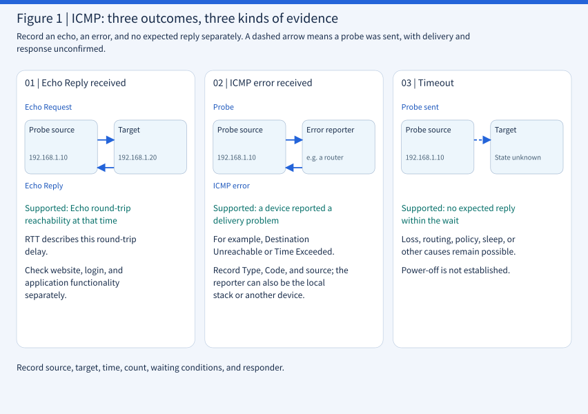
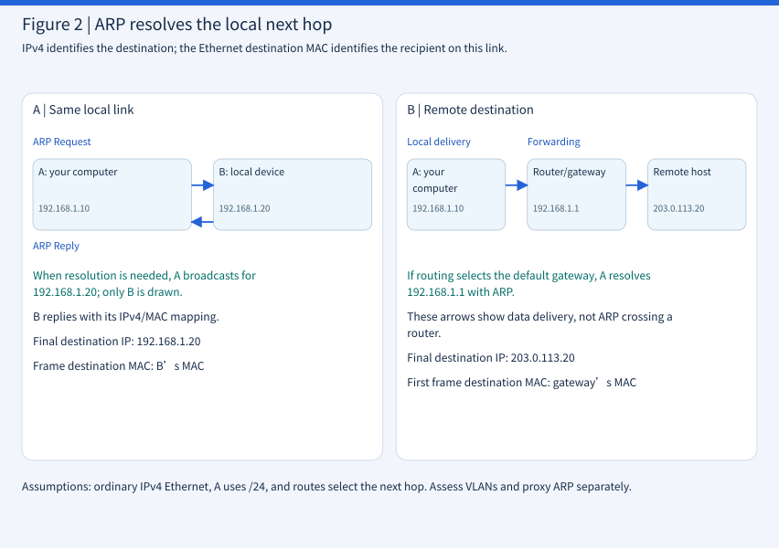

# CEH M03-02 | Host discovery: ICMP and ARP

## 1 | Find activity, interpret replies, and select the next hop

Host discovery looks for activity at network addresses under a specified time, observation point, and probe configuration. After a reply arrives, identify who replied, which message it represents, and what it establishes.

Imagine delivering a document to an office building. You call to check whether someone answers, then determine whether this leg of delivery goes to the recipient or a forwarding desk. An unanswered call has several possible explanations. A desk accepting the document does not establish that all the recipient's work is functioning.

| Concept | Plain-language meaning | Question answered |
|---|---|---|
| Host Discovery | Look for signs of activity | Which addresses warrant further checks? |
| ICMP | IP communication status messages | Was an echo or an error received? |
| Timeout | No expected reply within the wait | What is known, and which evidence is missing? |
| ARP | Ask for the local next hop's MAC | Who receives this Ethernet delivery? |

M03-01 explained IP, TCP, UDP, and ports. This lesson focuses on typical IPv4 Ethernet and separates address responses from service availability. Addresses, times, and outputs below are teaching examples; practical exercises start on the local computer.

## 2 | Discovery produces an observation with context

A host is a network-capable device such as an Ubuntu computer, NAS, server, or printer. Routers and other network devices may also respond to probes. With management authorization, use a designated test computer to observe responses from approved devices.

A NAS can answer ICMP while its DSM interface is stopped. A printer can print successfully while policy suppresses Echo Replies. Discovery supplies evidence about particular communication. The [Nmap host discovery documentation](https://nmap.org/book/man-host-discovery.html) describes its role in narrowing the set of targets for subsequent checks.

Compare two illustrative records: “192.168.1.50 did not respond; possibly offline” and “2026-11-03 10:00 Taiwan time: from 192.168.1.10, sent 4 ICMP Echo Requests to 192.168.1.50, waiting 1 second for each; no expected Echo Reply arrived. Check ICMP policy, connectivity, and device state.” The second preserves conditions a colleague can investigate. It illustrates a record format, not a per-packet timing guarantee for the Linux ping command below.

- Record the source computer, network, and target IP.
- Record protocol, tool and options, time and time zone, count, and waiting conditions.
- Record the actual responder, Type/Code and content, or absence of an expected reply.
- List possible causes, unknowns, and the next verification separately.

| Level | Illustrative wording | Supported? |
|---|---|---|
| Observation | No expected reply to 4 Echo probes | Yes; preserve the conditions |
| Inference | A firewall may restrict ICMP | Check policy |
| Inference | The device may be powered off | Check device state |
| Conclusion | The device certainly does not exist | Insufficient evidence |

## 3 | ICMP reports IP communication status

ICMP, Internet Control Message Protocol, carries IP control and diagnostic messages. IP provides best-effort delivery without guaranteeing success. Like delivery-status notices, ICMP can report some problems, but does not guarantee notification of every error.

### 3.1 ping, Echo messages, and round-trip time

ping is a diagnostic tool that commonly uses ICMP Echo Request and Echo Reply to observe round-trip communication. Host 192.168.1.10 sends a request; 192.168.1.20 may reply if it receives and permits it. The sender associates the reply using fields such as identifier and sequence number. RTT, Round-Trip Time, measures the interval from sending the request to receiving its matching reply.

The following is illustrative output, not a measured result:

```text
64 bytes from 192.168.1.20: icmp_seq=1 ttl=64 time=2.15 ms
```

| Field | Meaning |
|---|---|
| 192.168.1.20 | Source IP shown in the reply |
| icmp_seq=1 | Sequence number of this Echo probe |
| ttl=64 | Remaining TTL at arrival, not 64 routers already traversed |
| time=2.15 ms | RTT of this request and reply |

Several probes describe latency and loss at that time. A small sample cannot establish overall network performance or website quality.

### 3.2 Read Type/Code rather than TCP/UDP ports

ICMPv4 is carried directly in IPv4 packets and has no TCP/UDP source or destination port fields. Type and Code identify the message; Echo also has an identifier and sequence number. When reading a capture in Wireshark, identify the protocol before selecting the fields to interpret.

| ICMPv4 Type | Message | Interpretation |
|---|---|---|
| 8 | Echo Request | Echo request, Code 0 |
| 0 | Echo Reply | Echo reply, Code 0 |
| 3 | Destination Unreachable | Code distinguishes causes such as network, host, or port unreachable |
| 11 | Time Exceeded | Code 0: TTL exhausted in transit; Code 1: fragment reassembly timeout |

See [RFC 792](https://www.rfc-editor.org/rfc/rfc792) for these types and fields. ICMP supplies IP control messages; applications such as HTTP, SSH, and DNS communicate through their respective transport protocols.

## 4 | Interpret replies and timeouts

Group observations into three categories: Echo Reply received, ICMP error received, and no expected reply received. Destination Unreachable and Time Exceeded both belong to the error category.



### 4.1 An Echo Reply arrives

If ping -c 4 192.168.1.20 against an approved NAS receives four matching Echo Replies, record successful Echo round trips from this source at that time. The operating system may still reply when DSM is broken. Use the task's service checks to verify DSM, SSH, or a database separately.

### 4.2 Destination Unreachable arrives

Illustrative output:

```text
From 192.168.1.1: Destination Host Unreachable
```

Read From 192.168.1.1 first. If that is the gateway, the gateway reported a delivery problem. A local network stack or another device can also produce the message. Record source, Type, and Code, then investigate routing, links, or policy. This message alone does not confirm that the remote host is powered off.

### 4.3 Time Exceeded arrives

IPv4 TTL, Time To Live, limits packet lifetime. Normal routing reduces it by at least 1 per hop. On exhaustion, the packet is discarded and Type 11, Code 0 may be returned. This is one mechanism used by traceroute/tracepath tools to observe paths. It does not mean the test tool waited 5 or 10 seconds. Type 11 also includes fragment reassembly timeout as Code 1, so read the Code.

### 4.4 Timeout: the expected reply did not arrive

```text
4 packets transmitted, 0 received, 100% packet loss
```

This illustrative summary shows no expected Echo Replies to four requests. Preserve command options and full output to check for additional error messages. Possible causes include power-off, sleep, Echo filtering, routing problems, lost requests or replies, ICMP rate limits, and a broken return path.

Timeout is a tool's waiting outcome. Time Exceeded is a received ICMP error type. Keeping these observations separate directs the next investigation.

### 4.5 ping can fail while a website works

Suppose policy on 192.168.1.50 silently drops ICMP Echo Requests, allows TCP/443, and limits TCP/22 to designated management sources. ping may time out while HTTPS serves requests successfully. A policy that returns errors instead would produce a different observation.

Host discovery looks for activity; service-availability checks test whether a specified service performs the required function. The next lesson on port scanning examines responses from service endpoints.

## 5 | ARP finds the local next hop's MAC address

### 5.1 Why is a MAC needed when the IP is known?

IP describes the packet's network destination. Ethernet delivers frames locally, with source and destination MAC addresses in each frame. Think of IP as the postal destination and the destination MAC as the desk receiving this leg of delivery.

A MAC, Media Access Control, address is 48 bits in common Ethernet networks; 02:00:00:00:00:20 is an illustrative value. Ethernet and Wi-Fi interfaces on one computer may have different MAC addresses. Addresses may be randomized, changed, or spoofed, so a MAC alone is not an unforgeable device identity.

ARP, Address Resolution Protocol, resolves a local next-hop IPv4 address to a MAC address. Ethernet carries ARP directly. Its fields include IPv4 addresses, but ARP is not inside an IPv4 packet. [RFC 826](https://www.rfc-editor.org/rfc/rfc826) describes the resolution process.

Think of an Ethernet frame as the envelope used on this leg, carrying an IP packet inside. For an ICMP Echo Request from A to B on the same link, read the layers as follows. This field comparison omits other header fields.

| Location | Field or contents | Meaning in this exchange |
|---|---|---|
| Outer Ethernet frame | Source MAC: A’s interface | Who sends on this link |
| Outer Ethernet frame | Destination MAC: B’s interface | Who receives on this link |
| Enclosed IPv4 packet | Source IP: 192.168.1.10 | Source of the IP communication |
| Enclosed IPv4 packet | Destination IP: 192.168.1.20 | Destination of the IP communication |
| Inside the IP packet | ICMP Echo Request | The echo request carried here |

Thus “Ethernet frame → IPv4 packet → ICMP” is one encapsulation. ARP uses “Ethernet frame → ARP message.” IP addresses inside ARP are data fields; they do not mean an additional IPv4 packet surrounds ARP.

### 5.2 Four steps in a local Request/Reply exchange

Assume A is 192.168.1.10 with MAC 02:00:00:00:00:10, and B is 192.168.1.20 with MAC 02:00:00:00:00:20, on the same local Ethernet link.

- A checks its ARP cache and may use an available mapping directly.
- When resolution is needed, A sends an ARP Request asking who uses 192.168.1.20. A typical resolution request uses destination MAC ff:ff:ff:ff:ff:ff, broadcasting within that broadcast domain.
- B sends an ARP Reply containing its IPv4/MAC mapping. A reply to a typical request is usually sent directly back to A.
- A puts B's MAC in the Ethernet destination field to deliver the enclosed IP packet.

A broadcast resembles asking a classroom, “Who uses 192.168.1.20?” B, C, and D within the broadcast domain may receive it if that traffic is permitted. Normally, B, using the requested IP, answers. Broadcasting distributes the question within that domain; it does not make every device the final destination of the subsequent data.

Unicast sends a frame to one specified interface. A typical ARP Request already carries A’s IPv4 and MAC information, so B knows where to send its Reply directly. In this example, B reports that 192.168.1.20 maps to 02:00:00:00:00:20. With a usable mapping, A has the information needed for the destination MAC of this link’s data frame. This describes an ordinary request/reply exchange; proxy responses need separate interpretation.

Subsequent IP packets do not each require another broadcast. The system can reuse a valid mapping or confirm neighbor reachability when its cache state requires it. ARP resolves an address needed for delivery; ICMP, TCP, or UDP communication still has its own work to do.

### 5.3 A cached entry may reflect an earlier observation

On Ubuntu, ip -4 neigh show displays IPv4 neighbor information. Illustrative output:

```text
192.168.1.1 dev enp3s0 lladdr 02:00:00:00:00:01 REACHABLE
```

192.168.1.1 is the neighbor IPv4 address; dev enp3s0 names the local interface; lladdr introduces the link-layer address. Linux manages the final state:

| State | Meaning |
|---|---|
| REACHABLE | The kernel considers the neighbor reachable during the reachability validity period |
| STALE | The mapping remains valid, but reachability needs confirmation on subsequent use; not proof of being offline |
| INCOMPLETE | Resolution has not completed |
| FAILED | This resolution or reachability check failed |

Record when a cache entry was read separately from when a new ARP Reply arrived. Neighbor states do not establish the health of every device service. [ip-neighbour manual](https://man7.org/linux/man-pages/man8/ip-neighbour.8.html)

The neighbor table is temporary communication information, not a live inventory of online devices. Running ip -4 neigh show only reads existing records. An entry does not imply that reading it just triggered an ARP Request or received a fresh ARP Reply. Whether later traffic reuses the mapping, resolves it again, or confirms reachability depends on its state.

### 5.4 ARP's trust boundary

Basic ARP supplies no cryptographic identity authentication. If a forged mapping is accepted, such as mapping 192.168.1.1 to an unexpected device's MAC, traffic may be directed to that device. This is the basic risk of ARP spoofing. Corroborate identity using switch records, asset information, and network access controls.

IPv6 uses Neighbor Discovery, ND, through ICMPv6 for functions including neighbor-address resolution, rather than IPv4 ARP. [RFC 4861](https://www.rfc-editor.org/rfc/rfc4861)

ARP poisoning emphasizes the resulting incorrect mapping in the neighbor cache. If gateway 192.168.1.1 is mistakenly mapped to another device’s MAC, subsequent frames may go to the wrong recipient. Record the reported IP/MAC, reception time, and source, then corroborate management records to distinguish a normal gateway, a proxy response, or an anomalous mapping. This explains the risk without treating receipt of ARP as identity authentication.

## 6 | Local and remote delivery: whose MAC does ARP resolve?

Assume A is 192.168.1.10/24; its routing table treats 192.168.1.0/24 as directly connected and selects 192.168.1.1 as the default gateway. /24 means a 24-bit network prefix. This example uses ordinary IPv4 Ethernet without added NAT or tunnels.



For 192.168.1.20 on the same link, routing selects direct delivery. A resolves B's MAC. The destination IP is 192.168.1.20; the frame's destination MAC is B's MAC.

For remote 203.0.113.20, if routing selects the default gateway, A resolves the MAC for 192.168.1.1. The destination IP remains 203.0.113.20, while the first frame targets the gateway's MAC. The gateway then forwards according to its routes. Obtaining its MAC only completes local next-hop resolution; the remote host's reachability remains unverified.

203.0.113.20 is a documentation address. Actual next hops follow routing tables and interfaces. VLANs, Virtual LANs, can divide broadcast domains. With proxy ARP, another device may answer on an address's behalf. Ordinary ARP broadcasts do not cross routers, so they cannot directly request an arbitrary remote device's MAC. [RFC 1122](https://www.rfc-editor.org/rfc/rfc1122)

### 6.1 Understand the subnet with its mask

This supplementary exercise uses a separate synthetic address set from Figure 2: A is 192.168.10.10/24, B is 192.168.10.20/24, and the gateway is 192.168.10.1/24. All share a local Ethernet link that permits direct communication. /24 corresponds to mask 255.255.255.0 and network prefix 192.168.10.0/24.

In this /24 example, the first 24 bits identify the network and the remaining 8 identify the host portion. Addresses ending in .10, .20, and .1 belong to the same subnet; remote 10.20.30.40 does not. Comparing the first three dotted numbers works under this /24 assumption, not for every prefix length.

The operating system ultimately selects the next hop using routes and applicable routing policy. Addresses that appear to share a subnet also need a link permitting direct communication for local delivery to work.

### 6.2 Routing selects the next hop before ARP resolves its MAC

For B, if A selects the directly connected 192.168.10.0/24 route, B itself is the next hop. When resolution is needed, A asks for 192.168.10.20. Delivery in this case does not go through the default gateway first.

For remote C, 10.20.30.40, if no better applicable route exists and A selects the default route through 192.168.10.1, it resolves the gateway’s MAC. Crossing a subnet does not always mean using the default gateway: a selected more-specific route determines its own next hop.

| Destination for A | Selected local next hop | Which IP does ARP query when needed? |
|---|---|---|
| B: 192.168.10.20 | B’s interface, direct delivery | 192.168.10.20 |
| C: 10.20.30.40 | Gateway 192.168.10.1 | 192.168.10.1 |

### 6.3 The first frame and the next frame

Assume A’s MAC is 02:00:00:00:00:10, the gateway’s local interface MAC is 02:00:00:00:00:01, and routing selects that gateway. Read the first leg toward C as follows:

| Encapsulation layer | Source | Destination |
|---|---|---|
| Outer Ethernet frame | A’s MAC: 02:00:00:00:00:10 | Gateway MAC: 02:00:00:00:00:01 |
| Inner IPv4 packet | A’s IP: 192.168.10.10 | C’s IP: 10.20.30.40 |

The IP and MAC destinations differ because they answer questions at different scopes: IP targets remote C, while this frame goes to the gateway first.

After receiving the packet, the router selects a next hop and output interface from its own routes. If the next link is Ethernet too, it re-encapsulates with the source and destination MAC addresses appropriate to that link. A’s original MAC fields do not travel unchanged all the way to C. In this simplified example without NAT, the IP source and destination addresses remain the same during forwarding, but fields such as TTL change. NAT, Network Address Translation, may also rewrite IP addresses. A non-Ethernet next link uses its corresponding link-layer encapsulation.

### 6.4 Broadcast scope and two common pitfalls

Calling out inside an office in Yilan reaches people in that local space; saying a Taipei address does not carry your voice to Taipei. Ordinary ARP broadcasts similarly stay within their Layer 2 broadcast domain. Routers do not forward them across the Internet as they forward IP packets.

VLANs divide Layer 2 broadcast domains. Even if two devices both use 192.168.10.x/24, A’s ordinary ARP broadcast cannot directly reach B when they occupy different VLANs that are not bridged together. Check interfaces, VLANs, and routes rather than inferring direct reachability from similar-looking addresses.

With proxy ARP, a router may answer for another address using its own MAC, allowing packets to reach it for forwarding. Such a Reply shows that someone supplied a mapping; it does not authenticate the responder as the final target. Corroborate proxy configuration with assets, routes, and management records. [RFC 1027: Proxy ARP](https://www.rfc-editor.org/rfc/rfc1027)

### 6.5 Connect the delivery steps

- Start with the destination IP; consult routes to select an output interface and local next hop.
- Check that next hop’s neighbor record. Reuse a usable mapping where appropriate; let the system handle state-dependent reachability confirmation.
- When resolution is needed, send an ARP Request on the applicable local link. After obtaining a usable mapping, fill in the frame’s destination MAC.
- Encapsulate the IP packet in the Ethernet frame for this leg and deliver it to the next hop. Preserve resolution failures as failures rather than recording delivery as completed.

This is a simplified sequence for ordinary IPv4 Ethernet. ARP resolution, IP delivery, ICMP response, and application success each need their own observations.

## 7 | Worked example: turn three observations into next steps

All data below is synthetic. Assume authorization to examine three test devices in an isolated laboratory network.

A: 192.0.2.20 responds to ARP on the local network; ICMP Echo times out.
B: 192.0.2.30 responds to both local ARP and ICMP Echo.
C: 198.51.100.20 is on a remote test network; currently only the ARP mapping for local gateway 192.0.2.1 has been found.

For A, record: “An ARP Reply for this IPv4 address was received locally. This Echo attempt timed out. Next, verify device identity, proxy ARP configuration, and ICMP policy.”

For B, record: “Local address resolution and Echo round-trip communication both responded, with time and source recorded. If the task includes service availability, continue with an approved service check.”

For C, record: “The local next-hop gateway's MAC address has been obtained. Activity at the remote target awaits the specified end-to-end check.”

Each record is useful. A separates link-layer responses from Echo policy. B supplies two complementary observations. C shows how far local delivery resolution has progressed.

Tool interpretation follows the same logic. In Nmap, -sn performs host discovery while skipping ordinary port scanning. The actual probes depend on local/remote placement, privileges, protocol, and options. -Pn skips host discovery and allows the specified subsequent checks to proceed against targets. Understand the option's purpose first, then configure it within approved scope. This lesson uses paper interpretation. [Nmap discovery options](https://nmap.org/book/man-host-discovery.html)

## 8 | Controls and verifiable results

For administrators, host discovery connects the devices listed in the asset register with the devices currently observed on the network. Put four practices into operation:

- Clear scope: record allowed networks, sources, times, rates, and stopping conditions. Use administrator-approved low-impact methods for sensitive devices.
- Clear policy: configure ICMP and management access for operational needs and document why required diagnostic messages are permitted. Routers also use ICMP to report certain errors, so policy should support normal communication. [RFC 1812: IPv4 router requirements](https://www.rfc-editor.org/rfc/rfc1812)
- Corroboration: compare probe results with the asset register, switch ports, DHCP leases, or endpoint-management records. DHCP dynamically assigns network settings; leases provide clues about allocation times.
- Evidence: retain source, destination, protocol, time, response, and actions. Refer unusual mappings to the responsible owner for review.

An acceptable result might be: “All three authorized test addresses have current observation records; responsive addresses have been checked against device ownership; timeout cases have investigation questions and owners; testing stayed within approved scope.”

This connects back to M02-08: keep observations, interpretations, and actions separate, and repeat checks under comparable conditions after policy changes.

### 8.1 Ubuntu exercises: loopback, neighbor records, and routes

Environment: Ubuntu with iputils ping and iproute2 ip. Confirm the tools are available. Loopback and table inspection require no external test host. The gateway ping in the second exercise is only for a device you administer and are authorized to test. Confirm its actual IP, send only 2 probes, and stop on unexpected impact. Do not copy an example address into a test of an unfamiliar network.

Step one: test local loopback.

```bash
ping -4 -c 4 -W 1 127.0.0.1
```

-4 selects IPv4; -c 4 sends 4 probes; -W 1 sets the response-timeout parameter to 1 second. The iputils manual states that -W affects waiting when there are no responses; after responses arrive, waiting is adjusted using RTT. It is neither a fixed one-second wait for every packet nor a one-second limit for the whole program. Normally, local Echo Replies and a summary appear. If none arrive, record errors and local policy. 127.0.0.1 tests only local IPv4/ICMP loopback, requires no Ethernet ARP, and does not verify an external network. [ping manual](https://man7.org/linux/man-pages/man8/ping.8.html)

Step two: inspect addresses, routes, and neighbor records in order.

```bash
ip -br -4 addr
ip -4 route
ip -4 neigh show
```

You might see the following illustrative routes. Actual addresses and interfaces vary.

```text
default via 192.168.1.1 dev enp3s0
192.168.1.0/24 dev enp3s0 proto kernel scope link
```

The first selects the default next hop; the second is a directly connected network. An empty neighbor table alone is not a fault. If your administered gateway is confirmed to be 192.168.1.1 and a low-volume test is authorized, run the following and compare neighbor records before and after:

```bash
ping -4 -c 2 -W 1 192.168.1.1
ip -4 neigh show
```

When local Ethernet delivery is needed, ARP resolution may succeed even if ICMP receives no reply. An existing cache entry also means a new ARP exchange is not guaranteed during this test. Record Echo results and neighbor states separately.

Step three: inspect a remote destination's route without probing it.

```bash
ip -4 route get 203.0.113.20
```

This asks the kernel to select a route; it does not send ping to the target. With a default route, the illustrative output below is possible. Without a usable route, an error may appear instead. Preserve the actual result.

```text
203.0.113.20 via 192.168.1.1 dev enp3s0 src 192.168.1.10
```

The destination is 203.0.113.20; 192.168.1.1 after via is the local next hop. [ip-route manual](https://man7.org/linux/man-pages/man8/ip-route.8.html)

Check: for each exercise, write what was observed and what it cannot establish. Route lookup does not prove the remote host is online; a cache entry does not prove a fresh reply; loopback success does not prove the external network interface works. Cleanup: these commands do not change configuration. ping ends after the specified count, or Ctrl+C stops it. Do not flush ARP records; the system manages their states naturally.

### 8.2 Connect observations to CEH scanning

Confirm authorization, discover hosts, record observations and uncertainties, select targets needing further checks, then proceed to port scanning and service detection. Each stage uses its own evidence to answer its own question.

| Question | ICMP | ARP |
|---|---|---|
| Main job | IP control and diagnostics | Resolve the local IPv4 next hop |
| Main information | IP, Type/Code | IPv4, MAC |
| Common messages | Echo Request/Reply | ARP Request/Reply |
| Routing scope | IP can route it to a remote destination | Ordinary broadcasts remain local |
| Reply establishes | Particular IP communication evidence | A reported IPv4/MAC mapping |
| No response | Does not directly prove power-off | Does not directly prove power-off |
| Ubuntu tools | ping | ip neigh |

### 8.3 Four read-only commands: connect routes with neighbor records

Use the supplementary Section 6 example with 192.168.10.0/24 and remote 10.20.30.40. This is a separate illustrative environment, not an instruction to change your network configuration. These Ubuntu iproute2 commands read local information without sending test traffic to the remote destination.

```bash
ip -br -4 addr
ip -4 route
ip -4 route get 10.20.30.40
ip -4 neigh show
```

First identify the interface and IPv4 address in the first command’s output. Illustrative output:

```text
lo       UNKNOWN  127.0.0.1/8
enp3s0   UP       192.168.10.10/24
```

Next, read the routing table together with the route lookup. These lines are also illustrative:

```text
default via 192.168.10.1 dev enp3s0
192.168.10.0/24 dev enp3s0

10.20.30.40 via 192.168.10.1 dev enp3s0 src 192.168.10.10
```

| Field | Meaning in this route result |
|---|---|
| 10.20.30.40 | Destination queried |
| via 192.168.10.1 | Selected next hop |
| dev enp3s0 | Output interface |
| src 192.168.10.10 | Selected source IP |

Finally, look for that next hop, shown after via, in the neighbor records for the same interface. An entry like this connects the routing decision to first-link delivery information:

```text
192.168.10.1 dev enp3s0 lladdr 02:00:00:00:00:01 REACHABLE
```

Record: “Route lookup selected enp3s0 and next hop 192.168.10.1 for the remote IP. At the time of reading, the neighbor table listed MAC 02:00:00:00:00:01 in REACHABLE state.” This describes table inspection, not a remote communication test. ip route get does not probe C or guarantee a corresponding neighbor entry. [ip-route manual](https://man7.org/linux/man-pages/man8/ip-route.8.html)

Check: identify destination IP, via, dev, src, lladdr, and state in your own output. If via is absent, no route exists, or the cache is empty, record that result instead of forcing the example. These queries change no settings and need no cleanup. Do not flush the cache to obtain a desired output. Later, direct observation of Request/Reply messages can use Wireshark or tcpdump on an administered, authorized laboratory link with a separately defined capture scope.

### 8.4 Place ARP within the CEH learning route

| Learning stage | Question answered |
|---|---|
| M02 reconnaissance | Which addresses, domains, and public information are known? |
| M03 routing and ARP | Where is the packet going, who is the local next hop, and how is its MAC obtained? |
| M03 ICMP and TCP/UDP probes | Which replies arrived, and which endpoints need further checks? |
| M04 enumeration | What additional information can authorized service queries obtain? |
| M08 sniffing | Which protocol exchanges actually appear in captured traffic? |

IP identifies the destination, routing selects the next hop, ARP helps obtain a local delivery address, and ICMP supplies particular replies or errors. Separating their evidence explains how an ARP Reply can coexist with a ping timeout and which service check is still needed.

## 9 | Checks and the takeaway

Answer in your own words first. Reference answers accompany the formal website material.

1. A device on the same local network returns an ARP Reply, but ping times out. How would you record the observation and the next check?
2. A sends to a remote network through its default gateway. Does A use ARP to resolve the remote host's MAC or the gateway's MAC, and why?
3. How should the observation times of an existing ARP cache entry and a newly received ARP Reply be distinguished?
4. An ICMP Echo Reply has been received. If the task is to confirm that a website provides its service correctly, what additional type of check is needed?

The key idea: establish the observation point and next hop before choosing a probe. Record the state represented by a response. Preserve timeout conditions and arrange verification. ICMP helps observe IP communication; ARP performs local IPv4 address resolution.

Next, M03-03 introduces TCP Connect, SYN, and UDP scanning, connecting addresses with activity indications to the responses of their individual ports.

### 9.1 Check understanding with three scenarios

5. Ubuntu receives Echo Replies to all four NAS ping probes, but a browser cannot open DSM. Are these outcomes contradictory? Why?

6. A printer's ping summary reads 4 packets transmitted, 0 received, 100% packet loss, yet colleagues can still print. What could explain this, and how would you record the observation?

7. A computer is 192.168.1.10/24, its gateway is 192.168.1.1, and it wants to reach 203.0.113.20. Assume routing selects the default gateway on ordinary IPv4 Ethernet. A. What is the final destination IP? B. Whose MAC is the first frame's destination? C. Why not directly ARP for the remote MAC?

### 9.2 Integrated scenario: a silent printer and a remote destination

Synthetic environment: computer A is 192.168.10.10/24, printer B is 192.168.10.20/24, the default gateway is 192.168.10.1, and remote server C is 10.20.30.40. Assume A, B, and the gateway’s local interface share an Ethernet link permitting direct communication, and the route to C selects that gateway.

Observation: all pings to B time out, but you receive an ARP Reply claiming a mapping for B. You then prepare to connect to C. Use this same scenario for all four questions; write your explanation before opening the reference answers.

8. Do B’s ping timeouts prove that it is powered off? What further evidence would you need?

9. Why might an ARP Reply arrive despite no ping reply? Does it authenticate B’s identity?

10. Which IP must A resolve with ARP to reach C? Why not directly ask for C’s MAC?

11. Who owns the destination IP and destination MAC in the first frame toward C? Does that establish that C received the data?
