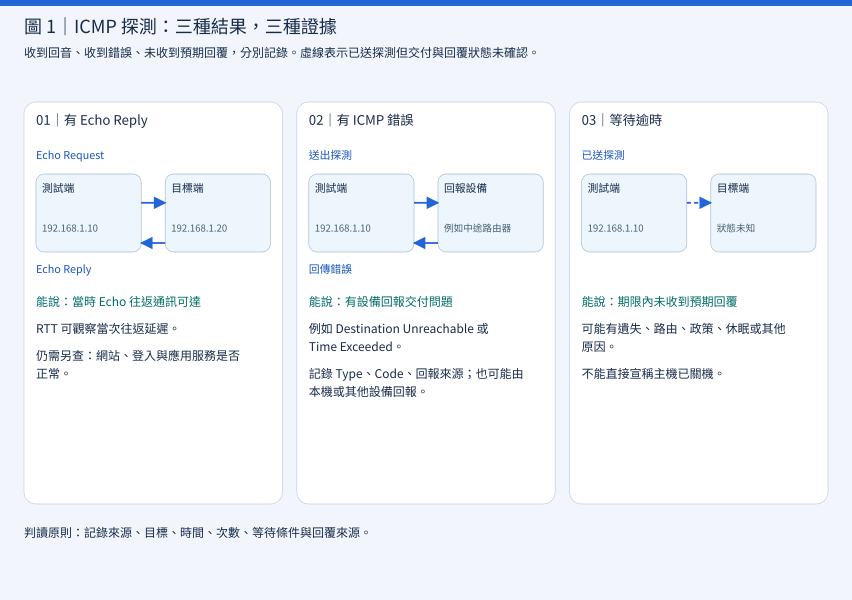
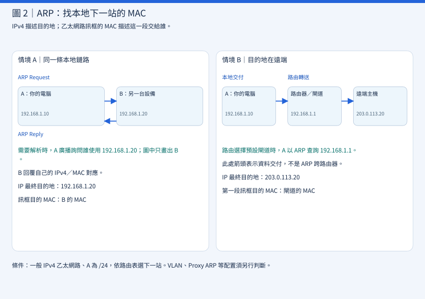

# CEH M03-02｜主機探索：ICMP 與 ARP

## 1｜先建立觀念：找人、確認回應、找到下一站

主機探索（Host Discovery）是在指定時間、觀察位置與探測條件下，尋找網路位址的活動跡象。收到回應後，還要判斷誰回應、回應哪一種訊息，以及它能證明什麼。

想像你到辦公大樓送文件：先打電話確認能不能聯絡，再確認這一段要把文件交給收件人還是轉送窗口。電話沒人接有多種原因；窗口願意收件，也不代表收件人的所有工作都正常。

| 概念 | 白話理解 | 要回答的問題 |
|---|---|---|
| Host Discovery | 找活動跡象 | 哪些位址值得進一步確認？ |
| ICMP | IP 通訊的狀態通知 | 收到回音或錯誤了嗎？ |
| Timeout | 等待期限內沒等到預期回覆 | 已知什麼、還缺什麼證據？ |
| ARP | 詢問本地下一站的 MAC | 這一段乙太網路要交給誰？ |

上一課 M03-01 說明 IP、TCP、UDP 與 Port 的分工。這一課以一般 IPv4 乙太網路為主，把「位址有回應」與「服務可用」分開。以下位址、時間與輸出均為教學示例；實際練習先從本機開始。

## 2｜探索的成果：一筆有情境的觀察

Host（主機）是能透過網路通訊的設備，例如 Ubuntu 電腦、NAS、伺服器或印表機。路由器等設備也可能回應探測。獲得管理授權後，你可以從指定測試電腦，觀察核准設備目前有哪些回應。

NAS 可以回應 ICMP，但 DSM 管理介面已停止；印表機也可以正常列印，卻因政策而不回覆 Echo。主機探索提供的是特定通訊的證據。[Nmap 主機探索文件](https://nmap.org/book/man-host-discovery.html)說明，這一步有助於縮小後續要檢查的目標範圍。

比較兩筆示意紀錄：「192.168.1.50 沒回應，疑似離線」與「2026-11-03 10:00（台灣時間），從 192.168.1.10 向 192.168.1.50 發送 4 次 ICMP Echo Request；每次等待 1 秒，未收到預期 Echo Reply。待查 ICMP 政策、連線及設備狀態」。第二筆留下了可供同事接續查核的條件；這是紀錄格式示例，並非下方 Linux ping 的逐封包計時保證。

- 記錄來源電腦、網段與目標 IP。
- 記錄探測協定、工具與參數、時間與時區、次數及等待條件。
- 記錄實際收到的來源、Type／Code、內容或未收到預期回覆。
- 分別列出可能原因、未知資訊與下一步查核。

| 層次 | 示意寫法 | 能否成立 |
|---|---|---|
| 觀察 Observation | 4 次 Echo 探測均未收到預期回覆 | 可以，保存測試條件 |
| 推論 Inference | 可能是防火牆限制 ICMP | 待查政策 |
| 推論 Inference | 可能是設備關機 | 待查設備狀態 |
| 結論 Conclusion | 設備確定不存在 | 現有證據不足 |

## 3｜ICMP：IP 網路的狀態回報

ICMP（Internet Control Message Protocol，網際網路控制訊息協定）提供 IP 通訊的控制與診斷訊息。IP 採盡力傳送（Best-effort Delivery），不保證交付成功；ICMP 像配送過程中的狀態通知，能回報部分問題，也不保證所有錯誤都有通知。

### 3.1 ping、回音請求與往返時間

ping 是診斷工具，常透過 ICMP Echo Request（回音請求）與 Echo Reply（回音回覆）觀察往返通訊。192.168.1.10 發出請求，192.168.1.20 收到且允許處理時可能回覆，測試端再以識別碼、序號等資訊配對回覆。RTT（Round-Trip Time，往返時間）是送出請求到收到對應回覆的時間。

以下為示意輸出，並非實測：

```text
64 bytes from 192.168.1.20: icmp_seq=1 ttl=64 time=2.15 ms
```

| 欄位 | 白話解讀 |
|---|---|
| 192.168.1.20 | 回覆封包顯示的來源 IP |
| icmp_seq=1 | 這次 Echo 探測的序號 |
| ttl=64 | 回覆抵達時剩餘的 TTL，並非已經過 64 台路由器 |
| time=2.15 ms | 這次請求與回覆的 RTT |

連續幾次 ping 可觀察當時延遲與遺失情形；少量樣本不足以代表整體網路效能或網站品質。

### 3.2 看 Type／Code，不找 TCP／UDP Port

ICMPv4 直接承載在 IPv4 封包中，沒有 TCP／UDP 的來源與目的 Port 欄位。它以 Type（類型）與 Code（代碼）描述訊息；Echo 另有識別碼、序號等欄位。用 Wireshark 判讀時，先確認封包的協定，再選對欄位。

| ICMPv4 Type | 訊息 | 解讀 |
|---|---|---|
| 8 | Echo Request | 回音請求，Code 0 |
| 0 | Echo Reply | 回音回覆，Code 0 |
| 3 | Destination Unreachable | 依 Code 區分網路、主機、連接埠等無法到達原因 |
| 11 | Time Exceeded | Code 0 是轉送時 TTL 耗盡；Code 1 是分片重組逾時 |

這些類型與欄位見 [RFC 792](https://www.rfc-editor.org/rfc/rfc792)。ICMP 是 IP 控制訊息；HTTP、SSH、DNS 等應用則透過各自使用的傳輸協定通訊。

## 4｜如何讀懂「有回覆」與「等待逾時」

把結果分成三類：收到 Echo Reply、收到 ICMP 錯誤、沒有收到預期回覆。Destination Unreachable 與 Time Exceeded 都屬於收到錯誤的情況。



### 4.1 收到 Echo Reply

若對核准 NAS 執行 ping -c 4 192.168.1.20，四次都收到對應 Echo Reply，可以記錄「當時從此來源到該 IP 的 Echo 往返通訊成功」。即使 DSM 網頁故障，作業系統仍可能回覆 Echo，因此還要用任務要求的服務檢查確認 DSM、SSH 或資料庫。

### 4.2 收到 Destination Unreachable

下面是示意輸出：

```text
From 192.168.1.1: Destination Host Unreachable
```

先看 From 192.168.1.1：若這是閘道，代表閘道回報交付問題。訊息也可能由本機網路堆疊或其他設備產生。記錄回報來源、Type 與 Code，再查路由、鏈路或政策；單靠這句話，無法確認遠端主機已關機。

### 4.3 收到 Time Exceeded

IPv4 的 TTL（Time To Live）限制封包的存活；一般路由轉送每跳至少減 1，耗盡時封包被丟棄，並可能收到 Type 11、Code 0。這是 traceroute／tracepath 類工具觀察路徑的基礎之一。此處不是測試工具等了 5 或 10 秒；Type 11 也另有分片重組逾時的 Code 1，須看 Code。

### 4.4 Timeout：沒有等到預期回覆

```text
4 packets transmitted, 0 received, 100% packet loss
```

這段示意摘要表示四次請求沒有收到預期 Echo Reply；仍應保留命令參數與完整輸出，確認是否另有錯誤訊息。可能原因包括關機、休眠、防火牆限制 Echo、路由問題、請求或回覆遺失、ICMP 限速，以及回程路徑異常。

Timeout 是工具的等待結果；Time Exceeded 是實際收到的一類 ICMP 錯誤。把這兩筆觀察分清楚，後續查核才有方向。

### 4.5 ping 失敗，網站仍可能正常

假設 192.168.1.50 的政策會靜默丟棄 ICMP Echo Request、允許 TCP/443，並把 TCP/22 限制為指定管理來源。此時 ping 可能逾時，但 HTTPS 可以正常服務。若政策改為回覆錯誤，觀察結果也會不同。

主機探索與服務可用性檢查回答不同問題：前者找活動跡象，後者確認指定服務能否完成所需功能。下一課 Port Scanning（連接埠掃描）會進一步觀察服務端點的回應。

## 5｜ARP：在本地找到下一站的 MAC 位址

### 5.1 已有 IP，為什麼還要 MAC？

IP 描述封包的網路目的地；Ethernet（乙太網路）以 Frame（訊框）在本地交付，每個訊框有來源與目的 MAC。可以把 IP 想成郵寄地址，把目的 MAC 想成這一段配送要交付的窗口。

MAC（Media Access Control，媒體存取控制）位址在常見乙太網路中為 48 位元，例如示範值 02:00:00:00:00:20。同一台電腦的乙太網路與 Wi-Fi 介面可能有不同 MAC；MAC 也可隨機化、變更或偽造，不能單獨當成不可偽造的設備身分證明。

ARP（Address Resolution Protocol，位址解析協定）協助解析本地下一站 IPv4 對應的 MAC。ARP 訊息直接由乙太網路承載；其中有 IPv4 欄位，但並未包在 IPv4 封包裡。[RFC 826](https://www.rfc-editor.org/rfc/rfc826)說明這個解析流程。

### 5.2 本地 Request／Reply 的四個步驟

假設 A 是 192.168.1.10、MAC 為 02:00:00:00:00:10；B 是 192.168.1.20、MAC 為 02:00:00:00:00:20，兩者位於同一條本地乙太網路。

- A 先查 ARP Cache（ARP 快取），有可用的對應資訊時可能直接使用。
- 需要解析時，A 發出 ARP Request：「誰使用 192.168.1.20？」一般解析請求以 ff:ff:ff:ff:ff:ff 為目的 MAC，廣播到該廣播範圍。
- B 回覆 ARP Reply，提供自己的 IPv4／MAC 對應資訊；對一般請求的回覆通常直接送回 A。
- A 取得對應後，把 B 的 MAC 填入乙太網路訊框目的欄位，交付其中的 IP 封包。

### 5.3 快取有紀錄，不代表剛剛驗證過

Ubuntu 可用 ip -4 neigh show 查看 IPv4 鄰居資訊。以下為示意輸出：

```text
192.168.1.1 dev enp3s0 lladdr 02:00:00:00:00:01 REACHABLE
```

192.168.1.1 是鄰居 IPv4；dev enp3s0 是本機介面；lladdr 後面是鏈路層位址。最後的狀態由 Linux 核心管理：

| 狀態 | 白話解讀 |
|---|---|
| REACHABLE | 在可達性有效期內，核心認為鄰居可達 |
| STALE | 對應仍有效，但可達性需在後續使用時確認；不等於離線 |
| INCOMPLETE | 解析尚未完成 |
| FAILED | 本次解析或可達性確認已失敗 |

讀取快取的時間與新收到 ARP Reply 的時間應分別記錄。這些狀態描述鄰居資訊，不能證明設備所有服務正常。[ip-neighbour 手冊](https://man7.org/linux/man-pages/man8/ip-neighbour.8.html)

### 5.4 ARP 的信任限制

基本 ARP 沒有提供密碼學身分驗證。若偽造對應被接受，例如把 192.168.1.1 對應到非預期設備的 MAC，流量可能被導向該設備；這是 ARP Spoofing（ARP 欺騙）的基本風險。設備身分仍要對照交換器紀錄、資產資料與網路存取控制。

IPv6 使用 Neighbor Discovery（ND，鄰居探索），透過 ICMPv6 完成鄰居位址解析等工作，不使用 IPv4 的 ARP。[RFC 4861](https://www.rfc-editor.org/rfc/rfc4861)

## 6｜同網段與跨網段：ARP 到底在問誰？

假設 A 為 192.168.1.10/24，路由表把 192.168.1.0/24 設為直接相連網路，預設閘道為 192.168.1.1。/24 表示網路前綴有 24 位元；本例使用一般 IPv4 乙太網路，不另加 NAT 或隧道。



送給同一鏈路上的 192.168.1.20 時，路由選擇直接交付。A 需要解析的是 B 的 MAC；IP 目的地為 192.168.1.20，訊框目的 MAC 為 B 的 MAC。

送給遠端 203.0.113.20 時，若路由選擇預設閘道，A 需要解析的是 192.168.1.1 的 MAC。IP 目的地仍為 203.0.113.20，第一段訊框目的 MAC 為閘道 MAC；閘道收到後再依路由轉送。取得閘道 MAC，只完成本地下一站解析，尚未證明遠端主機可達。

203.0.113.20 是文件示範位址。實際下一站依路由表與介面決定；VLAN（虛擬區域網路）可劃分廣播範圍，Proxy ARP（代理 ARP）可能由其他設備代答。一般 ARP 廣播不跨越路由器，因此不能直接詢問任意遠端設備的 MAC。[RFC 1122](https://www.rfc-editor.org/rfc/rfc1122)

## 7｜完整案例：把三筆觀察整理成下一步

以下均為合成資料，假設你已獲准檢查實驗室隔離網路中的三台測試設備。

A：192.0.2.20，在同一本地網路收到 ARP Reply；ICMP Echo 等待逾時。
B：192.0.2.30，在同一本地網路收到 ARP Reply，也收到 ICMP Echo Reply。
C：198.51.100.20，位於遠端測試網段；目前只查到本機閘道 192.0.2.1 的 ARP 對應。

A 可以記成：「本地收到此 IPv4 位址的 ARP 回覆；Echo 本次逾時。下一步核對設備識別、代理 ARP 設定與 ICMP 政策。」

B 可以記成：「本地位址解析與 Echo 往返均有回應，附時間及來源。若任務還要確認服務，接續核准的服務檢查。」

C 可以記成：「已取得本地下一跳閘道的 MAC。遠端目標的活動狀態留待指定的端到端查核。」

你會發現，三筆紀錄都有價值：A 幫助區分鏈路回覆與 Echo 政策；B 提供兩種互相補充的觀察；C 說明本地交付路徑已經解析到哪一步。

工具使用也沿用這個邏輯。Nmap 的 -sn 表示做主機探索而略過一般連接埠掃描；實際採用的探測會依本地／遠端、權限、協定及選項而變。-Pn 則是略過主機探索、讓後續指定檢查繼續處理目標。學習時先讀懂選項目的，再在核准範圍設定；本課採紙上判讀。[Nmap 主機探索選項](https://nmap.org/book/man-host-discovery.html)

## 8｜防護與可驗收的證據

主機探索對管理者的用途，是把「清冊上的設備」與「目前網路看到的設備」連起來。可從四件事落實：

- 明確範圍：記錄允許的網段、來源、時段、速率與停止條件；對敏感設備採管理者核准的低影響方法。
- 清楚政策：依營運需求設定 ICMP 與管理連線；保留必要診斷訊息的設計依據。路由器也使用 ICMP 回報特定錯誤，政策需要考量正常通訊。[RFC 1812：IPv4 路由器需求](https://www.rfc-editor.org/rfc/rfc1812)
- 交叉核對：把探測結果與資產清冊、交換器埠、DHCP 租約或端點管理紀錄比對。DHCP 是動態分配網路設定的協定；租約紀錄提供分配時間的線索。
- 留下證據：保存來源、目的地、協定、時間、回應與採取的動作；異常對應交給負責人查核。

一個可驗收的成果可以是：「三個授權測試位址皆有當次觀察紀錄；有回應者已核對設備歸屬；逾時者已列查核原因與負責人；測試沒有超出核定範圍。」

這種紀錄也能串回 M02-08：觀察、推論與行動分開，後續修改政策時再用相同條件複查。

### 8.1 Ubuntu 練習：從本機觀察到路由判讀

環境：Ubuntu、iputils 的 ping 與 iproute2 的 ip。先確認工具存在；本機回送與查表不需要指定外部測試主機。第二個練習的閘道 ping 僅限你管理且獲准測試的設備；確認實際 IP、只送 2 次，出現非預期影響便停止，不照抄示例位址測試陌生網路。

第一步：測試本機回送。

```bash
ping -4 -c 4 -W 1 127.0.0.1
```

-4 使用 IPv4；-c 4 指定發送 4 次；-W 1 指定等待回覆的逾時參數為 1 秒。依 iputils 手冊，-W 影響尚無回覆時的等待，已有回覆時會依 RTT 調整等待，不能當成每包固定等一秒或整個程式只跑一秒。正常情況可看到本機 Echo Reply 與摘要；沒有回覆時，記錄錯誤與本機政策。127.0.0.1 只測本機 IPv4／ICMP 回送，不需要乙太網路 ARP，也未驗證外部網路。[ping 手冊](https://man7.org/linux/man-pages/man8/ping.8.html)

第二步：依序看位址、路由與鄰居快取。

```bash
ip -br -4 addr
ip -4 route
ip -4 neigh show
```

可能看到以下示意路由；介面與位址依實際環境為準。

```text
default via 192.168.1.1 dev enp3s0
192.168.1.0/24 dev enp3s0 proto kernel scope link
```

第一行選擇預設下一站，第二行是直接相連網路。快取可能為空，這本身不代表故障。若已確認自己管理的閘道就是 192.168.1.1，且獲准低量測試，可執行下列命令，再比較前後快取：

```bash
ping -4 -c 2 -W 1 192.168.1.1
ip -4 neigh show
```

需要在本地乙太網路交付時，即使 ICMP 沒回覆，仍可能取得 ARP 對應；若已有快取，也不保證此次會新送 ARP。分別記錄 Echo 結果與鄰居狀態。

第三步：只查跨網段路由決策。

```bash
ip -4 route get 203.0.113.20
```

此命令詢問核心的路由選擇，不會對該目標發送 ping。若有預設路由，可能看到下列示意；沒有可用路由時也可能回報錯誤，依實際輸出記錄。

```text
203.0.113.20 via 192.168.1.1 dev enp3s0 src 192.168.1.10
```

目的地為 203.0.113.20，via 後的 192.168.1.1 是本地下一站。[ip-route 手冊](https://man7.org/linux/man-pages/man8/ip-route.8.html)

檢核：為三個練習各寫一句「觀察到什麼、尚不能證明什麼」。路由查詢不能證明遠端在線；快取不能證明剛收到回覆；回送成功不能證明外部網卡正常。清理：命令不修改設定，ping 在指定次數後結束，也可用 Ctrl+C 停止；不需清空 ARP 快取，系統會自然管理狀態。

### 8.2 把觀察接回 CEH 掃描

從確認授權範圍，依序到主機探索、記錄觀察與不確定性、選擇需要進一步檢查的目標，再到連接埠掃描與服務辨識。每一步用自己的證據回答自己的問題。

| 問題 | ICMP | ARP |
|---|---|---|
| 主要工作 | IP 控制與診斷 | IPv4 本地下一站位址解析 |
| 主要資訊 | IP、Type／Code | IPv4、MAC |
| 常見訊息 | Echo Request／Reply | ARP Request／Reply |
| 路由範圍 | 可透過 IP 路由到遠端 | 一般廣播留在本地範圍 |
| 收到回應 | 特定 IP 通訊證據 | 特定 IPv4／MAC 對應 |
| 沒回應 | 不能直接認定關機 | 不能直接認定關機 |
| Ubuntu 工具 | ping | ip neigh |

## 9｜小檢核與今天帶走的觀念

先用自己的話回答，參考答案會隨正式網站教材提供。

1. 同一本地網路的設備有 ARP Reply，但 ping 逾時。你會如何寫出觀察，以及下一步查核？
2. A 要傳送到遠端網段，下一跳是預設閘道。A 用 ARP 查詢的是遠端主機，還是閘道的 MAC？為什麼？
3. 一筆 ARP 快取和剛收到的 ARP 回覆，在紀錄時間上應如何區分？
4. 已收到 ICMP Echo Reply；若任務要確認網站能正常提供服務，下一步要補哪一類檢查？

今天最重要的是：先確定觀察位置與下一站，再選擇探測方式；收到回應就記錄回應代表的狀態，逾時就保留條件並安排查核。ICMP 協助觀察 IP 通訊，ARP 協助完成本地 IPv4 位址解析。

下一單元 M03-03 再接 TCP Connect、SYN 與 UDP 掃描，把「有活動跡象的位址」接到「各連接埠如何回應」。

### 9.1 用三個情境確認理解

5. Ubuntu 對 NAS 的四次 ping 都收到 Echo Reply，但瀏覽器無法開啟 DSM。這兩個結果是否矛盾？為什麼？

6. 印表機的 ping 摘要為 4 packets transmitted, 0 received, 100% packet loss，同事卻仍可列印。可能怎麼解釋？你會如何記錄觀察？

7. 電腦為 192.168.1.10/24，Gateway 為 192.168.1.1，準備連線 203.0.113.20。假設路由選擇預設閘道，並使用一般 IPv4 乙太網路：A. 最終目的 IP 是多少？B. 第一段訊框目的 MAC 屬於誰？C. 為何不直接 ARP 查遠端 MAC？
