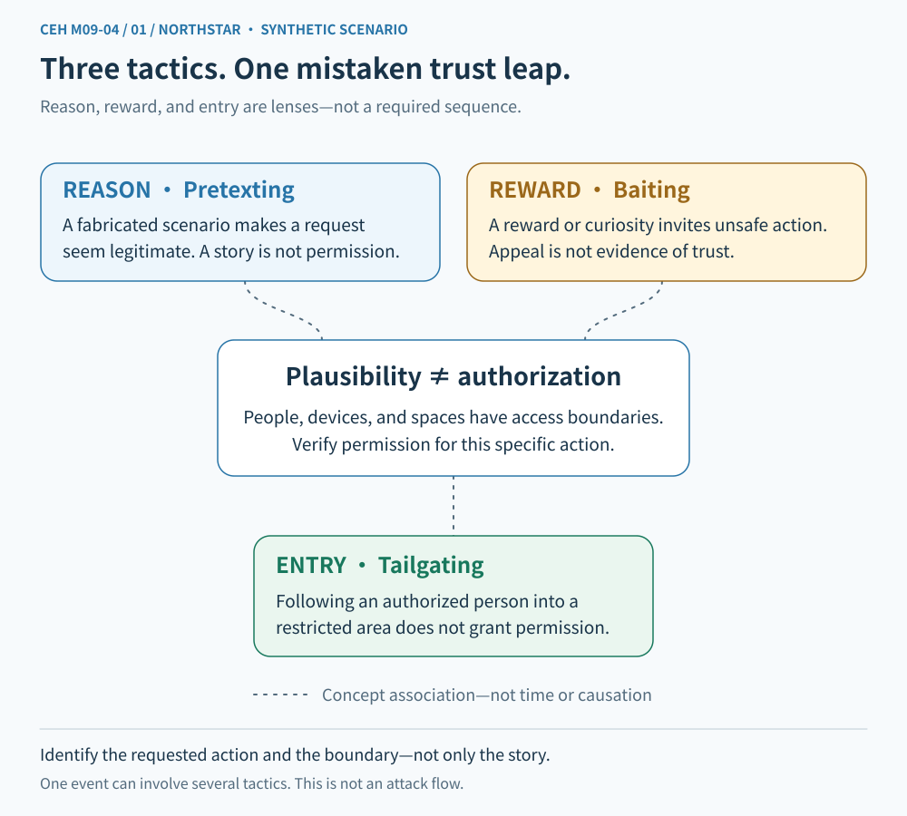
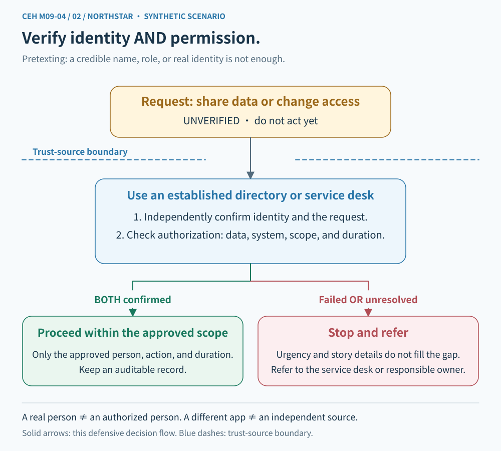
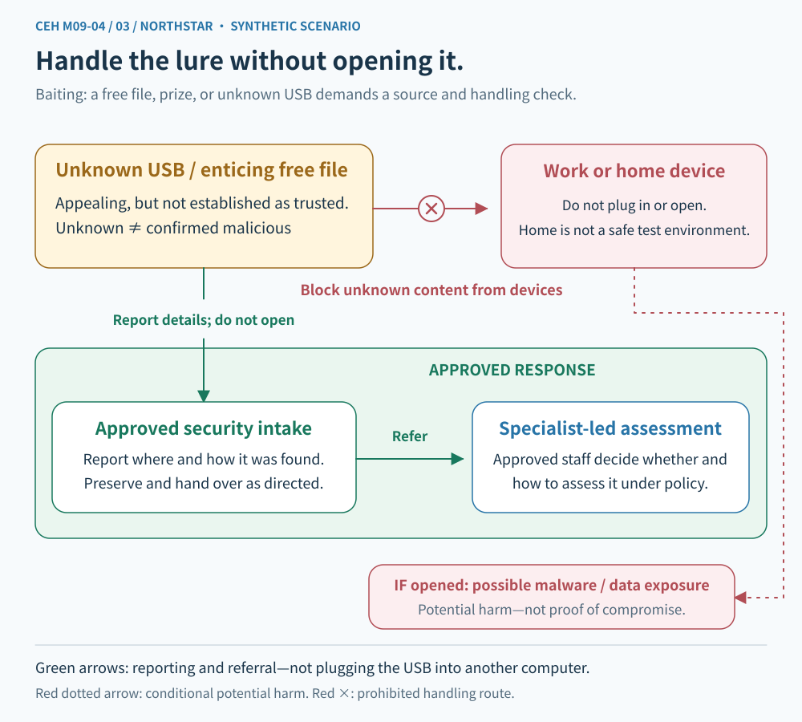
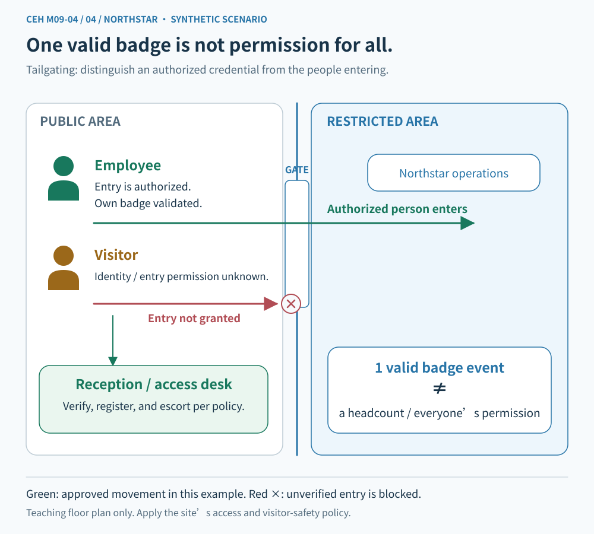

# CEH M09-04 | Pretexting, Baiting, and Tailgating

**Module 09: Social Engineering**
Read in sections; allow about 10–15 minutes.

## 1. The main idea: a plausible story, an attractive offer, and an open door are not authorization

M09-03 covered voice calls, text messages, and impersonation. Something that looks authentic is not necessarily verified. Today we take that idea further: **an adversary may persuade someone to cross a boundary for them without using a fake website or an exploit.**

Imagine working at the fictional Northstar learning center. Its office has controlled entry, and its computers contain private learner responses. A visitor says they are an urgently dispatched maintenance contractor. They carry a USB drive labeled “free course tools” and try to enter with an employee who has just used their badge.

Do not immediately conclude that the visitor is an attacker. This is a synthetic situation requiring verification. Separate three possible mechanisms:

- **A reason:** a story makes an unusual request seem reasonable.
- **An incentive:** something desirable encourages a particular action.
- **Entry:** someone uses another person's passage to skip their own access check.

The lesson is not to distrust everybody. It is to distinguish being helpful from skipping required procedures.

## 2. A knowledge map: three techniques, not a fixed attack sequence

**Figure 1 caption:** The concepts connect to one central question: what action does the requester want me to perform? Concept links are not data transfers or a claim that every incident proceeds from a story, to bait, to physical entry.

| Term | Practical question | Synthetic example |
| --- | --- | --- |
| Pretexting | What invented reason makes the request seem justified? | Claimed urgent maintenance used to bypass normal checks |
| Baiting | What desirable offer encourages an action? | A free tool or interesting content used to entice use of an unknown file |
| Tailgating | Who is using another person's passage to cross a physical boundary? | An unverified visitor entering behind a badged employee |

These techniques can occur separately or together. M09-02 classified targets. M09-03 examined channels and claimed identities. This lesson examines reasons, incentives, and physical entry. These are different perspectives, not mutually exclusive labels.

## 3. Pretexting: build a story that makes the request seem necessary

A pretext is an apparent justification. **Pretexting uses a fabricated or manipulated situation to make contact, a request for information, or an access request seem reasonable.** The Canadian Cyber Centre likewise describes a false narrative used to build trust and seek information or access. [Canadian Cyber Centre: Social engineering](https://www.cyber.gc.ca/en/guidance/social-engineering-itsap00166)

The visitor might do more than claim to be a contractor. They add a justification: the manager wants the repair immediately, the contact is in a meeting, and registration can be completed later.

Separate two layers:

- **Impersonation:** who am I pretending to be?
- **Pretexting:** what story makes this request seem warranted?

They often overlap, but they are not identical. A person may invent an emergency without claiming a specific name. Real maintenance may also be urgent; urgency alone does not prove deception.

### Verify the person, the work, and its scope

Even if the company confirms that a visitor works for a real contractor, that does not authorize entry to every room or access to every file today.

**Authentication** checks the conditions needed to establish an identity. **Authorization** determines permitted actions. This is the same boundary introduced in M01-03 and M09-03.

Use an established trusted contact to check:

1. Is this work actually scheduled or approved?
2. Is this the designated person?
3. Which areas and equipment are included?
4. Are reception, escort, and activity records required?

**Figure 2 caption:** Arrows show a defensive decision process. Identity and work scope are separate checks. Limited execution follows only when the required checks satisfy the established procedure. Uncertainty goes to the authorized contact, not to an improvised approval.

**Independent verification** means using your established help desk, responsible contact, or system rather than relying only on contact details supplied by the requester. Australian guidance likewise calls for independent verification of requests to run code, change settings, or bypass controls. [Australian Cyber Security Centre guidance](https://www.cyber.gov.au/guidance/learn-about-social-engineering)

## 4. Baiting: persuade someone to perform the enabling action

**Baiting uses an attractive promise or object to induce an action that benefits the adversary.** It may appeal to curiosity, saving money, obtaining a tool, or fear of missing out.

The “free course tools” USB drive is a possible bait example. A free offer is not automatically malicious. Examine the source, the requested action, and what follows rather than deciding from a label alone.

Bait is not limited to USB drives. An unfamiliar “free assets” site might ask for a work account or an unapproved software installation. **Baiting does not require malware: it may instead induce disclosure of information.** Government guidance includes both malware installation and information disclosure as possible outcomes. [Papua New Guinea NCSC: Social Engineering](https://www.ncsc.gov.pg/social-engineering/)

### Separate the attraction from the consequence

Ask three questions:

- What benefit do I expect to receive?
- What must I first connect, open, install, enter, or disclose?
- Who might gain access to my device, account, or information through that action?

Different actions do not imply identical outcomes. Connecting a device, opening a file, allowing execution, and entering a password are separate events. Whether execution or access actually occurred depends on the device, system configuration, and evidence.

**Figure 3 caption:** An unknown source begins outside the trust boundary. The safe handling arrow leads to an approved intake and examination process, not straight to a daily-use computer. Dashed consequences are potential risks, not established events.

### Do not find an ordinary computer to “try” an unknown USB drive

Do not connect it to a work computer or take it home to test on a personal computer. Follow the organization's intake procedure. If analysis is needed, authorized people with appropriate expertise and an appropriately isolated environment should handle it.

A scan with no alert means the particular check did not detect a problem it could recognize. It is not an unconditional safety guarantee. This is an evidence principle, not a request to perform malware analysis.

Organizations can combine approved software sources, removable-device policies, appropriate device controls, and **least privilege**: granting only the access and capabilities required for the job. Least privilege can limit consequences, but does not guarantee that no incident can occur.

## 5. Tailgating: checking the person in front does not check the person behind

**In this lesson, tailgating is unauthorized entry through a physical access boundary by following a legitimate user.** This is not road traffic behavior or a synonym for network session hijacking here.

An employee's badge succeeds and the office door opens. A person carrying boxes wants to enter behind them. The open door is a physical state, not proof that the second person is authorized.

The University of Florida lists following someone, claiming a delivery, carrying large items, and claiming a forgotten badge among situations to examine. These appearances alone are not proof of criminal intent. [University of Florida: Tailgating](https://it.ufl.edu/security/learn-security/social-engineering/tailgating/)

**Figure 4 caption:** The public area is on the left and the controlled area on the right, separated by an entry boundary. The employee passes their own check. The visitor requires a separate approved process. Arrows indicate people's movement, not file transfer or a confirmed system compromise.

### Tailgating and piggybacking

Some training materials distinguish **tailgating** from **piggybacking** according to whether the authorized person knows about or helps the entry. **Terminology is not consistent across sources.** The PNG NCSC lists them together, while the University of Florida's tailgating definition includes persuading authorized people to let someone in.

Do not treat the awareness distinction as a universal standard. If a question defines its terms, use that context. Operationally, ask whether the second person completed the required checks, who may authorize passage, and how their scope is limited.

### Protect the boundary without creating a confrontation

Use the organization's reception, visitor verification, registration, and escort procedure. Entry design may also include individual passage controls and alerts. If the situation feels unsafe, prioritize personal safety and contact security or the designated team. Do not physically block, chase, or confront someone yourself.

Individual verification does not mean every site needs the same equipment. Accessibility, emergency evacuation, work patterns, and applicable policies still matter. This lesson is a risk model, not a construction specification.

## 6. Put the techniques together without collapsing the evidence

Return to Northstar: the visitor gives an urgent maintenance reason, offers free tools, and wants to enter with an employee.

| Observed situation | Risk to examine | Still to verify |
| --- | --- | --- |
| Urgent maintenance and a request to bypass procedure | Possible use of a fabricated justification | Whether the work and access are actually authorized |
| Free tools requiring use of an unknown device | Possible bait | The source, requested action, and whether it was used |
| Entry behind a badged person | Possible bypass of an independent entry check | Whether the visitor already had valid approval and escort arrangements |

You can pause a high-risk action and seek formal confirmation without first proving that the person is malicious. But an investigation must not turn every suspicious sign into a confirmed attack.

Connections to previous lessons:

- **M09-01:** trust and helpfulness do not replace verification.
- **M09-02/03:** target, channel, claimed identity, and manipulation technique can all be described together.
- **M01-01:** entry may affect confidentiality, integrity, or availability; actual consequences require evidence.
- **M01-02:** risks can arise from visitor processes and permission design, not only software flaws.
- **M01-03:** real exercises require authorization. This is a tabletop lesson, not permission to test an unfamiliar office or leave USB drives for others to find.
- **M01-06/07:** people, procedures, entry controls, device controls, and records form defense in depth; incidents follow the response process.

## 7. Evidence: a record first supports the event it actually describes

**One successful badge event does not prove that only one person entered.** Access records usually describe credential and device events; they do not necessarily capture every person's movement. Confirming people and identity may require other lawfully and appropriately accessed records, reception information, and statements.

Likewise:

- Finding an unknown USB drive does not prove anyone connected it.
- A device-connection event does not prove every file executed.
- An execution event does not prove all data was exfiltrated.
- Physical office entry does not prove a protected-system login.

These are reasoning examples, not a claim that every product records the same fields. Keep **observation**, **inference**, and **verification** separate, as in M01-02.

Report suspicious activity through the established channel. Describe time, place, observations, and your actual actions. Preserve existing evidence. Do not open an unknown file to confirm a suspicion or arbitrarily erase records.

## 8. One visual reasoning check

Look at Figure 4. There is one successful employee badge event. The employee reports that a self-described maintenance visitor entered behind them and left a USB drive labeled “free tools.” Work approval, visitor authorization, device-connection records, and file-execution records have not yet been checked.

Use your own words to answer this single scenario:

1. Which movement or check cannot inherit the employee's authorization? Why does an open door not prove visitor authorization?
2. Which concepts might describe the maintenance story, free tools, and entry behind the employee? Can all of them already be labeled malicious?
3. What would you stop first, which trusted source would you consult, and what evidence would you seek?

A short answer is enough. Reference answers belong in a separate initially collapsed section. **Publishing an answer is not the learner's response or evidence of mastery.**

## 9. Three lines to remember

1. **Pretexting:** a plausible reason still needs verified identity, work, and scope.
2. **Baiting:** examine the requested action; curiosity or a reward must not authorize risk.
3. **Tailgating:** another person's verification does not become your access right.

The next unit is M09-05, **Insider Threats & Identity Theft**. The aim is not to become unhelpful. It is to make helpful action safe and verifiable.
