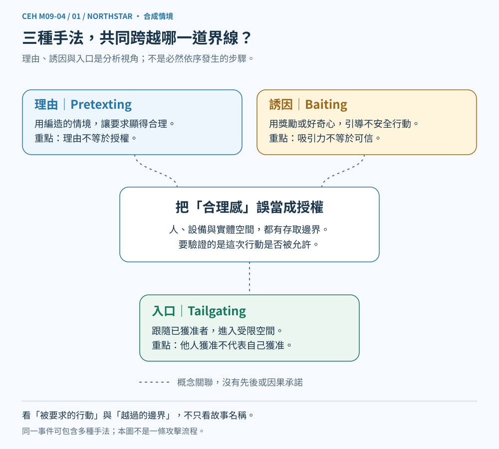
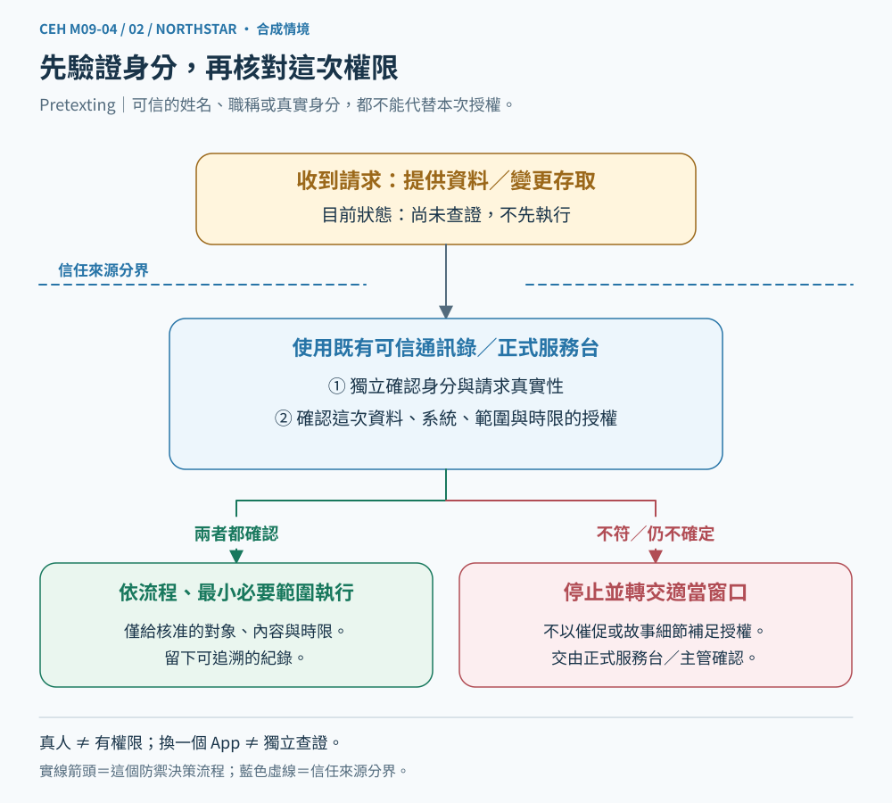
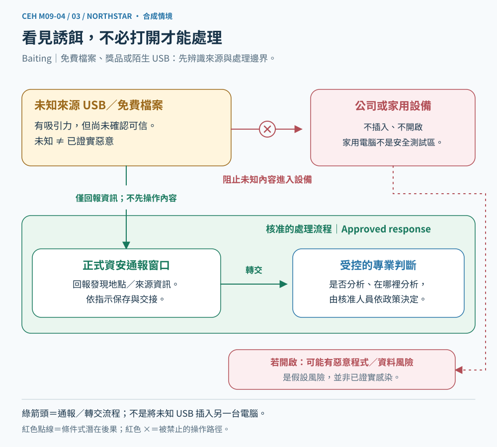
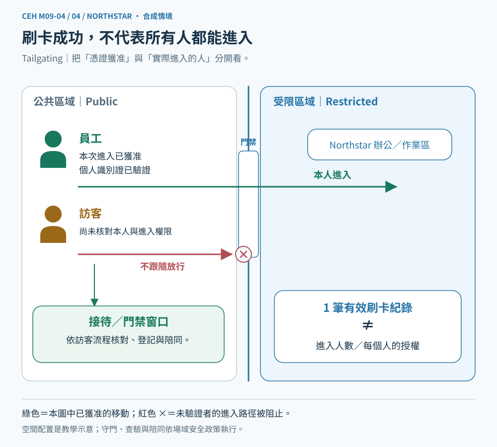

# CEH M09-04｜情境編造、誘餌與尾隨進入

**Module 09：Social Engineering（社交工程）**
本課核心：Pretexting、Baiting、Tailgating。建議分段閱讀 10～15 分鐘。

## 一、先說結論：合理的故事、吸引人的東西、已經打開的門，都不是授權

前一課 M09-03 談電話、簡訊與身分冒充，提醒我們「看起來像本人，不等於已驗證」。今天再往前一步：**即使沒有假網站、沒有駭客程式，對方也可能讓我們替他跨過原本過不去的界線。**

想像你在虛構的 Northstar 教材中心工作。辦公室有門禁，電腦裡有學員私人作答。某位來訪者說：「我是維修廠商，今天臨時來處理故障。」他拿著一支標示「課程免費工具」的隨身碟，並想趁同事刷卡後一起進辦公區。

先別急著認定他就是攻擊者；這是一個需要查證的合成情境。我們要拆開三種可能的操弄：

- **理由**：用一個故事，讓不尋常的要求看起來合理。
- **誘因**：用你想要的東西，讓你願意採取某個動作。
- **通行**：利用別人的開門機會，略過自己應完成的進入檢查。

本課不是教你對所有人失去信任，而是把「願意幫忙」與「可以略過程序」分開。

## 二、先建立知識地圖：三種手法不是固定攻擊順序

**圖1圖說：** 三個概念連到同一個判斷核心：「對方希望我替他做什麼？」圖中的概念連線不是實際資料傳輸，也不是一定先編故事、再放誘餌、最後進門的時間順序。

| 名詞 | 白話問題 | 本課的假想例子 |
| --- | --- | --- |
| Pretexting（情境編造／藉口詐術） | 對方編了什麼理由，讓要求變得合理？ | 聲稱有緊急維修，要求略過原本的確認 |
| Baiting（誘餌） | 對方拿什麼吸引你做出某個動作？ | 用免費工具或好奇內容誘導使用未知檔案 |
| Tailgating（尾隨進入） | 誰想利用別人的通行，跨過實體管制邊界？ | 未獨立核驗的訪客跟在刷卡員工後面進入 |

它們可以單獨出現，也可以在同一事件中結合。M09-02 分「鎖定誰」，M09-03 分「用什麼管道、冒充誰」，本課分「用什麼理由、誘因或通行方式」。這些是不同觀察角度，不是互斥標籤。

## 三、Pretexting：先造一個情境，讓你覺得這個要求說得通

Pretext 的意思是藉口或表面理由。**Pretexting 是刻意捏造或操弄情境，讓接觸、索取資料或要求存取看起來合理。** 加拿大資安中心的定義也把它描述為以虛構故事建立可信理由，誘導提供資訊或存取。[加拿大資安中心：Social engineering](https://www.cyber.gc.ca/en/guidance/social-engineering-itsap00166)

例如，對方不只是說「我是維修人員」，而是加上一套理由：「主管叫我趕快修，窗口正在開會，先讓我進去，之後再補登記。」

其中可以分兩層：

- **Impersonation（身分冒充）**：我假扮成誰。
- **Pretexting（情境編造）**：我用什麼故事，使這項要求看起來有必要。

兩者常重疊，但不同。對方也可能不冒充某個特定名字，只虛構一個緊急情境。另一方面，真實維修也可能很急；我們不能只憑「急」就斷定詐騙。

### 真正該驗證的是「人＋事＋範圍」

假設公司確認來訪者確實是合作廠商，這也不代表他今天獲准進入所有房間、讀取所有資料。

**Authentication（身分驗證）** 是確認身分所需的條件；**Authorization（授權）** 是決定能做哪些事。這就是 M01-03 與 M09-03 已經出現的界線。

可以從既有可信窗口核對：

1. 有沒有這次工作安排？
2. 來的人是不是指定人員？
3. 被核准進入哪個區域、處理哪些設備？
4. 是否需要接待、陪同及操作紀錄？

**圖2圖說：** 箭頭表示本課的防守決策流程。身分確認與工作範圍確認是不同檢查；只有兩者符合既有程序，才進入有限度的執行。不明確時轉交正式窗口，不是自行猜測批准。

這裡的 Independent verification（獨立查證）延續上一課：用自己原先知道的服務台、承辦人或系統確認，不只打對方提供的號碼。澳洲資安指引也要求對要求改設定、執行程式或略過控制的行為進行獨立查證。[澳洲資安中心：社交工程指引](https://www.cyber.gov.au/guidance/learn-about-social-engineering)

## 四、Baiting：不是破解你的電腦，而是讓你先做出它需要的動作

**Baiting 是用吸引人的承諾或物品，誘導對方採取會讓攻擊者受益的行動。** 可能利用好奇、想省錢、想拿到工具或怕錯失機會等心理。

本課的「免費課程工具」隨身碟，就是可能的誘餌例子。但看到免費工具，不代表一定惡意；要看來源、要求及後續動作，不能單靠標籤定案。

它也不限於隨身碟。例如一個來路不明的「免費素材」入口，可能要求你輸入公司帳號，或安裝沒有核准的程式。**誘餌不一定含惡意程式，也可能只是誘導交出資料。** 官方資料同時列出惡意程式與資訊揭露等可能結果。[巴布亞紐幾內亞 NCSC：Social Engineering](https://www.ncsc.gov.pg/social-engineering/)

### 把「誘惑」和「後果」拆開

可以想成三個部分：

- 表面利益：我以為能得到什麼？
- 被要求的動作：我需要先插入、開啟、登入、安裝或提供什麼？
- 可能影響：這個動作可能讓誰碰到我的裝置、帳號或資料？

不是所有動作都會造成相同後果。插入未知裝置、開啟檔案、允許程式執行、輸入密碼，是不同事件；是否發生程式執行或資料存取，要依實際裝置、系統設定與證據確認。

**圖3圖說：** 未知來源在信任邊界外。正常處理箭頭通往核准的接收與檢查程序，不是直接連進日常工作電腦；圖中的虛線後果是可能風險，並非已證明發生。

### 遇到未知隨身碟，先不要替它找一台電腦試試

不要插入工作電腦，也不要帶回家用私人電腦測。依組織程序交給負責窗口；需要分析時，由具備授權、合適隔離環境與能力的人處理。

掃毒沒有告警，只能支持「該次檢查沒有偵測到它能辨識的問題」，不是無條件安全證明。這是一般證據判讀，不表示你現在需要自行做惡意程式分析。

組織可以搭配核准軟體來源、外接裝置使用政策、必要的裝置控制與最小權限。**Least privilege（最小權限）** 就是只給工作所需的存取與操作能力；它可以限制後果，但不能保證完全不出事。

## 五、Tailgating：門禁驗證了前面的人，不等於驗證了後面的人

**Tailgating 在本課指未獲適當授權的人，跟著合法使用者穿過實體門禁或進入管制區。** 它不是道路上的跟車，也不是本課在討論的網路連線劫持。

想像辦公區的門：員工刷卡成功，門開了；後方的人抱著箱子想一起進去。此時「門已打開」只是物理狀態，不能推論後方的人也已獲准。

佛羅里達大學的資安教材將跟隨進入、聲稱送貨、搬運大物品或忘記識別證，列為需留意的情境；這些外觀本身不是犯罪證據。[University of Florida：Tailgating](https://it.ufl.edu/security/learn-security/social-engineering/tailgating/)

**圖4圖說：** 左側是公共區，右側是管制區，中線是門禁邊界。員工通過自己的核驗；訪客的通行需要另一個核准流程。箭頭代表人的移動，沒有表示檔案已傳輸或系統已被駭。

### Tailgating 和 Piggybacking 要怎麼分？

你可能看過某些教材用「前面的人是否知情、是否幫忙」區分 Tailgating 與 Piggybacking（搭便車式進入）。**不同來源用法不完全一致**；例如 NCSC 直接將兩者並列，佛羅里達大學的 Tailgating 定義也包含誘使有權者放行。

因此，本課不把這種知情區分說成全球唯一標準。考題若給明確定義，就按題目語境判讀；實務上更重要的是：後方這個人是否完成必要核驗、誰有權放行、活動範圍有沒有被限制。

### 防守不是要你和可疑訪客起衝突

可依組織程序引導至接待窗口、核實訪客、登記與陪同；門禁設計也可考量逐人通行與異常告警。遇到不安全情況，以人身安全為先，交由保全或正式窗口處理，不自行攔阻、追逐或對抗。

「逐人核驗」也不等於每個場域一律用同一設備。機構仍需兼顧無障礙、緊急疏散、工作動線與合法政策；本課是風險模型，不是現場施工規格。

## 六、把三種手法放回同一個案例，但不混成一個結論

回到 Northstar：來訪者提出臨時維修理由、拿出免費工具、想跟著員工入內。我們可以問：

| 可見情況 | 可以先辨認的風險 | 仍需確認 |
| --- | --- | --- |
| 臨時維修並要求略過流程 | 可能的情境操弄 | 是否真的有工作安排與授權 |
| 免費工具要求先使用未知裝置 | 可能的誘餌 | 來源與要求是否可信、是否真的使用 |
| 跟在刷卡者後面進入 | 可能略過獨立門禁檢查 | 該訪客是否已有有效核准與陪同安排 |

我們可以先暫停高風險動作、要求正式確認，不必先證明對方是壞人；但調查報告不能把所有可疑跡象直接寫成已確認攻擊。

這裡與先前 CEH 的連結是：

- **M09-01：** 信任與善意不能取代驗證。
- **M09-02／03：** 目標、管道、冒充角色與操弄手法可以同時標示。
- **M01-01：** 進入辦公區可能影響資料機密性、設定完整性或服務可用性，但後果需要證據。
- **M01-02：** 風險不只來自技術漏洞，也可能是訪客流程與權限安排的不足。
- **M01-03：** 有合法測試授權才進行演練；本課只有桌上案例，不准自行測試陌生辦公室或把隨身碟放給別人撿。
- **M01-06／07：** 人員、流程、門禁、裝置控制與紀錄形成縱深防禦；出事後依應變程序處理。

## 七、證據觀念：記錄的是哪件事，就先只支持哪件事

**一筆刷卡成功，不等於只有一人進門。** 門禁紀錄通常是憑證與設備事件，不必然完整記下當時所有人的移動。要確認人數與身分，可能需要依法、依權限使用其他紀錄、接待資料及當事人說明。

同樣地：

- 找到未知隨身碟，不代表有人插入。
- 有裝置連接紀錄，不代表所有檔案都已執行。
- 有程式執行紀錄，不代表已證明全部資料外洩。
- 有人進辦公區，不代表已登入受保護系統。

這些是本課推理模型，不是某一套系統保證會產生的日誌欄位。**Observation（觀察）**、**Inference（推論）** 與 **Verification（驗證）** 要分開，跟 M01-02 一樣。

若已出現可疑操作，先透過正式管道通報，說清楚時間、地點、看到什麼、自己做過什麼。保留現有證據，不自行開啟未知檔案來確認，也不要任意刪除紀錄。

## 八、一個圖形推理小檢核

請看圖4，假設現在只有一筆員工刷卡成功紀錄。員工說有一名自稱維修人員的人跟著進門，對方留下一支標示免費工具的隨身碟；尚未查到工作安排、訪客核准、裝置連接與檔案執行紀錄。

請用自己的話回答同一個情境：

1. 哪個箭頭或哪道檢查不能直接沿用員工的授權？為什麼「門開了」不等於訪客已獲准？
2. 維修理由、免費工具、跟隨進門，各可能對應哪個概念？現在能直接斷定全部是惡意攻擊嗎？
3. 你會先停止什麼、向哪個可信來源核實，以及補哪一類證據？

不用長篇，也不必背名詞順序。參考答案另放預設收合區；**公布答案不是本人作答，也不代表理解已通過。**

## 九、本課記住三句話

1. **Pretexting：理由看似合理，仍要核實人、事與授權範圍。**
2. **Baiting：先看被要求的動作，不要讓好奇或獎勵替你批准風險。**
3. **Tailgating：別人的驗證，不會自動變成你的通行權。**

下一個單元是 M09-05「Insider Threats & Identity Theft（內部威脅與身分竊用）」。本課的防守核心不是變得不友善，而是讓幫忙有安全、可驗證的做法。
