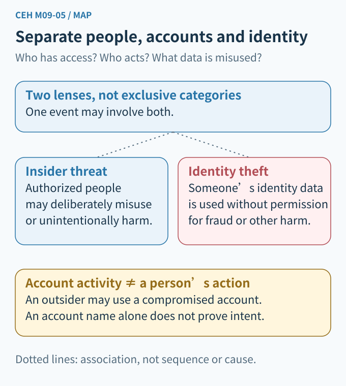
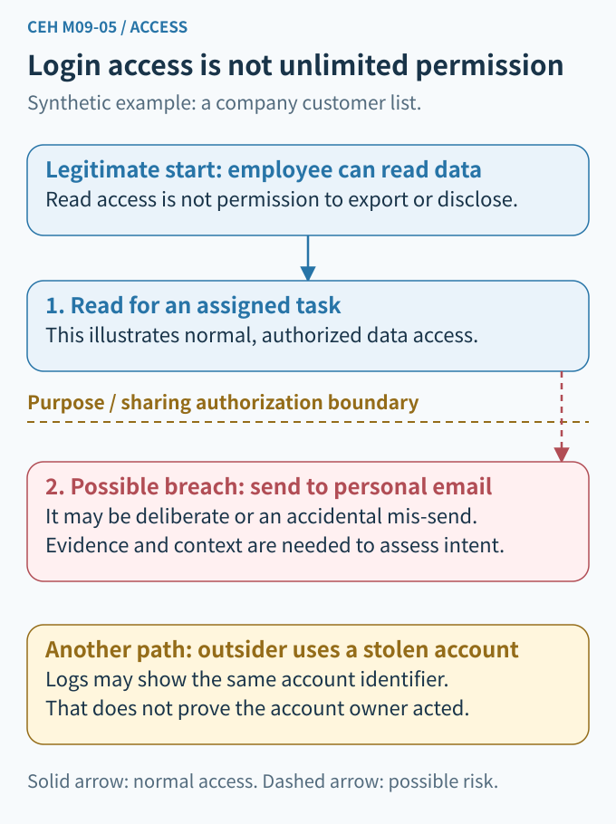
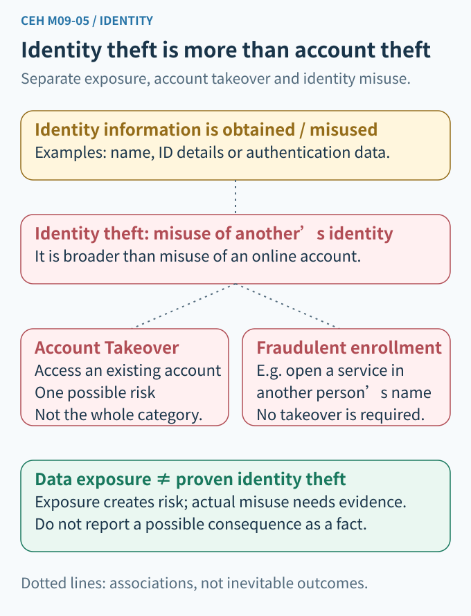
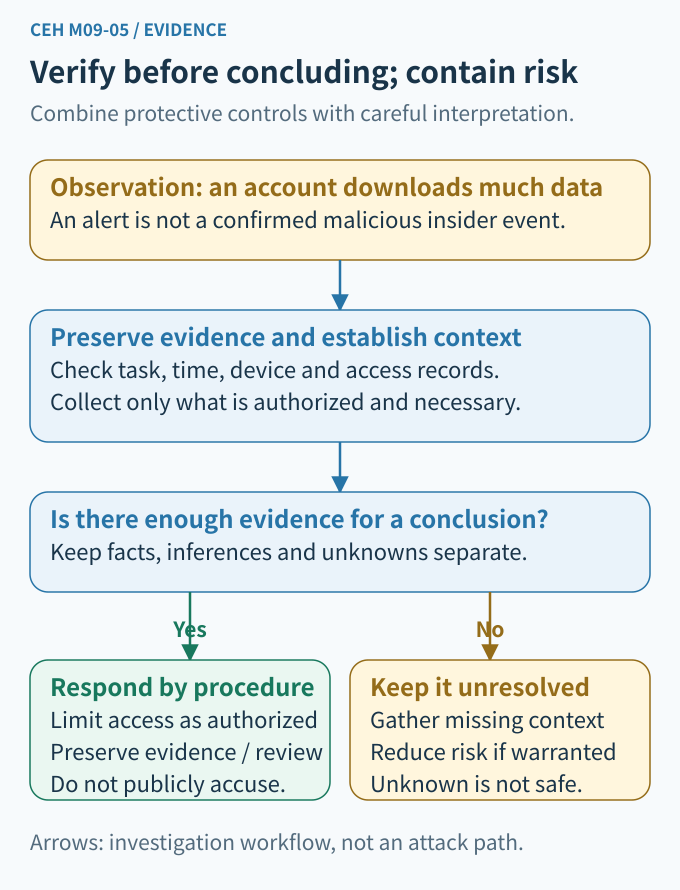

# CEH M09-05 | Insider Threats and Identity Theft

Module 09: Social Engineering. This lesson is one connected unit: Insider Threats & Identity Theft. Suggested reading time: 10–15 minutes.

## 1. Start with the conclusion: a legitimate account does not make every action authorized, and an account record does not identify the actual operator

M09-04 discussed pretexting, baiting and tailgating: a plausible story, an attractive offer or an open door is not a reason to skip authorization checks. Today, consider a different problem: what if the person already has a key, or an outsider obtains someone else's key?

Imagine the fictional Northstar learning center. An administrative employee, Alex, needs to read learners' contact information for work. One day, the system records a large data export under Alex's account.

Do not immediately conclude, “Alex stole the data!” There are at least three possibilities: Alex performed an approved export; Alex accidentally sent the file to the wrong destination; or someone obtained access to Alex's account and operated it. Deliberate misuse is also possible, but a conclusion needs evidence.

The essential skill today is separating four questions: **Who is the person? Whose account is it? What is authorized? What actually happened?**

## 2. Build the knowledge map: insider threats and identity theft can overlap, but they are not the same concept

An **Insider Threat** involves a person who has, or previously had, authorized access to an organization and may intentionally or unintentionally use that access in a way that adversely affects it. The key is the existing access and trust relationship—not whether the person is currently inside an office. Employees, contractors and business partners can be involved; that does not make all such people suspicious. This explanation follows [Carnegie Mellon SEI's insider-threat overview](https://insights.sei.cmu.edu/insider-threat/).

**Identity Theft** means using another person's personal or financial information without permission. In everyday terms, it is using someone else's identity information to do something for yourself. It extends beyond online accounts; applying for a service in another person's name can also be involved. This lesson explains a security concept, not a legal finding about an individual case. [FTC: What To Know About Identity Theft](https://consumer.ftc.gov/articles/what-know-about-identity-theft)

The two concepts can overlap: a person authorized to read information might misuse it to impersonate someone else. However, outsiders can also obtain information, and an insider can damage files without misusing anyone's identity. Therefore, they should not be drawn as a fixed sequence in which an insider threat inevitably produces identity theft.

The two concept links in Figure 1 show relationships between categories. They are neither established attacks nor an inevitable order of events.

## 3. Insider threats: having a key does not mean you may take things away

### 1. Distinguish malicious from unintentional behavior

A **Malicious Insider** intentionally misuses or exceeds authorization. For example, an administrator might transfer a contact list to an unapproved personal service for private gain.

An **Unintentional Insider Threat** involves harm or increased risk caused by an action or omission without malicious intent. For example, an employee might send a file containing personal information to the wrong recipient, or be persuaded by fake support personnel to grant access that should not be granted. [SEI: Unintentional Insider Threat and Social Engineering](https://sei.cmu.edu/blog/unintentional-insider-threat-and-social-engineering/)

“Unintentional” does not automatically remove responsibility, nor does it necessarily mean carelessness. A difficult interface, unclear process, insufficient training or manipulation may contribute. These causes require investigation rather than assumptions.

### 2. An outsider using an employee's account does not prove that the employee is a malicious insider

A **Compromised Account** is an account whose security protections have been defeated, potentially enabling unauthorized use. Some teaching materials include this risk within a broad insider-threat management scope. Evidence analysis must still distinguish an outsider acting through an internal identity from an insider deliberately misusing access.

Figure 2's solid arrow represents normal, authorized reading. The red dashed arrow represents a possible risk that crosses a purpose or sharing boundary—not an established event. The separate box below describes the possibility of an outsider using a compromised account. This still depends on obtaining the necessary authentication material and the system accepting it; merely knowing an account name does not guarantee login access.

A system should check more than “Can this account log in?” It should also check “May this account perform this action on this resource right now?” Even if a button can technically be clicked, using the data for any imaginable purpose is not necessarily authorized by the organization.

This is the distinction between **Authentication** and **Authorization**. Authentication checks whether the claimant can provide the required authentication evidence. Authorization determines which resources and actions are permitted. Authentication reduces impersonation risk, but is not an absolute guarantee of the real operator's identity or motive.

## 4. Identity theft: it is not just a stolen password

Distinguish four states that are often confused:

- **Data exposure or disclosure:** information reaches someone who should not have it. This increases the risk of misuse, but exposure alone does not establish that a fraudulent application has occurred.
- **Credential Theft:** passwords or other authentication material are obtained. Here, “credential” does not refer only to a digital certificate file.
- **Account Takeover:** an unauthorized person gains control of, or the ability to operate, an existing account. Changing its recovery email after logging in is one example.
- **Identity Theft:** another person's personal or financial information is used without permission. It may involve an existing account or a new service opened in their name. Its scope is broader than taking over one online account.

For example, knowing Alex's name does not establish an ability to log in. Obtaining a copy of Alex's identification document exposes sensitive information to risk, but does not establish that an account was successfully opened in Alex's name. If a service provider verifies an application made using Alex's information without authorization, there is more concrete evidence of identity misuse. Whether it succeeded and what harm resulted remain separate questions.

**Identity Proofing** establishes a trustworthy connection between an online applicant and a real-world identity. When someone applies for a new service, for example, the process may check not only whether information exists, but also the evidence and whether the applicant is its rightful holder. This differs from authenticating subsequent logins. This is a simplified introductory model, not a claim that every service follows an identical process. [NIST SP 800-63A-4](https://pages.nist.gov/800-63-4/sp800-63a.html)

Therefore, “They know my birthday” or “The photo looks like the person” is not sufficient proof. The impersonation and **AI Deepfakes** discussed in M09-03—synthetic or manipulated images, audio or video—can make surface clues seem convincing. Return to trusted channels and appropriate verification procedures rather than relying only on a voice or appearance.

## 5. Protection: secure the account and limit the impact it can have

### Layer 1: grant only the access required for the job

**Least Privilege** means providing only the access needed to perform assigned duties. Alex's need to contact one class does not imply a need to read sensitive attachments for every class, much less delete the entire database. [NIST: Least Privilege](https://csrc.nist.gov/glossary/term/least_privilege)

Access must also change with responsibilities. When duties change, a contract ends or an employee leaves, established procedures should revoke accounts, permissions and active sessions that are no longer needed. Collecting a physical access card does not automatically remove cloud access.

### Layer 2: do not let one person independently approve every high-impact action

**Separation of Duties** divides critical steps that should not be completed independently by the same person. For example, one person requests a list export and another authorized person reviews its purpose and recipient. This still needs records and technical enforcement; adding a merely ceremonial checkbox is not enough. [NIST: Separation of Duty](https://csrc.nist.gov/glossary/term/separation_of_duty)

### Layer 3: reduce impersonation risk and protect recovery paths

Use strong passwords that are not reused across services, safeguard authentication material, and enable **Multi-Factor Authentication (MFA)**. Multiple factors are different kinds of evidence—not simply two passwords. Sensitive operations, account recovery and changes to authentication methods also need appropriate protection.

MFA is not a cure-all. If a real employee already has permission to export, MFA does not automatically prevent misuse. Stolen active sessions or weak recovery procedures can also leave gaps. This is why M01-06's defense in depth matters: security should not depend entirely on one login checkpoint.

### Layer 4: make anomalies visible without treating alerts as verdicts

An **Audit Log** records which account performed which action on which resource and when. Protect logs from arbitrary modification, preserve suitable time and source information, and restrict who can read them.

**Data Loss Prevention (DLP)** can use rules to identify, alert on or block certain transfers of sensitive information. It can produce false positives or miss events, and may not cover every device or channel. A “large download” alert alone proves neither disclosure nor malicious intent by a particular person.

These controls are examples to adapt to business context, not universal thresholds for every organization. [NIST SP 800-53 Rev. 5](https://csrc.nist.gov/pubs/sp/800/53/r5/upd1/final) provides a reference for controls. This lesson does not claim that implementing these examples establishes any particular compliance certification.

## 6. Return to Northstar: separate observation, inference and verification

Suppose the only available record says, “An administrative account downloaded many files late at night.”

**Observation:** a particular account has a download record at a particular time. First check the meaning of the fields, time zone, completeness, and whether the record represents a completed download rather than merely a request.

**Inference:** this might be an approved data migration, an operator error, deliberate misuse by the account owner, or unauthorized use by an outsider. These are hypotheses to investigate, not facts to report simultaneously as established.

**Verification:** an authorized investigator compares work assignments, approvals, login and device records, file-access records and necessary transfer records. Establish what data was involved, its destination, whether the action succeeded, and the scope of impact. An account, device or network address by itself is generally insufficient to fully identify the real operator and their intent.

If risk is continuing, follow the incident-response process to apply appropriate, reversible restrictions while preserving original records. Protecting data does not have to wait until someone has “found the culprit.” Equally, an investigation is not permission to arbitrarily delete or alter logs or access unrelated private information.

Not finding an outbound-transfer record means only that none was found in the records currently available. If a channel was never logged, that absence cannot establish that data never left. This is the same evidence discipline as M01-02's distinction between discovering a vulnerability and establishing that an incident occurred.

Investigations should remain within authorized scope, necessary data and authorized personnel. One anomaly is not grounds for publicly accusing a colleague. Security manages access risk; it does not guess people's character.

## 7. Connect this lesson to the surrounding chapters

- M01-01, CIA: disclosure affects confidentiality; altered records affect integrity; malicious or accidental deletion can affect availability.
- M01-02, risk: exporting 100 public teaching records and 100 sensitive personal records can have different impacts. Quantity alone is not enough.
- M01-03, authorization: being able to log in or click a button does not authorize every purpose.
- M09-01–04, social engineering: an outsider may first gain trust, then persuade an insider to surrender authentication material or act on the outsider's behalf.
- Next, M09-06: combine independent verification and anti-phishing controls into a practical protective workflow.

## 8. Reason from the diagrams: three quick checks

Look at Figures 2 and 4, then answer in your own words:

1. The system reports “Alex's account successfully downloaded the data.” Why does that not establish “Alex maliciously stole data”? Give at least two questions that still need verification.
2. Suppose Alex really did use legitimate access to give the list to an unapproved recipient. Can MFA solve this on its own? At which boundary would you add a control, and what would it be?
3. A copy of someone's identification document has been exposed, but there is no evidence of a fraudulent application or account takeover. What is established, and what is not? If the service on the right of Figure 3 receives a new application, why is correct information alone insufficient to approve it?

Reference answers are provided separately and are collapsed by default on the website. Publishing answers does not mean you have answered or understood them. Understanding remains unverified; the lesson is not marked as mastered.

## 9. Remember these four sentences

**Having access does not authorize every use.**
**An internal account does not prove an internal person operated it.**
**Personal-data exposure, account takeover and identity theft are different states.**
**Use evidence to establish actions and impact before concluding causes or responsibility.**
