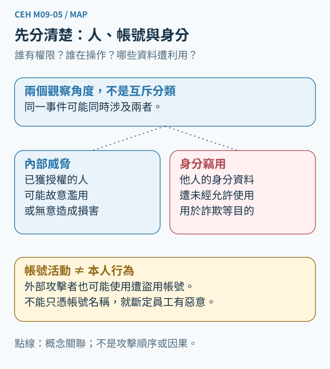
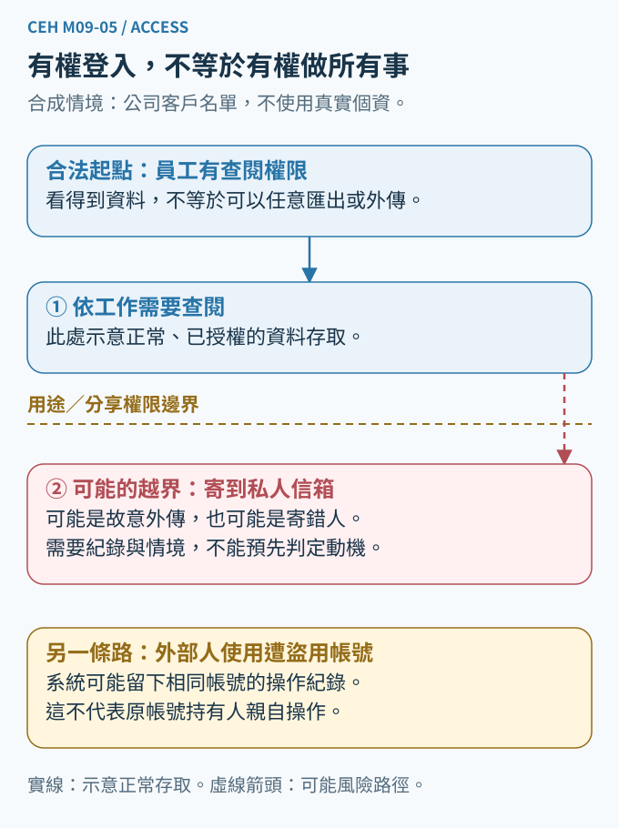
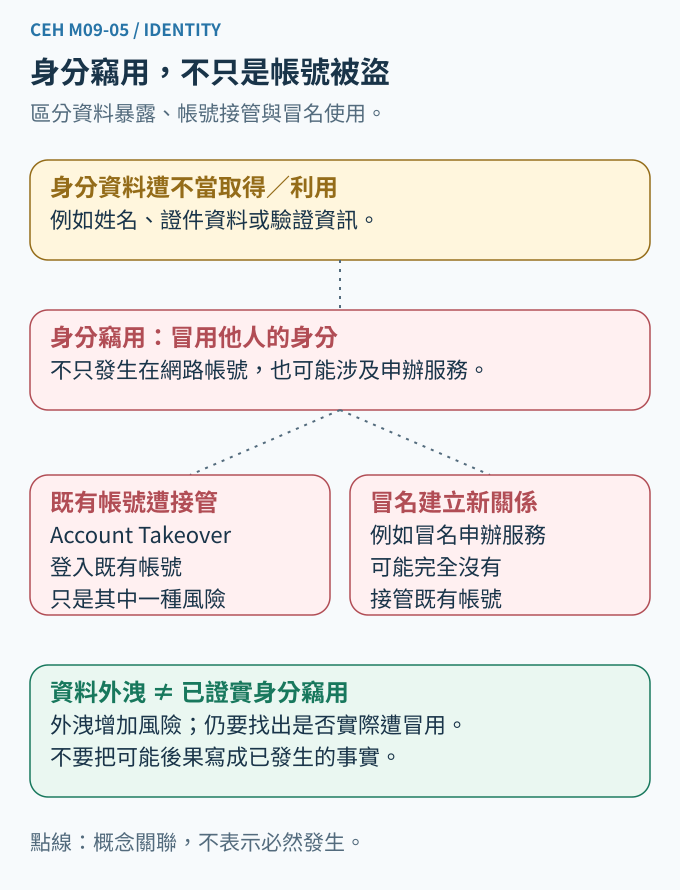
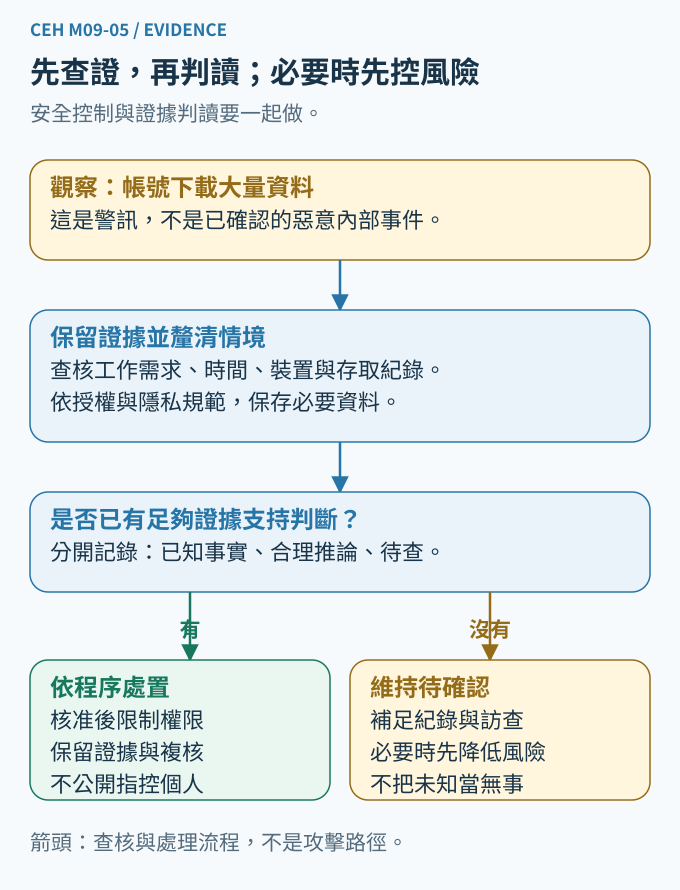

# CEH M09-05｜內部威脅與身分竊用

Module 09：Social Engineering（社交工程）。本課是一個連貫單元：Insider Threats & Identity Theft。建議閱讀 10～15 分鐘。

## 一、先說結論：合法帳號，不代表每個行為都合法；帳號留下紀錄，也不等於已查明是誰操作

上一課 M09-04 談情境編造、誘餌與尾隨進入：不能因為故事合理、東西誘人或門已經打開，就省略授權檢查。今天換個角度：如果對方本來就有鑰匙，或者外人拿到了別人的鑰匙，怎麼辦？

想像虛構的 Northstar 教材中心。小安是行政同仁，工作需要查看學員聯絡資料。有一天，系統留下「小安帳號大量匯出資料」的紀錄。

先不要直接說：「小安偷資料！」至少有三種可能：小安依核准工作匯出；小安誤把檔案寄到錯的地方；或者有人取得他的帳號後操作。也可能真的有人故意濫用權限，但要有證據才能判斷。

今天最重要的能力，是把四件事拆開：**人是誰、帳號是誰的、允許做什麼、實際做了什麼。**

## 二、先建立知識地圖：內部威脅與身分竊用，是兩個可以交會、但不相等的概念

**Insider Threat（內部威脅）**，指具有或曾具有組織授權存取能力的人，可能有意或無意地利用這種能力，對組織造成不利影響。重點是「原本具有的存取與信任關係」，不是人此刻是否坐在辦公室。員工、承包商與合作夥伴都可能涉及；也不能反過來把這些人一律視為可疑。定義依 [Carnegie Mellon SEI 的 insider threat 說明](https://insights.sei.cmu.edu/insider-threat/)。

**Identity Theft（身分竊用，也常譯身分盜用）**，是未經允許使用他人的個人或財務資訊。白話說，是「拿別人的身分資料，替自己辦事情」。它不只限於網路帳號，例如冒名申辦服務也可能涉及。這裡講安全概念，不替個案作法律定罪。[FTC：What To Know About Identity Theft](https://consumer.ftc.gov/articles/what-know-about-identity-theft)

兩者可以交會：有權查看資料的人，可能濫用取得的資料去冒用他人身分。但外部攻擊者也能取得資料；內部人員也可能破壞檔案而完全沒有冒用身分。因此，不能畫成「內部威脅一定造成身分竊用」的固定流程。

圖1的兩條概念關係線，是分類上的關聯，不是已發生的攻擊，也不是必然的先後順序。

## 三、內部威脅：有鑰匙，不等於能把東西帶走

### 1. 惡意與非惡意，先分清楚

**Malicious Insider（惡意內部人員）**：有意濫用或超出授權。例如行政同仁為了私利，將名單帶到未核准的私人服務。

**Unintentional Insider Threat（非蓄意內部威脅）**：沒有惡意，卻因行為或疏漏造成損害或增加風險。例如同仁把包含個資的檔案寄錯收件人，或被假客服說服，替對方開啟不該開的權限。[SEI：Unintentional Insider Threat and Social Engineering](https://sei.cmu.edu/blog/unintentional-insider-threat-and-social-engineering/)

「非蓄意」不代表一定沒有責任，也不代表必然是粗心。可能是介面難用、流程不清、訓練不足或遭到操弄；這些原因要調查，不能先入為主。

### 2. 外人使用員工帳號，不等於已證明員工是內鬼

**Compromised Account（遭入侵或遭冒用的帳號）**，表示帳號的安全控制已失守，未獲授權者可能取得使用能力。教材有時把這種風險放進廣義的內部威脅管理，但在證據判讀時，仍要區分「外人借用內部身分」與「內部人員故意濫用」。

圖2的實線是正常、已授權的查閱；紅色虛線是可能跨過用途或分享權限邊界的風險，不代表已經發生。底下另列外部人員使用遭冒用帳號的可能性；這仍以取得必要驗證材料、且系統接受為條件，不是知道帳號名稱就一定能登入。

系統不應只檢查「這個帳號能登入嗎」，還要檢查「這個帳號目前能對這份資料做這個動作嗎」。即使某個按鈕技術上可以點，也不表示把資料拿去任何地方都符合業務授權。

這就是 **Authentication（身分驗證）** 與 **Authorization（授權）** 的差別：前者檢查登入者能否提出符合要求的驗證證明；後者決定可以操作哪些資源、執行哪些動作。驗證降低冒用風險，但不是對真實操作者與動機的絕對保證。

## 四、身分竊用：不是只有密碼被偷

先分清四個容易混在一起的狀態：

- **資料外洩**：資料被不該接觸的人取得。外洩會增加冒用風險，但不能單憑外洩宣稱已經發生冒名申辦。
- **Credential Theft（驗證憑證竊取）**：密碼或其他可用來驗證的材料被取得。「憑證」在這裡不只指數位憑證檔案。
- **Account Takeover（帳號接管）**：未獲授權者取得對既有帳號的控制或操作能力。例如登入後更改復原信箱。
- **身分竊用**：未經同意使用他人的個人或財務資訊；可能發生在既有帳號，也可能冒名建立新服務。其範圍比「盜走一個網路帳號」更廣。

例子：有人知道小安的姓名，還不足以證明他能登入。有人取得小安的證件影本，代表敏感資料有風險，也還不能直接證明已成功冒名開戶。若服務機構查核到未經小安授權、使用其資料提出的申請，才有更具體的冒用證據；是否成功、造成什麼損失，仍需分開確認。

**Identity Proofing（身分查核）**，是建立線上申請者與真實世界身分之間的可信連結。例如新申請服務時，不只檢查資料是否存在，也要查核證據及申請者是否為真正持有人。它和日後每次登入的驗證不同。這裡是入門簡化模型，不代表每項服務都採完全相同流程。[NIST SP 800-63A-4](https://pages.nist.gov/800-63-4/sp800-63a.html)

因此，「他能說出我的生日」或「傳來的照片很像本人」不是充分證明。前面 M09-03 談過的冒充與 AI Deepfake（AI 深偽，合成或操弄的人像、影音），會讓表面線索更像真的；應回到可信管道與適當的查核程序，而非只比聲音或長相。

## 五、怎麼防護：保護帳號，也限制帳號能造成的影響

### 第一層：只給工作需要的權限

**Least Privilege（最小權限）**：只提供完成職務必要的存取能力。小安需要聯絡某班學員，不表示要能讀取所有班級的敏感附件，更不表示需要刪除整個資料庫。[NIST：Least Privilege](https://csrc.nist.gov/glossary/term/least_privilege)

權限也要隨職務調整。換工作、結束合作、離職時，應依既定程序撤銷不再需要的帳號、權限與有效登入狀態；不能只收回門禁卡，就認為雲端存取也已解除。

### 第二層：高影響動作，不讓一個人說了算

**Separation of Duties（職務分離）**：把不應由同一人獨立完成的關鍵步驟分開。例如名單匯出由一人提出，另一位有權限的人審核用途與對象；仍需記錄與技術落實，不能只多一個形式上的勾選。[NIST：Separation of Duty](https://csrc.nist.gov/glossary/term/separation_of_duty)

### 第三層：降低冒用，並注意復原入口

使用不同服務不重複的強密碼、妥善保管驗證材料，並啟用 **MFA（Multi-Factor Authentication，多因素驗證）**。多因素是不同種類的證明，不是把兩組密碼當成兩個因素。敏感操作、復原帳號與變更驗證方式，也需要相應保護。

MFA不是萬能：如果真正員工本來就可以匯出，MFA不會自動阻止他濫用；既有登入狀態遭竊或復原程序薄弱，也可能留下缺口。這正是 M01-06「多層防禦」的用處，不把安全全押在一個登入關卡上。

### 第四層：讓異常看得見，但不要把告警當判決

**Audit Log（稽核日誌）**，是記錄誰的帳號在何時對哪些資源執行哪些動作的資料。應保護紀錄不被任意修改，保留合適的時間與來源資訊，並限制誰能查看。

**Data Loss Prevention（DLP，資料外洩防護）**，可依規則辨識、警示或阻擋某些敏感資料傳送。但它可能誤判或漏判，也未必涵蓋所有裝置與通道。只有「大量下載」告警，不能直接判定外洩，更不能直接認定某人惡意。

這些措施都是依業務情境設計的例子，不是所有組織都應套同一組門檻。控制措施可參考 [NIST SP 800-53 Rev.5](https://csrc.nist.gov/pubs/sp/800/53/r5/upd1/final)，但本課不是宣稱做了這幾項就通過任何合規認證。

## 六、回到 Northstar：怎麼把觀察、推論與驗證分開？

假設我們只有一則紀錄：「行政帳號在深夜下載了大量檔案。」

**Observation（觀察）**：某個帳號在特定時間出現下載紀錄。先確認紀錄欄位的意思、時區、完整性，以及是否真的是完成下載，而非僅提出要求。

**Inference（推論）**：可能是核准的資料搬移、本人誤操作、本人濫用，或外人冒用。它們是待查假設，不應全部寫成事實。

**Verification（驗證）**：由有權限的人比對工作安排、核准紀錄、登入與裝置紀錄、檔案存取及必要的傳送紀錄；核實實際資料、目的地、成功與否、影響範圍。帳號、裝置或網路位址單獨一項，都通常不足以完整確認真實操作者與意圖。

如果仍有持續風險，應依事件處理程序，採取適當且可回復的限制措施，同時保存原始紀錄；不必等到「找出犯人」才保護資料，也不要為了調查擅自刪除、修改紀錄或存取無關私人資料。

沒有找到外傳紀錄，只能說「在目前可用紀錄中尚未找到」。如果系統本來沒有記錄某個通道，就不能據此宣稱資料從未離開。這和 M01-02 的「發現弱點，不等於事件已發生」是同一種證據紀律。

調查應限於授權範圍、必要資料與有權處理的人，不能因為一個異常就公開指責同仁。防護是在管理存取風險，不是在猜測人格。

## 七、把前後章節接起來

- M01-01 CIA：名單外流影響機密性；資料被改影響完整性；惡意刪除或誤刪也可能影響可用性。
- M01-02 風險：同樣匯出100筆，公開教材與敏感個資的影響不同；不能只看數量。
- M01-03 授權：能登入、能按按鈕，仍不等於任意用途都有授權。
- M09-01～04 社交工程：外人可能先取得信任，讓內部人員交出驗證材料或替他做事。
- 下一課 M09-06：把獨立查證與反釣魚控制，整理成真正做得到的防護流程。

## 八、看圖推理：三個小檢核

請看圖2與圖4，再用自己的話回答：

1. 系統顯示「小安帳號成功下載」，為什麼不能直接說「小安惡意偷資料」？至少提出兩個還要核實的問題。
2. 若實際是小安本人、使用合法權限，把名單交給未核准的對象，MFA能單獨解決嗎？你會在哪一道界線加什麼控制？
3. 某人的證件影本外洩，但尚無冒名申辦或帳號接管證據。現在可以確認什麼、不能確認什麼？如果圖3右側的服務收到新申請，為什麼不能只靠「資料內容正確」就放行？

參考解答另外整理，網站以預設收合呈現。公布答案不代表你已作答或已理解；目前保留待驗證，不計成學會。

## 九、最後記住這四句話

**有權限，不代表能任意使用。**
**是內部帳號，不代表一定是內部本人操作。**
**個資外洩、帳號接管、身分竊用，不是同一個狀態。**
**先用證據確認行為與影響，再談原因與責任。**
